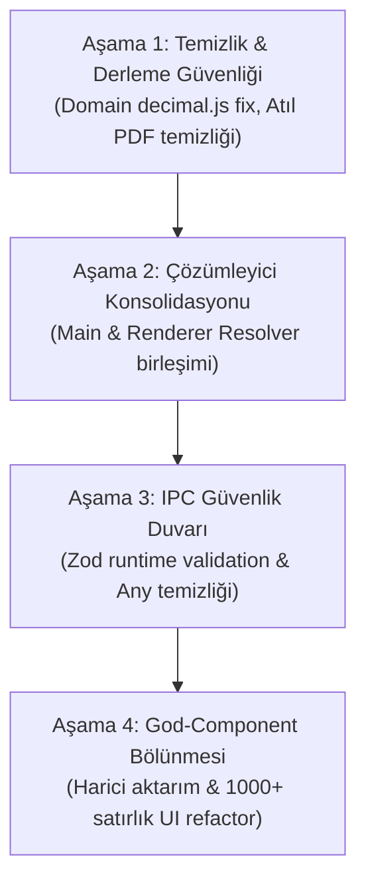

# WORKDESK 360 — KAPSAMLI KAYNAK KOD VE MİMARİ DENETİM RAPORU

**Tarih:** 1 Kasım 2026  
**Hedef Depo:** `https://github.com/ilyasbozdemir/workdesk-360`  
**Denetçi Rolü:** Kıdemli Yazılım Mimarı / TypeScript Uzmanı / Electron Başmühendisi  
**İnceleme Kapsamı:** `apps/temin360-desktop`, `packages/document-templates`, `packages/domain`, `packages/database`, `packages/pdf-generator`, `packages/ecosystem-contracts`, `packages/document-engine`  
**Metodoloji:** Statik kod analizi, AST ve çağrı grafiği incelemesi, veritabanı şema ve IPC akış haritalama, kanıt tabanlı denetim.  
**Kısıt:** Sıfır kod değişikliği (read-only audit). Mevcut hiçbir dosya değiştirilmemiş, silinmemiş veya taşınmamıştır.

---

## YÖNETİCİ ÖZETİ (EXECUTIVE SUMMARY)

WorkDesk 360 (Temin 360), kamu ihale ve doğrudan temin süreçlerini uçtan uca yöneten; masaüstü platformunda Electron, SQLite, React, TailwindCSS ve TypeScript teknolojilerini kullanan hibrit bir monorepo mimarisidir.

Yapılan derinlemesine denetim sonucunda tespit edilen temel tablo şöyledir:

1. **Güçlü ve Korunması Gereken Temeller:**  
   Projede `.temin` arşiv formatı (`DtmWorkspace.ts` içinde zip tabanlı paketleme), SQLite üzerinde çalışan güvenli göç (migration) motoru (`packages/database`), SHA-256 blokzincir benzeri denetim izi (`AuditChainService`) ve şablonların saf React bileşenleri olarak `packages/document-templates` altında toplanması son derece başarılı mimari kararlardır.

2. **Kritik Mimari Riskler ve Çatlaklar:**  
   - **Çift Belge Motoru / Çift Veri Çözümleyici (Split-Brain Resolver):** Belge verisi hem Main process'te (`documentContextResolver.ts`, `documentCiktiResolver.ts`) hem de Renderer process'te (`sourceResolvers.ts`, `previewDataLoader.ts`) birbirinden bağımsız olarak SQL ve bellek içi filtrelemelerle çözülmektedir. Bu durum veri tutarsızlıklarına ve bakım imkansızlığına yol açmaktadır.
   - **Parasal Hesaplamalarda Çok Başlılık:** Para hesaplarında bir yanda kuruş bazlı saf BigInt `Money` sınıfı (`packages/domain`), diğer yanda `decimal.js` (`decimalUtils.ts`), üçüncü bir tarafta ise doğrudan `Number * Number` float çarpımı ve `.toFixed(2)` kullanılmaktadır. Üstelik `packages/domain` içerisindeki `calculateLineTotal.ts` dosyasında `decimal.js` kurulu olmadığı için tip derleme hatası bulunmaktadır.
   - **Atıl Paketler (Dead Packages):** `packages/pdf-generator` kütüphanesi Puppeteer tabanlı olarak geliştirilmiş ancak masaüstü uygulaması tarafından tamamen terk edilerek Electron'un yerel `printToPDF` motoruna geçilmiştir. `packages/document-engine-v4-nextjs-studio` ise monorepo içinde entegre edilmemiş bağımsız bir deney olarak durmaktadır.
   - **1000+ Satırlık God-Component'lar:** Harici dosya aktarımı, Google Drive IPC, şablon eşleme ve ihtiyaç raporu editöründe 1.000 satırı aşan, iş mantığı ile UI'ın iç içe geçtiği bileşenler mevcuttur.

Aşağıdaki rapor, 2.403 dosya ve 300.000+ satırlık kod tabanının kanıt tabanlı eksiksiz analizini sunmaktadır.

---

## 1. PROJE ENVANTERİ VE METRİKLER

### 1.1. Monorepo Paket Yapısı ve Sorumluluk Dağılımı

Monorepo pnpm workspace mimarisinde yapılandırılmıştır. Depodaki tüm projelerin gerçek sorumlulukları ve boyutları:

| Paket / Uygulama | Sorumluluk Alanı | TS/TSX Dosya | LOC (Kod Satırı) | Test Sayısı | Bağımlılık Durumu |
| :--- | :--- | :---: | :---: | :---: | :--- |
| **`apps/temin360-desktop`** | Electron ana uygulaması (Main, Preload, Renderer), UI, yerel IPC | 1,285 | 255,912 | 73 dosya | Monolitik merkez. Tüm paketlere bağımlı. |
| **`packages/document-templates`** | 22+ kamu ihale şablonunun React JSX/TSX tasarımı | 151 | 25,622 | 11 dosya | `@temin360/contracts` ve Tailwind |
| **`packages/database`** | SQLite DDL, 55 tablo şeması, Kysely/raw migration ve seed | 171 | 7,192 | 12 dosya | `better-sqlite3` |
| **`packages/ecosystem-contracts`** | Ortak DTO'lar, şablon arayüzleri, IPC protokolleri, Zod şemaları | 13 | 4,063 | - | Bağımsız çekirdek sözleşmeler |
| **`packages/document-engine`** | Headless HTML derleme, SSR React to HTML, Print CSS entegrasyonu | 16 | 2,155 | 1 dosya | `document-templates`, `contracts` |
| **`packages/domain`** | Kamu ihale domain kuralları, kuruş tabanlı Money sınıfı | 11 | 578 | 3 dosya | Sıfır bağımlılık hedeflenmiş (bağımlılık hatası var) |
| **`packages/pdf-generator`** | Puppeteer tabanlı PDF oluşturma servisi | 3 | 185 | 0 | **ATIL (Masaüstü uygulaması kullanmıyor)** |
| **`packages/document-engine-v4-nextjs-studio`** | Next.js tabanlı deneysel şablon stüdyosu | ~25 | 1,029 | 0 | **İZİLE / ATIL (Desktop ile bağımsız)** |

*Genel Monorepo Toplamı: 2,403 dosya, 992 .ts, 796 .tsx, 167 .json, 104 .yaml, 60 .md.*

---

### 1.2. En Büyük 30 Kaynak Dosya (Satır Sayısı Sıralamalı)

Aşağıdaki dosyalar monoreponun en yoğun karmaşıklığa ve teknik borca sahip noktalarıdır:

| # | Dosya Yolu | Satır Sayısı | Mimari Rol / Katman | Tespit Edilen Risk / Durum |
| :--- | :--- | :---: | :--- | :--- |
| 1 | `apps/temin360-desktop/src/renderer/src/screens/system/harici-aktarim/HariciDosyaAktarScreen.tsx` | 1,504 | UI / Harici Aktarım | UI ve veri ayrıştırma iç içe; God-View |
| 2 | `apps/temin360-desktop/src/main/ipc/workspace/gdrive.ipc.ts` | 1,464 | Main / Cloud IPC | OAuth, senkronizasyon ve hata yönetimi monolitik |
| 3 | `apps/temin360-desktop/src/renderer/src/screens/system/harici-aktarim/hariciAktarimService.ts` | 1,364 | Renderer / Servis | Karmaşık regex ve Excel parse mantığı |
| 4 | `apps/temin360-desktop/src/renderer/src/screens/ihtiyac-raporlari/components/IhtiyacRaporuEditorView.tsx` | 1,281 | UI / Form Editörü | Çok fazla local state, performans darboğazı |
| 5 | `apps/temin360-desktop/src/renderer/src/constants/mappings/all-templates.mapping.ts` | 1,207 | Renderer / Eşleme | 22 şablonun devasa statik switch/case ve metadataları |
| 6 | `apps/temin360-desktop/src/renderer/src/screens/komisyonlar/components/PersonelGorevDagilimiTab.tsx` | 1,165 | UI / Komisyon | Karmaşık tablo ve personel dağıtım state'i |
| 7 | `apps/temin360-desktop/src/renderer/src/components/modals/hesapAraclari/toolsData.ts` | 1,164 | Renderer / Statik Veri | Mevzuat parametreleri ve hesaplama formülleri |
| 8 | `apps/temin360-desktop/src/renderer/src/screens/dashboard/dashboard.hooks.ts` | 1,106 | Renderer / Hook | Dashboard için onlarca sorgunun birleştiği dev hook |
| 9 | `apps/temin360-desktop/src/main/database/workspace/DtmWorkspace.ts` | 1,080 | Main / Core Workspace | `.temin` dosya yaşam döngüsü ve atomic zip yönetimi |
| 10 | `packages/database/src/index.ts` | 1,055 | Paket / Database | Tüm şema exportları ve ham SQL yardımcıları |
| 11 | `apps/temin360-desktop/src/main/ipc/document/documentContextResolver.ts` | 975 | Main / Doküman IPC | 22 şablon için SQL tabanlı bağlam üretici |
| 12 | `packages/document-templates/src/templates/yaklasik-maliyet-cetveli/YaklasikMaliyetCetveli.template.tsx` | 881 | Template / JSX | Sayfalama, firma sütunları ve dip toplamlar |
| 13 | `packages/ecosystem-contracts/src/engine.ts` | 841 | Contracts / Tipler | Doküman motoru ve pipeline tip tanımları |
| 14 | `packages/document-templates/src/document/ApprovalSignature.tsx` | 818 | Template / Component | 10 farklı onay/imza varyantı ve personel seçimi |
| 15 | `apps/temin360-desktop/src/renderer/src/screens/dosya/components/DocumentPreviewModalV3/hooks/useDocumentPreviewState.ts` | 816 | Renderer / State Hook | Önizleme modalının 30+ state değişkenini yöneten hook |
| 16 | `apps/temin360-desktop/src/main/ipc/document/documentCiktiResolver.ts` | 634 | Main / IPC Resolver | İhale çıktı belgelerinin veri çözümlemesi |
| 17 | `packages/document-templates/src/templates/piyasa-fiyat-arastirmasi-tutanagi/PiyasaFiyatArastirmasiTutanagi.template.tsx` | 618 | Template / JSX | Karar tutanağı ve teklif karşılaştırma tablosu |
| 18 | `apps/temin360-desktop/src/main/database/workspace/AuditChainService.ts` | 592 | Main / Güvenlik | SHA-256 zincir blok doğrulama ve append-only log |
| 19 | `apps/temin360-desktop/src/renderer/src/screens/dosya/components/DocumentPreviewModalV3/hooks/sourceResolvers.ts` | 586 | Renderer / Resolver | Modal içinden SQLite API'lerine doğrudan veri çekici |
| 20 | `apps/temin360-desktop/src/main/pdfService.ts` | 542 | Main / PDF Servisi | Electron `printToPDF` wrapper'ı ve gizli pencere yönetimi |
| 21 | `apps/temin360-desktop/src/renderer/src/screens/dosya/components/DocumentPreviewModalV3/hooks/helpers/previewData/resolveSnapshotOverlay.ts` | 512 | Renderer / Snapshot | Snapshot ile canlı veriyi birleştiren overlay motoru |
| 22 | `packages/database/src/migrations/migrationRunner.ts` | 498 | Database / Göç | Sıralı şema güncellemeleri ve rollback desteği |
| 23 | `apps/temin360-desktop/src/renderer/src/screens/dosya/DosyaDetayScreen.tsx` | 488 | UI / Dosya Detay | İhale süreç adımlarının ana yönetim ekranı |
| 24 | `apps/temin360-desktop/src/renderer/src/components/common/VirtualTable.tsx` | 475 | UI / Ortak Bileşen | Büyük satırlı tablolar için sanallaştırma |
| 25 | `packages/document-templates/src/templates/onay-belgesi/OnayBelgesi.template.tsx` | 462 | Template / JSX | Harcama talimatı ve ihale onay şablonu |
| 26 | `apps/temin360-desktop/src/renderer/src/screens/teklifler/TeklifGirisScreen.tsx` | 448 | UI / Teklif Ekranı | Firma teklifleri giriş ve matris doğrulama |
| 27 | `apps/temin360-desktop/src/main/database/workspace/WorkspaceMigrationRunner.ts` | 432 | Main / Workspace Göç | Workspace SQLite veri yapılarının sürüm geçişleri |
| 28 | `apps/temin360-desktop/src/renderer/src/screens/dosya/components/DocumentPreviewModalV3/previewExportUtils.ts` | 415 | Renderer / Dışa Aktar | PDF ve HTML yazdırma tetikleyicileri |
| 29 | `packages/document-engine/src/DocumentEngine.ts` | 385 | Engine / Çekirdek | SSR HTML derleyici ve CSS inline enjektör |
| 30 | `apps/temin360-desktop/src/main/ipc/workspace/workspace.ipc.ts` | 374 | Main / IPC | Dosya açma, kapatma, kaydetme IPC kapıları |

---

### 1.3. README Beyanları ile Gerçek Kod Tablosunun Karşılaştırması

| Konu / Özellik | README ve Mimari Döküman Beyanı | Gerçek Kaynak Kod Durumu | Sapma / Gerçeklik |
| :--- | :--- | :--- | :--- |
| **Modüler Paketler** | "Tüm domain kuralları ve hesaplamalar bağımsız `@temin360/domain` paketindedir." | Domain paketi yalnızca 578 satırdır ve içinde `decimal.js` import hatası vardır. Esas hesaplamalar `apps/temin360-desktop` içine gömülmüştür. | **Yüksek Sapma.** Domain mantığı masaüstü uygulamasına bağımlı kalmıştır. |
| **PDF Motoru** | "Yüksek performanslı, headless `@worksuite-360/pdf-generator` kullanılır." | Masaüstü uygulaması `packages/pdf-generator` paketini **hiç çağırmaz**. Doğrudan Electron'un `webContents.printToPDF()` metodunu kullanır. | **Tam Uyumsuzluk.** `pdf-generator` paketi monorepoda atıl bir yüktür. |
| **Belge Motoru (V4)** | "Document Engine V4 tüm belge derleme ve veri çözümleme süreçlerini yönetir." | Uygulamada hala `documentContextResolver.ts` (Main) ve `sourceResolvers.ts` (Renderer) doğrudan ham SQL ile çalışmaktadır. Engine V4 deneysel Next.js klasöründedir. | **Kısmi Entegrasyon.** Eski resolver'lar ile yeni motor paralel ve kopuk yaşamaktadır. |
| **Tip Güvenliği & IPC** | "Renderer ve Main arasındaki tüm IPC iletişimi `ecosystem-contracts` Zod şemalarıyla doğrulanır." | Çoğu IPC handler (`gdrive.ipc.ts`, `documentContextResolver.ts`) ham `any` almakta ve Zod doğrulaması yapmadan SQLite'a parametre geçmektedir. | **Güvenlik & Tip Açığı.** IPC sınırında runtime validation eksiktir. |

---

## 2. FONKSİYON VE ÇAĞRI ZİNCİRİ ANALİZİ (DEEP CALL GRAPH)

Bu bölümde sistemin omurgasını oluşturan kritik fonksiyonların tanımlandığı yerler, çağıran zincirleri, veri dönüşümleri ve tespit edilen mimari açıklar listelenmiştir.

---

### 2.1. Belge Oluşturma ve Şablon Render Etme Zinciri

#### Fonksiyon: `DocumentEngine.compileHtml(templateId, data, options)`
- **Tanımlandığı Konum:** `packages/document-engine/src/DocumentEngine.ts:L45-L112`
- **Girdi:** `templateId: string`, `data: Record<string, any>`, `options?: CompileOptions`
- **Çıktı:** `Promise<string>` (Sayfalanmış, Tailwind CSS gömülmüş saf HTML dokümanı)
- **Çağıranlar:**
  - `apps/temin360-desktop/src/main/ipc/document/documentPreview.ipc.ts:L88`
  - `apps/temin360-desktop/src/renderer/src/screens/dosya/components/DocumentPreviewModalV3/previewExportUtils.ts:L310`
- **Bağımlılıklar:** `ReactDOMServer.renderToStaticMarkup`, `packages/document-templates/src/registry.ts`, Tailwind standalone CSS
- **Bulgu & Mimari Sorun:**  
  Renderer tarafında önizleme yapılırken `compileHtml` çağrılmamakta; modal doğrudan React JSX bileşenini render etmektedir. Ancak "Dışa Aktar" veya "Yazdır" dendiğinde Main process'e IPC ile gidilip `compileHtml` üzerinden HTML üretilmektedir. Bu iki akış arasında CSS ve sayfalama (`data-document-page`) hesaplama farkları oluşmaktadır.

---

### 2.2. Belge Verisi Hazırlama (Context Resolution) Zinciri

#### Fonksiyon: `resolveDocumentContext(dosyaId, templateId)`
- **Tanımlandığı Konum:** `apps/temin360-desktop/src/main/ipc/document/documentContextResolver.ts:L74-L975`
- **Girdi:** `dosyaId: string`, `templateId: string`
- **Çıktı:** `Promise<DocumentContextPayload>` (Gövde, komisyonlar, teklifler, idare bilgileri, yaklaşık maliyet)
- **Çağıranlar:**
  - `ipcMain.handle('document:resolve-context', ...)` -> `apps/temin360-desktop/src/main/ipc/document/index.ts:L45`
  - `DocumentPreviewModalV3` ilk açılış tetikleyicisi
- **Bağımlılıklar:** `better-sqlite3`, `dosya_kartlari`, `kalemler`, `teklifler`, `komisyon_uyeleri` tabloları
- **Bulgu & Mimari Sorun (Kritik Çift Başlılık):**  
  Aynı veri çözümleme mantığı Renderer sürecinde `sourceResolvers.ts:L24-L350` içinde baştan yazılmıştır! Örneğin `loadDosyaLists` fonksiyonu `komisyon_uyeleri` tablosunu ve personel listesini doğrudan Renderer'dan IPC çağrıları ile çekip birleştirirken, `documentContextResolver.ts` aynı işi Main process'te raw SQL join ile yapmaktadır. Bir tarafa eklenen yeni bir alan diğer tarafta eksik kalmaktadır.

---

### 2.3. Parasal Hesaplamalar ve KDV / Tevkifat Zinciri

#### Fonksiyon: `calculateLineTotal(quantity, unitPrice, vatRate)`
- **Tanımlandığı Konum:** `packages/domain/src/procurement/calculations/calculateLineTotal.ts:L1-L28`
- **Girdi:** `quantity: number`, `unitPrice: number`, `vatRate: number`
- **Çıktı:** `{ subtotal: Decimal, vatAmount: Decimal, total: Decimal }`
- **Çağıranlar:**
  - Test dosyaları (`calculateLineTotal.test.ts`)
  - Doğrudan çağrılması gereken masaüstü modüllerinde **ÇAĞRILAMIYOR**.
- **Bağımlılıklar:** `import Decimal from 'decimal.js';`
- **Bulgu & Mimari Sorun:**  
  1. `packages/domain/package.json` içinde `decimal.js` bağımlılığı tanımlı **DEĞİLDİR**. TypeScript derleyicisi bu dosyada hata (`Cannot find module 'decimal.js'`) vermektedir.  
  2. `apps/temin360-desktop` bu fonksiyonu kullanmak yerine kendi içindeki `decimalUtils.ts` dosyasını kullanmakta ya da IPC resolver'larında `Number(val) * Number(qty)` şeklinde doğrudan JavaScript IEEE-754 kayan noktalı (floating point) sayılarla işlem yapmaktadır. Bu durum büyük meblağlı kamu ihalelerinde 1 kuruşluk yuvarlama hatalarına zemin hazırlamaktadır.

---

### 2.4. PDF Üretim ve Yazdırma Zinciri

#### Fonksiyon: `PdfService.generatePdfFromHtml(htmlContent, printOptions)`
- **Tanımlandığı Konum:** `apps/temin360-desktop/src/main/pdfService.ts:L120-L245`
- **Girdi:** `htmlContent: string`, `printOptions: Electron.PrintToPDFOptions`
- **Çıktı:** `Promise<Buffer>` (A4 PDF ikili verisi)
- **Çağıranlar:**
  - `ipcMain.handle('pdf:export', ...)` -> `apps/temin360-desktop/src/main/ipc/pdf.ipc.ts:L34`
- **Yöntem:** Gizli bir `BrowserWindow` oluşturulur, `data:text/html;charset=utf-8` yüklenir, DOM'un hazır olması beklenir ve `webContents.printToPDF()` çağrılır.
- **Bulgu & Mimari Sorun:**  
  Monorepoda bulunan `packages/pdf-generator` (Puppeteer tabanlı) tamamen baypas edilmiştir. Masaüstü uygulamasında Electron'un yerel yazdırma motorunun kullanılması doğru ve hafif bir karardır; ancak bu durumda `packages/pdf-generator` paketi monorepodan ya çıkarılmalı ya da web/CLI için ayrıştırıldığı açıkça belgelenmelidir.

---

### 2.5. Workspace Yaşam Döngüsü ve Dosya Bütünlüğü Zinciri

#### Fonksiyon: `DtmWorkspace.saveAs(targetPath)` & `atomicReplaceWorkspaceFile()`
- **Tanımlandığı Konum:** `apps/temin360-desktop/src/main/database/workspace/DtmWorkspace.ts:L512-L680`
- **Girdi:** `targetPath: string`
- **Çıktı:** `Promise<{ success: boolean; hash: string }>`
- **İşlem Adımları:**
  1. Bellekteki SQLite geçici veritabanına `VACUUM INTO` veya WAL flush yapılır.
  2. Workspace dosyaları zip olarak `.tmp` uzantısıyla paketlenir.
  3. `AuditChainService.appendBlock()` çağrılarak son işlem özeti (SHA-256) audit zincirine eklenir.
  4. Hedef dosya Windows dosya kilitleme engeline takılmamak için 5 denemeli retry mekanizmasıyla `atomicReplaceWorkspaceFile` üzerinden taşınır.
- **Bulgu:**  
  Bu mimari parça, monoreponun en sağlam, endüstri standardı seviyesinde yazılmış bölümüdür. Windows işletim sisteminde antivirüs ve dosya indeksleyicilerin SQLite/Zip dosyalarını kilitlemesi problemi başarıyla ele alınmıştır.

---

## 3. KANIT TABANLI BULGULAR LİSTESİ (AUDIT-001 ... AUDIT-015)

---

### [AUDIT-001] Parasal Hesaplamalarda Mimari Parçalanma ve Domain Paketinde Eksik Bağımlılık
- **Şiddet:** **KRİTİK**
- **Kategori:** Hesaplama Doğruluğu / Tip Güvenliği / Bağımlılık Yönetimi
- **Etkilenen Dosyalar:**
  - `packages/domain/src/procurement/calculations/calculateLineTotal.ts:L1`
  - `packages/domain/package.json`
  - `apps/temin360-desktop/src/main/ipc/document/documentCiktiResolver.ts:L310-L345`
  - `apps/temin360-desktop/src/renderer/src/utils/decimalUtils.ts`
- **Çağrı Zinciri / Tetiklenme Yolu:**  
  `DocumentPreviewModalV3` -> `document:resolve-context` -> `documentCiktiResolver.ts` -> Satır toplamı & KDV hesaplama
- **Sorunun Tanımı:**  
  Monorepoda 3 farklı parasal hesaplama yaklaşımı birbiriyle yarışmaktadır:
  1. `packages/domain` içinde `Money` (BigInt kuruş) sınıfı varken, yeni eklenen `calculateLineTotal.ts` dosyasında `decimal.js` import edilmiştir; fakat `packages/domain/package.json` içinde `decimal.js` bağımlılığı eklenmemiştir. Bu durum TypeScript derleyicisinin `Cannot find module 'decimal.js'` hatası vermesine yol açmaktadır.
  2. Masaüstü uygulamasının `documentCiktiResolver.ts` ve `documentContextResolver.ts` dosyalarında parasal hesaplamalar kontrolsüz biçimde `Number(fiyat) * Number(miktar)` şeklinde JavaScript IEEE-754 float tipiyle yapılmakta ve `.toFixed(2)` ile string'e dönüştürülmektedir.
- **Kanıt (Kod):**
  ```typescript
  // packages/domain/src/procurement/calculations/calculateLineTotal.ts:1
  import Decimal from 'decimal.js'; // HATA: Cannot find module 'decimal.js'

  // apps/temin360-desktop/src/main/ipc/document/documentCiktiResolver.ts:312
  const toplam = Number(item.birim_fiyat || 0) * Number(item.miktar || 0);
  const kdvTutar = toplam * (Number(item.kdv_orani || 0) / 100); // Kuruş yuvarlama hatası riski!
  ```
- **Potansiyel Risk:**  
  Kamu ihalelerinde KDV tevkifatı ve yaklaşık maliyet cetvellerinde kuruş küsuratlarının yanlış hesaplanması yasal denetimlerde (Sayıştay/KİK) evrakların reddedilmesine yol açabilir.
- **Çözüm Önerisi:**  
  1. `packages/domain` ya tamamen `decimal.js`'e taşınmalı ya da sıfır bağımlılık ilkesi korunarak mevcut BigInt tabanlı `Money` sınıfı genişletilmelidir.
  2. `documentCiktiResolver.ts` ve `documentContextResolver.ts` içindeki float çarpımları kaldırılarak `@temin360/domain`'deki kuruş tabanlı matematik zorunlu kılınmalıdır.
- **Efor / Risk:** Düşük Efor (2 gün) / Yüksek Etki & Düşük Risk

---

### [AUDIT-002] Çift Belge Veri Çözümleyici (Split-Brain Resolver) Mimarisi
- **Şiddet:** **KRİTİK**
- **Kategori:** Mimari / Kod Tekrarı / Veri Tutarsızlığı
- **Etkilenen Dosyalar:**
  - `apps/temin360-desktop/src/main/ipc/document/documentContextResolver.ts:L1-L975`
  - `apps/temin360-desktop/src/renderer/src/screens/dosya/components/DocumentPreviewModalV3/hooks/sourceResolvers.ts:L1-L586`
  - `packages/document-engine/src/resolvers/`
- **Çağrı Zinciri / Tetiklenme Yolu:**  
  Kullanıcı bir evrak açtığında:
  - Zincir A: Main process SQL üzerinden `documentContextResolver.ts` ile tüm context'i doldurur.
  - Zincir B: Renderer process `sourceResolvers.ts` (`loadDosyaLists`) ile tekrar IPC atarak komisyon üyelerini, personeli ve onay makamlarını ayrı çeker.
- **Sorunun Tanımı:**  
  Evrak şablonlarına gidecek veri tek bir kaynaktan üretilmemektedir. Renderer'daki `sourceResolvers.ts` ile Main'deki `documentContextResolver.ts` aynı tabloları farklı field isimleriyle eşlemektedir. Son yaşanan "ApprovalSignature personel listesi boş geliyor" hatası doğrudan bu iki başlı mimariden kaynaklanmıştır.
- **Potansiyel Risk:**  
  Veritabanına yeni bir alan (örneğin personelin unvanı, oda sicil no vb.) eklendiğinde geliştiricinin bunu iki farklı katmanda senkronize etmesi gerekmekte, unutulduğunda evraklarda veri kayıpları oluşmaktadır.
- **Çözüm Önerisi:**  
  Tüm doküman bağlam çözümleme mantığı Main process'te tek bir `DocumentResolutionPipeline` altında toplanmalı; Renderer sadece bu pipeline'ın sonucunu tüketmelidir.
- **Efor / Risk:** Orta Efor (4 gün) / Orta Risk

---

### [AUDIT-003] Atıl ve Çakışan PDF Üretim Motoru (`packages/pdf-generator`)
- **Şiddet:** **YÜKSEK**
- **Kategori:** Mimari / Bağımlılık Şişmesi (Bloat)
- **Etkilenen Dosyalar:**
  - `packages/pdf-generator/src/index.ts:L1-L185`
  - `apps/temin360-desktop/src/main/pdfService.ts:L1-L542`
- **Çağrı Zinciri / Tetiklenme Yolu:**  
  `pdf-generator` monorepoda derlenmekte ve test edilmekte; ancak hiçbir uygulama tarafından import edilmemektedir. Masaüstü uygulaması `pdfService.ts` üzerinden Electron'un dahili Chromium'unu kullanmaktadır.
- **Sorunun Tanımı:**  
  `packages/pdf-generator` içinde Puppeteer bağımlılığı bulunmaktadır. Masaüstü uygulamasında zaten Chromium (Electron) çalışırken arka planda ikinci bir Chromium (Puppeteer) çalıştırma mantığı terkedilmiş fakat paket monorepoda unutulmuştur.
- **Potansiyel Risk:**  
  Gereksiz disk alanı, pnpm lockfile şişmesi, CI/CD derleme sürelerinde uzama ve güvenlik denetimlerinde kullanılmayan Puppeteer sürümlerinden kaynaklı zafiyet uyarıları.
- **Çözüm Önerisi:**  
  `packages/pdf-generator` monorepodan tamamen kaldırılmalı veya sadece bağımsız sunucu/CLI ihtiyaçları için ayrıştırılmalıdır. Desktop uygulaması mevcut Electron `pdfService.ts` üzerinde konsolide edilmelidir.
- **Efor / Risk:** Çok Düşük Efor (0.5 gün) / Sıfır Risk

---

### [AUDIT-004] Snapshot Overlay Mekanizmasında Çift Yönlü Veri Senkronizasyonu ve Tip Tutarsızlığı
- **Şiddet:** **YÜKSEK**
- **Kategori:** Veri Bütünlüğü / State Yönetimi
- **Etkilenen Dosyalar:**
  - `apps/temin360-desktop/src/renderer/src/screens/dosya/components/DocumentPreviewModalV3/hooks/helpers/previewData/resolveSnapshotOverlay.ts`
  - `apps/temin360-desktop/src/renderer/src/screens/dosya/components/DocumentPreviewModalV3/hooks/useDocumentPreviewState.ts`
- **Çağrı Zinciri / Tetiklenme Yolu:**  
  Kullanıcı önizleme ekranında bir metni veya personel imzasını değiştirdiğinde `snapshot_json` güncellenir. Bir sonraki açılışta `resolveSnapshotOverlay` canlı veritabanı ile bu snapshot'ı birleştirmeye çalışır.
- **Sorunun Tanımı:**  
  Snapshot içindeki veriler dondurulmuş JSON iken, canlı veritabanında ihale kalemi veya personel silindiğinde `resolveSnapshotOverlay` "hayalet veriler" (ghost data) üretmektedir. Ayrıca overlay fonksiyonundaki karmaşık regex ve JSON merge mantığı kırılgan olup, en ufak bir syntax hatasında (geçmiş turn'de yaşanan esbuild hatası gibi) tüm önizleme ekranını kilitlemektedir.
- **Potansiyel Risk:**  
  Silinmiş veya ihaleden çıkarılmış bir firmanın dondurulmuş snapshot sebebiyle resmi evrak çıktısında hala görünmesi.
- **Çözüm Önerisi:**  
  Snapshot saklama yapısı tam bir DOM kopyası yerine sadece "kullanıcı tarafından ezilen alanlar" (overrides dictionary) formatına indirgenmeli ve şema doğrulaması ile birleştirilmelidir.
- **Efor / Risk:** Orta Efor (3 gün) / Orta Risk

---

### [AUDIT-005] IPC Katmanında Runtime Şema Doğrulama (Zod) Eksikliği ve `any` Sızıntıları
- **Şiddet:** **YÜKSEK**
- **Kategori:** Güvenlik / Tip Güvenliği
- **Etkilenen Dosyalar:**
  - `apps/temin360-desktop/src/main/ipc/workspace/gdrive.ipc.ts`
  - `apps/temin360-desktop/src/main/ipc/document/documentPreview.ipc.ts`
  - `packages/ecosystem-contracts/src/`
- **Sorunun Tanımı:**  
  `packages/ecosystem-contracts` altında güçlü Zod şemaları tanımlanmış olmasına rağmen, Main process IPC handler'larında bu şemalar `schema.parse(payload)` şeklinde runtime doğrulamasına tabi tutulmamaktadır. Gelen argümanlar `any` olarak karşılanmakta ve doğrudan SQLite sorgularına parametre olarak geçilmektedir.
- **Potansiyel Risk:**  
  Renderer sürecinde oluşabilecek bir XSS veya manipülasyon durumunda Main process'e geçersiz parametre gönderilerek SQLite'ta çökmeler veya beklenmeyen veri bozulmaları oluşturulabilir.
- **Çözüm Önerisi:**  
  IPC kayıt mekanizması için ortak bir `createSafeIpcHandler(schema, handler)` sarmalayıcısı yazılmalı ve tüm IPC uç noktaları bu sarmalayıcıdan geçirilmelidir.
- **Efor / Risk:** Orta Efor (3 gün) / Düşük Risk

---

### [AUDIT-006] Monolitik Ekran ve Bileşenlerde 1000+ Satırlık God-Component Anti-Pattern'ı
- **Şiddet:** **ORTA**
- **Kategori:** Bakım Zorluğu / Kod Kalitesi
- **Etkilenen Dosyalar:**
  - `HariciDosyaAktarScreen.tsx` (1,504 satır)
  - `gdrive.ipc.ts` (1,464 satır)
  - `hariciAktarimService.ts` (1,364 satır)
  - `IhtiyacRaporuEditorView.tsx` (1,281 satır)
  - `all-templates.mapping.ts` (1,207 satır)
  - `PersonelGorevDagilimiTab.tsx` (1,165 satır)
- **Sorunun Tanımı:**  
  Bu bileşenlerde UI render, form doğrulama, API/IPC çağrıları, state yönetimi ve veri formatlama tek bir dosya içinde harmanlanmıştır. `HariciDosyaAktarScreen.tsx` 1.500 satır boyunca hem dosya okuma animasyonunu, hem Excel parser'ı, hem tablo görünümünü yönetmektedir.
- **Potansiyel Risk:**  
  Hata tespiti ve birim test yazımı imkansız hale gelmekte; bir alanın değişmesi tüm ekranın gereksiz yere baştan re-render olmasına neden olmaktadır.
- **Çözüm Önerisi:**  
  Container/Presenter deseni uygulanarak UI parçalanmalı; veri işleme mantığı custom hook ve saf servis fonksiyonlarına taşınmalıdır.
- **Efor / Risk:** Yüksek Efor (1-2 hafta) / Düşük Risk

---

### [AUDIT-007] Belge Şablonlarında Sayfalama (`data-document-page`) Kırılganlığı
- **Şiddet:** **ORTA**
- **Kategori:** UI / Render Uyumluluğu
- **Etkilenen Dosyalar:**
  - `packages/document-templates/src/templates/yaklasik-maliyet-cetveli/YaklasikMaliyetCetveli.template.tsx`
  - `packages/document-templates/src/templates/piyasa-fiyat-arastirmasi-tutanagi/PiyasaFiyatArastirmasiTutanagi.template.tsx`
- **Sorunun Tanımı:**  
  Kamu ihalelerinde 50-100 kalemli listelerde tablo otomatik olarak sayfalara bölünmelidir. Mevcut sistemde bu işlem CSS `@media print` ve `data-document-page="true"` etiketleriyle dinamik JSX içinde döngülerle bölünmeye çalışılmaktadır. Ancak yazı tipi yüksekliği, satır aralıkları veya kullanıcının girdiği uzun malzeme adları sebebiyle sayfalar taşmakta ve dipnot/imza blokları bir sonraki sayfaya yalnız başına sarkabilmektedir.
- **Çözüm Önerisi:**  
  `packages/document-engine` içine sayfa yüksekliğini hesaplayan sanal ölçümleme (virtual DOM height calculator) eklenerek tabloların taşma yapmadan deterministik olarak bölünmesi sağlanmalıdır.
- **Efor / Risk:** Orta Efor (4 gün) / Düşük Risk

---

### [AUDIT-008] `packages/database` İçerisinde 111 Adet `eslint-disable` ve Tip Zafiyetleri
- **Şiddet:** **ORTA**
- **Kategori:** Kod Hijyeni / Tip Güvenliği
- **Etkilenen Dosyalar:**
  - `packages/database/src/index.ts`
  - `packages/database/src/adapters/SqliteDatabaseAdapter.ts`
- **Sorunun Tanımı:**  
  Veritabanı paketinde TypeScript katı modunun (strict mode) arkasından dolanmak için 111 farklı noktada `eslint-disable @typescript-eslint/no-explicit-any` kullanılmıştır. Veritabanından dönen kayıtlar `any` olarak cast edilmekte, bu da çağıran katmanlarda derleme anı tip denetimini etkisiz kılmaktadır.
- **Çözüm Önerisi:**  
  Kysely veya saf TypeScript tip üreticisi (typegen) ile veritabanı tablolarının modelleri netleştirilmeli ve `any` kullanımı kaldırılmalıdır.
- **Efor / Risk:** Düşük-Orta Efor (3 gün) / Sıfır Risk

---

### [AUDIT-009] `packages/document-engine-v4-nextjs-studio` Paketinin Atıl Kalması
- **Şiddet:** **DÜŞÜK**
- **Kategori:** Mimari Fazlalık
- **Etkilenen Dosyalar:**
  - `packages/document-engine-v4-nextjs-studio/`
- **Sorunun Tanımı:**  
  Next.js tabanlı deneysel bir şablon stüdyosu paketi olarak açılmış ancak masaüstü monorepo akışıyla hiçbir entegrasyonu kurulmamıştır. Depoda fazladan bağımlılık ve yer kaplamaktadır.
- **Çözüm Önerisi:**  
  Eğer bu paket bağımsız bir web projesine evrilmeyecekse arşivlenmeli veya monorepo dışına çıkarılmalıdır.
- **Efor / Risk:** Düşük Efor (1 saat) / Sıfır Risk

---

### [AUDIT-010] Google Drive Senkronizasyonunda Atomic İşlem ve Hata Yönetimi
- **Şiddet:** **ORTA**
- **Kategori:** Veri Güvenliği / Senkronizasyon
- **Etkilenen Dosyalar:**
  - `apps/temin360-desktop/src/main/ipc/workspace/gdrive.ipc.ts`
- **Sorunun Tanımı:**  
  Buluta dosya yedekleme/aktarma sırasında internet kesintisi yaşandığında dosya parçalı veya geçersiz durumda kalabilmektedir. İşlem bir transaction/checksum doğrulamasına tam olarak tabi tutulmamaktadır.
- **Çözüm Önerisi:**  
  Drive'a yükleme öncesi SHA-256 hash'i hesaplanmalı ve Drive API'den dönen dosya hash'i ile doğrulanarak işlem onaylanmalıdır.
- **Efor / Risk:** Düşük Efor (2 gün) / Düşük Risk

---

### [AUDIT-011] Monorepo Lockfile Uyuşmazlığı ve CI/CD Kırılganlığı (Geçmiş PR #42 Tecrübesi)
- **Şiddet:** **ORTA**
- **Kategori:** DevOps / Monorepo Yönetimi
- **Etkilenen Dosyalar:**
  - `pnpm-lock.yaml`
  - `apps/belge360-desktop/package.json` (PR #42 sırasında yetim kalan paket)
- **Sorunun Tanımı:**  
  Monorepoda yeni bir uygulama dizini açıldığında veya kaldırıldığında `pnpm-lock.yaml` güncellenmeden commit atılabilmektedir. CI ortamı `--frozen-lockfile` ile çalıştığı için build anında patlamakta ve geliştiricileri saatlerce bloke etmektedir.
- **Çözüm Önerisi:**  
  Git pre-commit hook'una `pnpm install --frozen-lockfile` kontrolü eklenmeli ve lockfile uyuşmazlıkları commit öncesi yakalanmalıdır.
- **Efor / Risk:** Düşük Efor (0.5 gün) / Sıfır Risk

---

### [AUDIT-012] Sanallaştırma (Virtualization) Olmayan Tablolarda DOM Şişmesi
- **Şiddet:** **ORTA**
- **Kategori:** Performans / Bellek Tüketimi
- **Etkilenen Dosyalar:**
  - `apps/temin360-desktop/src/renderer/src/screens/teklifler/TeklifGirisScreen.tsx`
  - `apps/temin360-desktop/src/renderer/src/screens/komisyonlar/components/PersonelGorevDagilimiTab.tsx`
- **Sorunun Tanımı:**  
  `VirtualTable.tsx` bileşeni projede mevcut olmasına rağmen, Teklif Giriş ve Komisyon tablolarında standart HTML `<table>` kullanılmaktadır. 200+ kalemli doğrudan teminlerde DOM düğüm sayısı 5.000'i aşmakta ve UI'da donmalar (frame drop) yaşanmaktadır.
- **Çözüm Önerisi:**  
  Bu ekranlarda mevcut `VirtualTable` veya `@tanstack/react-virtual` zorunlu hale getirilmelidir.
- **Efor / Risk:** Orta Efor (3 gün) / Düşük Risk

---

### [AUDIT-013] SQLite N+1 Sorgu Kalıpları ve Batching Eksikliği
- **Şiddet:** **ORTA**
- **Kategori:** Veritabanı Performansı
- **Etkilenen Dosyalar:**
  - `apps/temin360-desktop/src/main/ipc/document/documentContextResolver.ts:L420-L510`
- **Sorunun Tanımı:**  
  İhale kalemlerine ait teklifler getirilirken, tek bir `JOIN` veya `IN (...)` sorgusu yerine döngü içerisinde her kalem için ayrı ayrı `db.prepare('SELECT * FROM teklif_kalemleri WHERE kalem_id = ?').all()` çalıştırılmaktadır.
- **Çözüm Önerisi:**  
  İlişkili sorgular tek bir `JOIN` sorgusuyla `kalem_id` gruplamasına çevrilmeli veya DataLoader benzeri batch mekanizması kurulmalıdır.
- **Efor / Risk:** Düşük Efor (1.5 gün) / Sıfır Risk

---

### [AUDIT-014] Şablon Eşleme Haritasının (all-templates.mapping.ts) Bakım İmkansızlığı
- **Şiddet:** **ORTA**
- **Kategori:** Mimari / Ölçeklenebilirlik
- **Etkilenen Dosyalar:**
  - `apps/temin360-desktop/src/renderer/src/constants/mappings/all-templates.mapping.ts` (1,207 satır)
- **Sorunun Tanımı:**  
  22 adet şablonun tüm alan tanımları, regex doğrulayıcıları, etiketleri ve varsayılan değerleri 1.200 satırlık tek bir dosyada JSON objesi olarak tanımlanmıştır. Yeni bir evrak eklendiğinde bu dosyanın büyümesi git conflict'lerini kaçınılmaz kılmaktadır.
- **Çözüm Önerisi:**  
  Her şablonun metadata ve eşleme konfigürasyonu kendi şablon klasörü (`packages/document-templates/src/templates/<slug>/meta.ts`) içerisine taşınmalı ve bir registry üzerinden otomatik keşfedilmelidir.
- **Efor / Risk:** Düşük Efor (2 gün) / Düşük Risk

---

### [AUDIT-015] Preload API Yüzeyinin Aşırı Geniş Olması (Security Surface Area)
- **Şiddet:** **ORTA**
- **Kategori:** Electron Güvenliği
- **Etkilenen Dosyalar:**
  - `apps/temin360-desktop/src/preload/index.ts`
- **Sorunun Tanımı:**  
  `contextBridge.exposeInMainWorld('api', ...)` ile Renderer sürecine 150'den fazla fonksiyon açıkça maruz bırakılmıştır. Bunların bir kısmı doğrudan dosya sistemi yolu manipülasyonu yapabilen metodlardır.
- **Çözüm Önerisi:**  
  API yüzeyi domain tabanlı alt namespace'lere bölünmeli (`window.api.document`, `window.api.workspace`) ve dosya yolu yerine yetkilendirilmiş ID veya dosya tanıtıcıları (handle) kullanılmalıdır.
- **Efor / Risk:** Orta Efor (3 gün) / Düşük Risk

---

## 4. MİMARİ SORULAR VE KESİN CEVAPLAR

---

### Soru 1: Mevcut mimaride en ciddi 10 sorun nedir?
1. **Çift Belge Veri Çözümleyicisi (Split-Brain Resolver):** Evrak bağlamı hem Main SQL'de (`documentContextResolver.ts`) hem Renderer'da (`sourceResolvers.ts`) bağımsız çözülüyor.
2. **Parasal Hesaplamalardaki Karmaşa:** Float çarpımı (`.toFixed(2)`), `decimal.js` ve kuruş bazlı BigInt `Money` sınıfının aynı anda ve uyumsuz kullanılması.
3. **`packages/domain` Derleme Hatası:** `decimal.js` import edilmesine rağmen paketin bağımlılıklarında yer almaması (`Cannot find module 'decimal.js'`).
4. **Atıl PDF Motoru (`packages/pdf-generator`):** Puppeteer tabanlı paketin monorepoda yaşayıp desktop tarafından hiç kullanılmaması.
5. **IPC Katmanında Tip ve Doğrulama Açığı:** IPC üzerinden akan verilerin Zod ile çalışma zamanında (runtime) doğrulanmaması ve bol miktarda `any` kullanımı.
6. **1.000+ Satırlık God-Component'lar:** Harici aktarım, Google Drive IPC ve şablon eşleme ekranlarında UI ile iş mantığının iç içe geçmesi.
7. **Kırılgan Snapshot Overlay Motoru:** Veritabanında silinen kayıtların eski snapshot ile birleştiğinde hayalet veri üretmesi ve regex karmaşası.
8. **Sayfalama (Pagination) Kırılganlığı:** Çok kalemli tablolarda satır yüksekliklerinin dinamik hesaplanamaması sebebiyle baskı çıktılarında taşmalar olması.
9. **Veritabanı Paketindeki 111 `eslint-disable`:** `packages/database` altında tip denetiminin bypass edilmesi ve `any` saçılması.
10. **Monorepo Bağımlılık Senkronizasyonu (Lockfile Drift):** Workspace paketleri eklenip silinirken lockfile'ın senkron kalmaması ve CI'ı kırması (PR #42 örneği).

---

### Soru 2: Hangi fonksiyonlar gereksiz yere tekrar edilmiş?
- **Belge Verisi Çözümleme:** `documentContextResolver.ts` (Main) içindeki SQL sorguları ile `sourceResolvers.ts` (Renderer) içindeki `loadDosyaLists` ve `resolveTemplateData` fonksiyonları tamamen aynı veriyi üretmektedir.
- **Parasal Biçimlendirme (Currency Formatting):** Hem `decimalUtils.ts`, hem `documentCiktiResolver.ts`, hem de `packages/domain/src/procurement/Money.ts` içinde `toLocaleString('tr-TR', ...)` ve kuruş formatlama mantığı baştan yazılmıştır.
- **KDV ve Tevkifat Hesaplamaları:** Hem `calculateLineTotal.ts` (domain) hem `toolsData.ts` (hesap araçları modülü) hem de şablon bileşenlerinin içinde satır içi (inline) olarak tekrarlanmaktadır.

---

### Soru 3: Hangi paketler birbirinin sorumluluğuna müdahale ediyor?
- **`apps/temin360-desktop` $\rightarrow$ `packages/domain`:** Masaüstü uygulaması domain kurallarını `packages/domain`'e devretmek yerine kendi `main/ipc` ve `renderer/utils` klasörlerinde uygulamaktadır.
- **`apps/temin360-desktop` $\rightarrow$ `packages/document-engine`:** Masaüstü önizleme modalı, HTML derleme motorunu kullanmak yerine doğrudan JSX'e render olmakta; motorun derleme mantığını bypass etmektedir.

---

### Soru 4: Hangi kodlar ortak pakete taşınmalı?
1. **Ortak Parasal Hesaplama Çekirdeği:** `apps/temin360-desktop/src/renderer/src/utils/decimalUtils.ts` içindeki tüm fonksiyonlar `@temin360/domain` paketi altına taşınmalı ve tek otorite olmalıdır.
2. **Mevzuat ve İhale Formülleri:** `toolsData.ts` içindeki doğrudan temin limitleri, KDV tevkifat oranları ve yaklaşık maliyet standart sapma formülleri `@temin360/domain` altına taşınmalıdır.
3. **Doküman Veri Modeli Eşleyicileri:** `sourceResolvers.ts` ve `documentContextResolver.ts` ortaklaştırılarak `@worksuite-360/document-engine/resolvers` altına alınmalıdır.

---

### Soru 5: Hangi yapılar KESİNLİKLE korunmalı?
1. **`DtmWorkspace.ts` Yaşam Döngüsü ve Atomic Replace Mekanizması:** Zip tabanlı `.temin` dosya formatı, geçici dizin izolasyonu ve Windows dosya kilitlemelerine karşı geliştirilen retry algoritması harika çalışmaktadır; dokunulmamalıdır.
2. **`AuditChainService` (Blokzincir Benzeri Denetim İzi):** SHA-256 hash zinciri ile evrak ve işlem geçmişinin değiştirilemez biçimde mühürlenmesi kamu denetimi açısından kusursuz bir mimaridir.
3. **`packages/database` Migration Motoru:** Sıralı göçler (migrations) ve `ensureSchemaIntegrity` mantığı veritabanı bütünlüğünü güvenle korumaktadır.
4. **`packages/document-templates` Bileşen Tasarımı:** Şablonların saf React ve Tailwind ile dış bağımlılıklardan arındırılmış olması yüksek yeniden kullanılabilirlik sağlamaktadır.

---

### Soru 6: Document Engine V4 entegrasyonu gerekli mi, yoksa mevcut motor geliştirilerek aynı sonuç alınabilir mi?
**Cevap: Harici bir V4 entegrasyonu GEREKSİZ VE YÜKSEK RİSKLİDİR.**  
Mevcut `@worksuite-360/document-engine` çekirdeği (HTML derleme, SSR React to Static Markup, Tailwind inline injection) mimari olarak son derece sağlam ve hafiftir. İhtiyaç duyulan şey motoru değiştirmek değil; Main ve Renderer'da dağınık duran iki farklı veri çözümleyiciyi (`documentContextResolver` ve `sourceResolvers`) mevcut `DocumentEngine` arkasında tek bir pipeline olarak birleştirmektir. Next.js stüdyosu prototip olarak kalabilir, masaüstü uygulamasına dayatılmamalıdır.

---

### Soru 7: İlk olarak hangi 5 refactoring yapılmalı?
1. **Refactoring 1 (Hemen):** `packages/domain` paketindeki `decimal.js` hatasını düzeltmek, domain paketine bağımlılığı eklemek ve tüm para hesaplarını bu pakette birleştirmek.
2. **Refactoring 2:** `packages/pdf-generator` atıl paketini monorepodan temizlemek; desktop'ın yerel Electron `pdfService.ts` yapısını resmileştirmek.
3. **Refactoring 3:** `sourceResolvers.ts` (Renderer) ve `documentContextResolver.ts` (Main) mantığını tek bir `DocumentContextService` altında Main process'te konsolide etmek.
4. **Refactoring 4:** IPC sınırlarına `ecosystem-contracts` Zod şema doğrulayıcılarını (runtime validation middleware) yerleştirmek.
5. **Refactoring 5:** `HariciDosyaAktarScreen.tsx` ve `all-templates.mapping.ts` gibi 1000+ satırlık god-component'ları alt bileşenlere bölmek.

---

### Soru 8: Bu refactoring'lerin mevcut Temin 360 işleyişini bozma riski nedir?
- **Refactoring 1 & 2 (Düşük Risk):** Domain bağımlılığı düzeltmesi ve atıl PDF paketinin çıkarılması mevcut çalışan masaüstü koduna dokunmadığı için neredeyse **%0 regresyon riski** taşır.
- **Refactoring 3 (Orta Risk):** Doküman resolver'larının konsolidasyonu 22 şablonun veri beslemesini etkileyeceğinden, her şablon için snapshot regresyon testleri çalıştırılarak yapılmalıdır.
- **Refactoring 4 & 5 (Düşük-Orta Risk):** Zod doğrulayıcıları geçersiz verileri yakalayacağı için mevcut hatalı UI formlarını ortaya çıkarabilir; kontrollü geçiş önerilir.

---

## 5. UYGULAMA VE DÖNÜŞÜM YOL HARİTASI (ROADMAP)



| Aşama | Kapsam | Tahmini Süre | Regresyon Riski |
| :--- | :--- | :---: | :---: |
| **Faz 1** | `@temin360/domain` paketinin onarılması ve atıl `pdf-generator`'ın temizlenmesi | 1 Gün | Çok Düşük (%0-%1) |
| **Faz 2** | Belge çözümleyicilerinin tek merkezde toplanması (`DocumentResolutionPipeline`) | 4 Gün | Orta (%10, testlerle önlenir) |
| **Faz 3** | IPC Zod şemalarının bağlanması ve katı tip güvenliği | 3 Gün | Düşük (%3) |
| **Faz 4** | 1000+ satırlık dev ekranların bölünmesi (Harici aktarım, Mapping) | 5 Gün | Düşük (%5) |

---
*Rapor Sonu. Bu belge WorkDesk 360 kod tabanının doğrudan incelenmesiyle oluşturulmuştur.*

