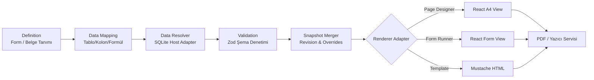

# WorkDesk 360 — Birleşik Form Builder & Document Engine Mimari Analizi ve Tasarım Raporu

> **Durum:** Taslak Mimari & Analiz Raporu (Onay Bekliyor)  
> **Tarih:** 31 Ekim 2026  
> **Hedef Kapsam:** WorkDesk 360 Ekosistemi (TEMİN 360, İhale 360, Süreç 360, Belge 360 vb.)  
> **Önemli İlke:** Bu aşamada kaynak kod değişikliği yapılmamış, TEMİN 360 RC stabilitesini koruyacak şekilde yalnızca analiz ve tasarım sunulmuştur.

---

## Terminoloji ve Motor Ayrımı (Kritik Netleştirme)

Karışıklıkları önlemek adına raporda iki farklı motor net kod adlarıyla anılmaktadır:

* **Document Engine V1 (Mevcut Üretim Motoru):**  
  `packages/document-engine` altında konumlanan (`@worksuite-360/document-engine`), `DocumentPreviewModalV3` arayüzü ile sıkı çalışan, React bileşeni tabanlı (`DocumentRenderer`, `IhtiyacListesiRenderer`, `TemplateRegistry`) mevcut aktif üretim motoru.
* **Document Engine V2 (Referans Snapshot & Mapping Motoru):**  
  Kullanıcı tarafından sunulan `document-engine-example` paketindeki (`@workdesk/document-engine`), UI'dan tamamen bağımsız, deklaratif `TableColumnMapping`, `MappingResolver`, `SnapshotBuilder`, `SnapshotMerger`, `RefreshPolicy` (`source` | `preserve` | `manual`) ve `MustacheRenderer` prensiplerine dayalı yeni nesil referans mimari.

---

## 1. Mevcut Repository Mimarisi ve Paket Analizi

WorkDesk 360; Electron, React, TypeScript ve SQLite temelli, pnpm workspace kullanan modüler bir monorepo yapısına sahiptir.

### 1.1. Monorepo Paket Dağılımı ve Görevleri

```
workdesk-360/
├── apps/
│   └── temin360-desktop/          # Electron + React masaüstü ana uygulaması (Doğrudan Temin)
├── packages/
│   ├── database/                  # SQLite şema tanımları (TANIM_*, DATA_*), migration yöneticisi (v46)
│   ├── document-engine/           # [Document Engine V1] React DocumentRenderer, TemplateRegistry, Resolver sözleşmeleri
│   ├── document-engine-example/   # [Document Engine V2] Referans mapping, snapshot merger, Mustache motoru
│   ├── document-templates/        # Şablon tanımları, TableColumnMapping, ProcessMapping, CSS/HTML şablonları
│   ├── domain/                    # Temin, ihale ve süreç alanına ait ortak iş modelleri ve tipleri
│   ├── ecosystem-contracts/       # IPC, modül ve servisler arası paylaşılan Zod/TypeScript sözleşmeleri
│   └── pdf-generator/             # Chromium/Electron tabanlı HTML'den PDF'e çıktı dönüştürücü
```

### 1.2. Mevcut Veri ve Belge Akışının İşleyişi (TEMİN 360)
1. **Veri Tabanı:** `.temin` uzantılı yerel SQLite dosyaları (`better-sqlite3`). Son sürümde `DATA_DosyaSablonVeri` yerini temiz ilişkisel modele sahip `DATA_TeminBelgeSnapshot` (`dosya_id`, `sablon_kodu`, `veri_json`) tablosuna bırakmıştır.
2. **IPC Katmanı:** `document.ipc.ts` üzerinden Electron ana süreci ile renderer süreci arasında `getDocumentData`, `saveDocumentData`, `resetDocumentData` kanalları çalışır.
3. **Renderer Katmanı:** `DocumentPreviewModalV3` modali içerisinde `DocumentEngine.resolveDocument()` çağrılarak SQLite verisi React tabanlı şablon resolver'larına iletilir.
4. **Önizleme ve Çıktı:** Şablonlar doğrudan React bileşenleri olarak DOM üzerinde render edilir, sayfalama ve zoom kontrolleri React state'inde yönetilir.

---

## 2. Document Engine V2 Örneğinin Teknik Analizi

`document-engine-example` paketi, belge verilerinin yaşam döngüsünü ve kullanıcı müdahalelerini (override) yönetmek için temiz ve deterministik bir snapshot motoru sunar.

### 2.1. Çekirdek Bileşenler
1. **`TableColumnMapping` & `ProcessMapping`:**
   Şablondaki bir değişkenin veritabanındaki hangi tablodan, kolondan, formülden veya alt ilişkiden geleceğini deklaratif olarak tanımlar.
2. **`RefreshPolicy` Mekanizması:**
   * `source`: Veritabanında veri değiştikçe belgedeki alan her yenilemede canlı kaynaktan ezilerek güncellenir.
   * `preserve`: Belge ilk oluşturulduğunda kaydedilen snapshot değerini koşulsuz korur; kaynak güncellense dahi eski belgeyi bozmaz.
   * `manual`: Kullanıcı arayüz üzerinden bir alana elle müdahale etmişse (`override`), bu müdahale korunur; kullanıcı müdahalesi yoksa kaynaktaki güncel veri çekilir.
3. **`SnapshotBuilder` & `SnapshotMerger`:**
   * Belge için ilk defa veya yenileme anında `createSnapshot` çalıştırıldığında önceki revizyon (`previous`) okunur.
   * `SnapshotMerger`, yeni çözümlenen ham veri (`freshData`) ile önceki snapshot ve kullanıcının uyguladığı `overrides` haritasını karşılaştırarak yeni `SnapshotEnvelope` üretir.
4. **`SnapshotEnvelope` Yapısı:**
   * `id`, `documentId`, `templateId`, `templateVersion`, `schemaVersion`, `revision`, `createdAt`, `data`, `overrides`.
   * Her yenilemede yeni bir revizyon üretilerek geçmiş sürümler korunabilir.
5. **Renderer Bağımsızlığı (`MustacheRenderer`):**
   * Renderer hiçbir veritabanı, SQLite veya IPC bağımlılığı taşımaz.
   * Girdi olarak yalnızca şablon metnini ve saf `snapshot.data` JSON nesnesini alır.

---

## 3. Mevcut Altyapı ile Önerilen Sistem Arasındaki Farklar

| Özellik / Kriter | Document Engine V1 (Mevcut) | Document Engine V2 (Örnek / Referans) | Birleşik Form & Belge Motoru (Hedef) |
| :--- | :--- | :--- | :--- |
| **Bağımlılık Tipi** | React / DOM odaklı | Saf TypeScript (Headless) | Saf Core + Tak-Çıkar Adapter'lar |
| **Veri Çözümleme** | Her şablona özel TS/JS resolver fonksiyonları | Deklaratif `TableColumnMapping` + `DocumentDataSource` | Deklaratif Mapping + Schema Validator + Form Resolver |
| **Kullanıcı Düzenlemesi (Override)** | Modal UI state'inde JSON patch olarak tutulur | `SnapshotOverride` ile path tabanlı izlenir (`manual`) | Path tabanlı override + Form Submission alan eşleme |
| **Render Mekanizması** | Yalnızca React JSX bileşenleri | Yalnızca Mustache şablonu | React Designer, Form Renderer, Mustache/Handlebars |
| **Form Desteği** | Yok (Yalnızca hazır belge önizleme) | Yok (Yalnızca şablon mapping) | Dinamik Form Builder + Alan Doğrulama + Veri Girişi |
| **Çoklu Uygulama Desteği** | TEMİN 360 iş kurallarına yakın bağlı | Genel amaçlı mapping iskeleti | Tüm WorkDesk 360 (İhale, Süreç, Belge vb.) uyumlu |

---

## 4. Üç Üretim Yönteminin Sorumluluk Sınırları

Tüm sistem, tek bir devasa bileşen yerine sorumlulukları net ayrılmış üç bağımsız motor ve bir ortak veri omurgası üzerine inşa edilir:

```
+-----------------------------------------------------------------------------------+
|                        ORTAK VERİ OMURGASI (Unified Core)                         |
|  Document/Form Definition -> Data Mapping -> Data Resolver -> Snapshot & Overrides|
+-----------------------------------------------------------------------------------+
           |                                  |                                 |
           v                                  v                                 v
+-----------------------+          +--------------------+          +-----------------------+
|  A. React Document    |          |   B. Form Builder  |          |  C. Template Engine   |
|       Designer        |          |     & Runner       |          |        Adapter        |
+-----------------------+          +--------------------+          +-----------------------+
| - A4 Sayfa düzeni     |          | - Sürükle-bırak    |          | - Mustache/Handlebars |
| - Tablo, logo, imza   |          | - Dinamik inputlar |          | - HTML/CSS şablonları |
| - Çok sayfalı tasarım |          | - JSON editorü     |          | - Harici şablon ithali|
| - Tipografi, kenarlık |          | - Zod validasyonu  |          | - Hızlı toplu çıktı   |
| - Doğrudan baskı/PDF  |          | - Koşullu mantık   |          | - Arşivlenebilir HTML |
+-----------------------+          +--------------------+          +-----------------------+
```

### 4.1. Yöntem A: React Document Designer
* **Kullanım Amacı:** Resmi, kanuni ve mizanpajı katı belgelerin (Örn: Lüzum Müzekkeresi, İhtiyaç Listesi, Onay Belgesi) milimetrik A4 formatında tasarlanması.
* **Girdi:** `DocumentDefinition (Layout: "page-designer")` + `Snapshot.data`.
* **Sorumluluğu:** Sayfa kırılımları, header/footer, imza blokları, dinamik satır tekrarları. Asla doğrudan veritabanı sorgusu çalıştırmaz.

### 4.2. Yöntem B: Form Builder & Runner
* **Kullanım Amacı:** Kullanıcının formlar tasarlayarak veri toplaması, iş süreçlerini tetiklemesi (Örn: İhale Başvuru Formu, Firma Bilgi Formu, Talep Formu).
* **Girdi:** `FormDefinition (fields, validation, layout)` + opsiyonel `FormData`.
* **Sorumluluğu:** Alan doğrulama (Zod tabanlı), koşullu gösterim (`visibleWhen`), dinamik form alanları, verinin toplanıp `FormSubmission` JSON'ına dönüştürülmesi.
* **Çift Yönlü Senkronizasyon:** Form tasarımı hem görsel sürükle-bırak arayüzünden hem de yerleşik monaco/code JSON editöründen anlık olarak düzenlenebilir.

### 4.3. Yöntem C: Template Engine (Mustache / Handlebars vb.)
* **Kullanım Amacı:** Harici HTML/CSS tasarımcıları tarafından hazırlanmış veya üçüncü parti kaynaklardan gelen metin tabanlı şablonların işlenmesi.
* **Girdi:** `TemplateDefinition (mustache/liquid)` + `Snapshot.data`.
* **Sorumluluğu:** Mantıksız (logic-less) şablon birleştirme. Kod enjeksiyonu (`eval`, tehlikeli scriptler) barındırmaz.

---

## 5. Ortak Veri Modelinin Detaylı Tasarımı

Her üç yöntemin de arkasında çalışacak ortak veri akış hattı (Pipeline):



### 5.1. Ortak Çekirdek Varlıklar (Entities)
1. **`Definition`:** Belgenin veya formun şemasını, yerleşimini (layout) ve meta verilerini belirten değişmez tanım.
2. **`Mapping`:** Değişkenlerin uygulamanın hangi tablosundan (`DATA_TeminDosyasi`, `DATA_IhaleDosyasi` vb.) geleceğini tarif eden harita.
3. **`Snapshot`:** Belgenin belirli bir andaki donmuş verisi (`data`), versiyonu ve kullanıcı müdahaleleri (`overrides`).
4. **`Submission`:** Form Builder tarafından toplanan kullanıcı yanıtları. Bir submission, başka bir belgenin data mapping'ine girdi teşkil edebilir.

---

## 6. Önerilen JSON Şemaları (TypeScript Tanımları)

### 6.1. Form Builder Şeması (`FormDefinitionJSON`)
```typescript
export type FormFieldType =
  | 'text' | 'textarea' | 'number' | 'decimal' | 'currency'
  | 'date' | 'datetime' | 'select' | 'multiselect' | 'radio'
  | 'checkbox' | 'switch' | 'file' | 'image' | 'table'
  | 'relation' | 'formula' | 'section' | 'tabs' | 'divider';

export interface FormValidationRule {
  required?: boolean;
  min?: number;
  max?: number;
  minLength?: number;
  maxLength?: number;
  regex?: string;
  customMessage?: string;
}

export interface FormFieldCondition {
  fieldKey: string;
  operator: 'equals' | 'notEquals' | 'contains' | 'greaterThan' | 'lessThan' | 'isEmpty' | 'isNotEmpty';
  value: unknown;
}

export interface FormFieldDefinition {
  id: string;
  key: string;                       // Verideki JSON path'i (örn: "firma.yetkiliAdi")
  label: string;
  type: FormFieldType;
  description?: string;
  placeholder?: string;
  defaultValue?: unknown;
  validation?: FormValidationRule;
  readOnly?: boolean;
  hidden?: boolean;
  visibleWhen?: FormFieldCondition;  // Koşullu görünürlük
  requiredWhen?: FormFieldCondition; // Koşullu zorunluluk
  options?: Array<{ label: string; value: unknown }>; // Select/Radio için
  columns?: FormFieldDefinition[];   // Table / Repeater için alt kolonlar
  formula?: string;                  // Otomatik hesaplama formülü
  dataSource?: {                     // Dinamik Lookup bağlantısı
    resource: string;
    labelColumn: string;
    valueColumn: string;
  };
}

export interface FormDefinitionJSON {
  id: string;
  title: string;
  code: string;                      // Benzersiz form kodu
  version: number;
  layout: 'single-page' | 'stepper' | 'tabs';
  sections: Array<{
    id: string;
    title: string;
    fields: FormFieldDefinition[];
  }>;
}
```

### 6.2. Document Designer Şeması (`DocumentDesignerJSON`)
```typescript
export interface PageSettings {
  format: 'A4' | 'A5' | 'Letter';
  orientation: 'portrait' | 'landscape';
  margins: { top: number; bottom: number; left: number; right: number }; // mm cinsinden
}

export interface DesignerElement {
  id: string;
  type: 'text' | 'heading' | 'table' | 'image' | 'signature' | 'header' | 'footer' | 'pageNumber';
  style: {
    x?: number;
    y?: number;
    width?: string | number;
    height?: string | number;
    fontSize?: number;
    fontWeight?: string;
    textAlign?: 'left' | 'center' | 'right' | 'justify';
    border?: string;
    padding?: number;
  };
  content?: string;                  // Sabit metin veya şablon ifade (örn: "{{firmaAdi}}")
  bindingPath?: string;              // Snapshot verisindeki JSON path referansı
  tableConfig?: {
    repeatPath: string;              // Liste veri path'i (örn: "kalemler")
    columns: Array<{ header: string; dataKey: string; width?: string }>;
  };
}

export interface DocumentDesignerJSON {
  id: string;
  code: string;
  title: string;
  version: number;
  pageSettings: PageSettings;
  headerElement?: DesignerElement;
  footerElement?: DesignerElement;
  elements: DesignerElement[];
}
```

### 6.3. Birleşik Snapshot Zarfı (`SnapshotEnvelopeJSON`)
```typescript
export type RefreshPolicy = 'source' | 'preserve' | 'manual';

export interface SnapshotOverrideItem {
  value: unknown;
  updatedAt: string;
  updatedBy?: string | number;
}

export interface SnapshotEnvelopeJSON<T = Record<string, unknown>> {
  id: string;
  documentId: string | number;        // Bağlı olduğu iş dosyası (örn: dosya_id: 275)
  templateId: string;                // Şablon veya form kodu
  templateVersion: number;
  schemaVersion: number;
  revision: number;                  // 1, 2, 3...
  createdAt: string;
  sourceUpdatedAt?: string;
  data: T;                           // Renderer'ın tükettiği nihai birleşik veri
  overrides: Record<string, SnapshotOverrideItem>; // Elle düzenlenen alanlar (JSON path -> değer)
}
```

---

## 7. Veritabanı ve Migration Planı

WorkDesk 360 monoreposunda `packages/database` altında sürüm 46 (rc.10) aktiftir. Veritabanı dosyaları `.temin` vb. SQLite arşivleridir.

### 7.1. Adlandırma Standartları ve Uyumluluk
* `DATA_*`: Kullanıcıya veya iş dosyasına bağlı dinamik veriler (Örn: `DATA_TeminBelgeSnapshot`).
* `TANIM_*`: Şablonlar, kurum bilgileri, sistem sözlükleri.
* `SYS_*`: Form Builder ve Belge Motoru altyapısının genel şemaları (Önerilen).

### 7.2. Önerilen Yeni Veritabanı Tabloları

```sql
-- 1. Form Tanımları Tablosu
CREATE TABLE IF NOT EXISTS SYS_FormDefinition (
    id INTEGER PRIMARY KEY AUTOINCREMENT,
    form_kodu TEXT NOT NULL UNIQUE,
    baslik TEXT NOT NULL,
    aciklama TEXT,
    aktif_surum_id INTEGER,
    is_active INTEGER DEFAULT 1,
    is_deleted INTEGER DEFAULT 0,
    created_at DATETIME DEFAULT CURRENT_TIMESTAMP,
    updated_at DATETIME DEFAULT CURRENT_TIMESTAMP
);

-- 2. Form Sürüm ve Şema Geçmişi
CREATE TABLE IF NOT EXISTS SYS_FormVersion (
    id INTEGER PRIMARY KEY AUTOINCREMENT,
    form_id INTEGER NOT NULL,
    versiyon INTEGER NOT NULL,
    sema_json TEXT NOT NULL,          -- FormDefinitionJSON
    degisiklik_notu TEXT,
    created_at DATETIME DEFAULT CURRENT_TIMESTAMP,
    created_by INTEGER,
    FOREIGN KEY(form_id) REFERENCES SYS_FormDefinition(id) ON DELETE CASCADE,
    UNIQUE(form_id, versiyon)
);

-- 3. Form Yanıtları (Submissions)
CREATE TABLE IF NOT EXISTS SYS_FormSubmission (
    id INTEGER PRIMARY KEY AUTOINCREMENT,
    form_id INTEGER NOT NULL,
    form_version_id INTEGER NOT NULL,
    bagli_modul TEXT NOT NULL,         -- 'temin', 'ihale', 'surec'
    bagli_kayit_id INTEGER NOT NULL,   -- İlgili iş dosyasının ID'si
    yanit_json TEXT NOT NULL,          -- Kullanıcının doldurduğu JSON
    created_at DATETIME DEFAULT CURRENT_TIMESTAMP,
    updated_at DATETIME DEFAULT CURRENT_TIMESTAMP,
    FOREIGN KEY(form_id) REFERENCES SYS_FormDefinition(id),
    FOREIGN KEY(form_version_id) REFERENCES SYS_FormVersion(id)
);

-- 4. Belge Tasarım Tanımları (React Designer & Şablonlar için)
CREATE TABLE IF NOT EXISTS SYS_DocumentDefinition (
    id INTEGER PRIMARY KEY AUTOINCREMENT,
    belge_kodu TEXT NOT NULL UNIQUE,
    belge_adi TEXT NOT NULL,
    tip TEXT NOT NULL,                 -- 'designer' | 'template'
    aktif_surum_id INTEGER,
    is_active INTEGER DEFAULT 1,
    is_deleted INTEGER DEFAULT 0,
    created_at DATETIME DEFAULT CURRENT_TIMESTAMP,
    updated_at DATETIME DEFAULT CURRENT_TIMESTAMP
);

-- 5. Belge Sürümleri ve Düzen Tanımı
CREATE TABLE IF NOT EXISTS SYS_DocumentVersion (
    id INTEGER PRIMARY KEY AUTOINCREMENT,
    document_id INTEGER NOT NULL,
    versiyon INTEGER NOT NULL,
    tasarim_json TEXT NOT NULL,        -- DocumentDesignerJSON veya Template HTML
    created_at DATETIME DEFAULT CURRENT_TIMESTAMP,
    FOREIGN KEY(document_id) REFERENCES SYS_DocumentDefinition(id) ON DELETE CASCADE,
    UNIQUE(document_id, versiyon)
);

-- 6. Veri Haritalama Tanımı (Data Mapping)
CREATE TABLE IF NOT EXISTS SYS_DocumentMapping (
    id INTEGER PRIMARY KEY AUTOINCREMENT,
    kod TEXT NOT NULL UNIQUE,          -- Şablon kodu ile eşleşir
    mapping_json TEXT NOT NULL,        -- TableColumnMapping yapısı
    aciklama TEXT,
    updated_at DATETIME DEFAULT CURRENT_TIMESTAMP
);
```

> **Önemli Not (DATA_TeminBelgeSnapshot Uyumu):**  
> TEMİN 360'ta henüz yeni devreye alınan `DATA_TeminBelgeSnapshot` tablosu dokunulmadan korunacaktır. `DATA_TeminBelgeSnapshot.veri_json` kolonu, `SnapshotEnvelopeJSON` formatını doğrudan barındırabilecek yapıdadır. Böylece mevcut RC kararlılığı sıfır riskle devam eder.

---

## 8. Monorepo Paket Yerleşimi

Monorepoda paket sorumluluklarının temiz ayrılması için hedeflenen paket yapısı:

```text
packages/
├── document-engine/             # [Mevcut V1] Geriye dönük uyumluluk için korunur
├── document-templates/          # [Mevcut] Mevcut TEMİN şablonları
├── form-builder/                # [Yeni] Form sürükle-bırak editörü, alan kontrolleri, form runner
│   ├── package.json             # @workdesk/form-builder
│   └── src/
│       ├── components/          # Palette, Canvas, FieldSettings, JSONEditor
│       ├── fields/              # TextField, NumberField, DateField, TableField vb.
│       ├── runner/              # FormRunner (Doldurma ekranı ve Zod validasyonu)
│       └── types/
├── document-engine-core/        # [Yeni - V2 Gelişimi] Saf TypeScript veri ve snapshot motoru
│   ├── package.json             # @workdesk/document-engine-core
│   └── src/
│       ├── mapping/             # MappingResolver, TableColumnMapping çözümleyici
│       ├── snapshot/            # SnapshotBuilder, SnapshotMerger, OverrideTracker
│       ├── policies/            # RefreshPolicy (source, preserve, manual)
│       └── contracts/           # Ortak veri arayüzleri, Zod şemaları
├── document-designer/           # [Yeni] React A4 Belge Tasarım Editörü
│   ├── package.json             # @workdesk/document-designer
│   └── src/
│       ├── designer/            # Canvas, Toolbar, PageSettings, ElementPalette
│       ├── elements/            # A4Text, A4Table, A4Image, A4Signature
│       └── viewer/              # A4PageViewer (Önizleme ve baskı)
```

---

## 9. Renderer Adapter Mimarisi

Farklı render gereksinimlerini tek bir arayüz arkasında toplayan adapter sözleşmesi:

```typescript
export interface DocumentRendererProps<TData = Record<string, unknown>> {
  data: TData;
  scale?: number;
  readOnly?: boolean;
  onOverrideChange?: (path: string, value: unknown) => void;
}

export interface DocumentRendererAdapter {
  id: string;                                // 'react-designer' | 'form-runner' | 'mustache'
  name: string;
  supportsPageBreaks: boolean;
  renderToHtml?(templateSource: string, data: Record<string, unknown>): Promise<string> | string;
  Component?: React.ComponentType<DocumentRendererProps>;
}

export class DocumentRendererRegistry {
  private adapters = new Map<string, DocumentRendererAdapter>();

  register(adapter: DocumentRendererAdapter) {
    this.adapters.set(adapter.id, adapter);
  }

  get(id: string): DocumentRendererAdapter {
    const adapter = this.adapters.get(id);
    if (!adapter) throw new Error(`Bilinmeyen renderer adapter: ${id}`);
    return adapter;
  }
}
```

Bu sayede:
* **Mustache Adapter:** Sunucu/Electron main tarafında headless HTML üretip PDF motoruna (`pdf-generator`) besleyebilir.
* **React Designer Adapter:** UI tarafında A4 sayfaları üzerinde etkileşimli önizleme sunar.
* **Form Runner Adapter:** Kullanıcıya interaktif form doldurma ekranı açar.

---

## 10. Güvenlik ve Test Stratejisi

1. **Kod Enjeksiyonu Önleme (Sandbox Güvenliği):**  
   * Template motorunda (Mustache vb.) arbitrary code execution (JavaScript çalıştırma) kesinlikle engellenir. Logic-less yapı korunur.
   * Formüller için `eval()` veya `Function()` çağrısı yapılmaz; güvenli matematiksel parse motoru (örneğin kısıtlı AST parser) kullanılır.
2. **JSON Doğrulama:**  
   * Kullanıcı veya import kaynaklı tüm form ve belge şemaları IPC sınırında **Zod** ile tip ve sınır kontrolünden geçirilir (`safeParse`).
3. **IPC İzolasyonu:**  
   * Veritabanı sorguları renderer sürecinden doğrudan SQL çalıştırılarak yapılamaz. Yalnızca yetkilendirilmiş `DocumentDataSource` IPC handler'ları üzerinden parametrik sorgularla çalışır.
4. **Test Kapsamı:**  
   * **Birim Testleri:** `SnapshotMerger`'ın `source`, `preserve`, `manual` politikalarını doğru işlediğinin vitest ile doğrulanması.
   * **Regresyon Testleri:** Mevcut `teminBelgeSnapshotMigration.test.ts` ve `schemaIntegrity.test.ts` testlerinin her aşamada çalıştırılması.

---

## 11. Aşamalı Uygulama Planı (Phase-by-Phase Roadmap)

* **Aşama 1 (Hazırlık ve Onay - Şu Anki Aşama):**  
  Mevcut V1 ve V2 yapılarının netleştirilmesi, mimari raporun sunulması ve onay alınması. Kod yazılmaz.
* **Aşama 2 (Core Paketinin Oluşturulması):**  
  `document-engine-example` mimarisinin olgunlaştırılarak `packages/document-engine-core` olarak konumlandırılması, saf veri/snapshot resolver mantığının test edilmesi.
* **Aşama 3 (Form Builder Temelinin Atılması):**  
  `packages/form-builder` paketinin kurulması; temel alan tipleri, Zod validatörü ve çift yönlü JSON senkronizasyonu.
* **Aşama 4 (Renderer Adapter Entegrasyonu):**  
  Mustache ve React önizleme adapter'larının `document-engine-core` ile bağlanması.
* **Aşama 5 (React Document Designer):**  
  Görsel A4 sayfa tasarımcısının geliştirilmesi.
* **Aşama 6 (TEMİN 360 & Diğer Uygulamalara Entegrasyon):**  
  TEMİN 360 RC sürümü bozulmadan, yeni form ve belge şablonlarının kademeli olarak yeni motora açılması.

---

## 12. TEMİN 360 RC Sürümünü Korumak İçin Alınacak Önlemler

1. **Paralel Çalışma Prensibi (Zero-Breakage):**  
   Mevcut `packages/document-engine` (V1) ve `DocumentPreviewModalV3` bileşenleri yerinde duracaktır. TEMİN 360'ın mevcut çalışan 10+ şablonu (Lüzum Müzekkeresi, İhtiyaç Listesi vb.) yeni sistem tam test edilip onaylanana kadar mevcut V1 motoru üzerinden hizmet vermeye devam eder.
2. **Tablo Bütünlüğü:**  
   `DATA_TeminBelgeSnapshot` tablosunun yapısı değiştirilmeyecek, eski migration dosyaları manipüle edilmeyecektir.
3. **Bağımsızlık:**  
   Yeni `form-builder` veya `document-engine-core` paketleri, TEMİN 360'ın derleme (`build`), test veya paketleme adımlarına yan etki (side-effect) üretmeyecek şekilde izole workspace paketleri olarak eklenecektir.
4. **Kullanıcı Onayı:**  
   Her aşamada test sonuçları paylaşılacak ve kullanıcı onayı alınmadan üretim kodlarına müdahale edilmeyecektir.

