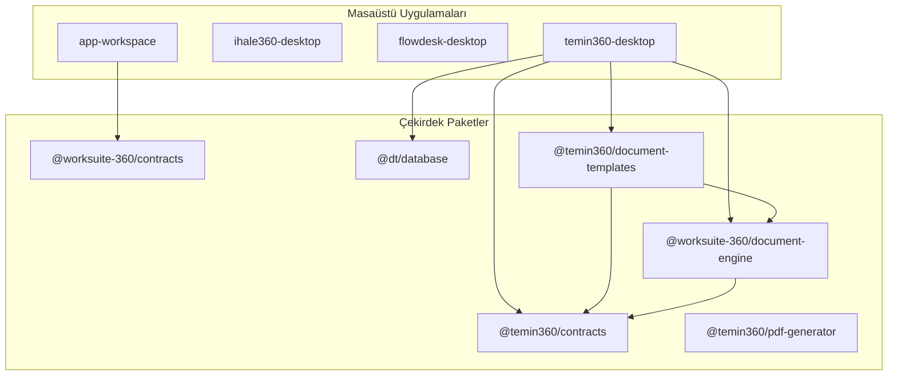

# WorkDesk 360 — Mimari Teknik Borç ve Kod Analiz Raporu (V2)

> **Raporlama Tarihi:** 07.11.2026 16:18:05  
> **Analiz Motoru:** AST Tabanlı Mimari Analiz Motoru (V2.0)  
> **Taranan Dosya:** 1.760 | **Toplam Satır:** 336.026

---

## 1. Yönetici Özeti ve Temel Bulgular

| Öncelik | Tanım | Adet | Durum |
|---|---|:---:|:---:|
| 🔴 **P0 (Kritik)** | Mimari sınır ihlalleri, güvenlik ve veri kaybı riskleri | **71** | Acil Müdahale |
| 🟡 **P1 (Yüksek)** | God-Component, mükerrer veri çözümleme ve yapısal klonlar | **45** | Planlı Refactoring |
| ⚪ **P2 (Orta)** | Co-located eksiklikler, kullanılmayan yardımcı kodlar | **107** | Teknik İyileştirme |
| **Toplam** | **Sistem Geneli Mimari Bulgu Sayısı** | **223** | **Aktif İzleme** |

---

## 2. Paket Bağımlılık ve Mimari Akış Grafiği

Mevcut monorepo paketleri ve izin verilen bağımlılık yönleri aşağıdaki Mermaid şemasında gösterilmiştir:

---

## 3. En Riskli God-Component Sıralaması (Çok Boyutlu Skor)

| Sıra | Bileşen Dosyası | Satır | Hook Sayısı | State / Effect | Doğrudan IPC | God Skoru |
|:---:|---|:---:|:---:|:---:|:---:|:---:|
| 1 | `apps/disk-analiz-360-desktop/src/renderer/src/App.tsx` | 2395 | 43 | 33 / 4 | 0 | **1599** |
| 2 | `apps/disk-analiz-360-desktop/src/renderer/src/components/SmartArchiveWorkspaceView.tsx` | 2006 | 39 | 29 / 4 | 0 | **1375** |
| 3 | `apps/temin360-desktop/src/renderer/src/screens/ihtiyac-raporlari/components/IhtiyacRaporuEditorView.tsx` | 1281 | 34 | 25 / 5 | 0 | **1046** |
| 4 | `apps/temin360-desktop/src/renderer/src/screens/ayarlar/index.screen.tsx` | 432 | 39 | 26 / 4 | 10 | **987** |
| 5 | `apps/temin360-desktop/src/renderer/src/screens/firmalar/components/FirmaEslestirmeModal.tsx` | 1195 | 24 | 16 / 2 | 8 | **981** |
| 6 | `apps/flowdesk-desktop/src/renderer/src/App.tsx` | 1491 | 24 | 19 / 2 | 0 | **950** |
| 7 | `apps/temin360-desktop/src/renderer/src/screens/system/harici-aktarim/HariciDosyaAktarScreen.tsx` | 1504 | 21 | 13 / 1 | 3 | **929** |
| 8 | `apps/temin360-desktop/src/renderer/src/screens/komisyonlar/useKomisyonlarScreenLogic.tsx` | 473 | 22 | 14 / 2 | 18 | **881** |
| 9 | `apps/temin360-desktop/src/renderer/src/screens/dosya/components/DocumentPreviewModalV3/components/DocumentPreviewRotaSection.tsx` | 1607 | 14 | 5 / 1 | 0 | **795** |
| 10 | `apps/personel360-desktop/src/renderer/src/App.tsx` | 953 | 15 | 14 / 1 | 8 | **782** |

---

## 4. Detaylı Bulgu Listesi (ID, Kanıt ve Önerilen Çözüm)

### 🔴 P0 — Kritik Mimari Bulgular

### [DEP-TMPL-DB-1] — Öncelik: P0
- **Dosya ve Satır:** `packages/document-templates/src/__tests__/workflowProfiles.test.ts:L10`
- **Etkilenen Modüller:** `@temin360/document-templates`, `@dt/database`
- **Güven Düzeyi:** YÜKSEK
- **Somut Kanıt:**
  > `document-templates directly imports database module: '../../../database/src/tables/TANIM_Roller'`
- **Önerilen Çözüm:** Şablonlar doğrudan veritabanı kütüphanesine bağlanmamalı; veri sağlayıcı (DataProvider) veya Resolver kontratları üzerinden veri almalıdır.
- **Gerekli Regresyon Testi:** `pnpm --filter @temin360/document-templates test`

### [SEC-PRELOAD-RAW-EXPOSURE-FLOWDESK-DESKTOP] — Öncelik: P0
- **Dosya ve Satır:** `apps/flowdesk-desktop/src/preload/index.ts:L36`
- **Etkilenen Modüller:** `flowdesk-desktop`
- **Güven Düzeyi:** YÜKSEK
- **Somut Kanıt:**
  > `contextBridge.exposeInMainWorld('electron', electronAPI) exposes unrestricted ipcRenderer methods (send, on, invoke) to the renderer process.`
- **Önerilen Çözüm:** Doğrudan ham electronAPI maruziyeti kaldırılmalı; izin verilen IPC kanalları (allowlist) üzerinden filtrelenmiş bir proxy veya yalnızca spesifik API metotları sunulmalıdır.
- **Gerekli Regresyon Testi:** `pnpm --filter flowdesk-desktop test`

### [SEC-PRELOAD-RAW-EXPOSURE-PERSONEL360-DESKTOP] — Öncelik: P0
- **Dosya ve Satır:** `apps/personel360-desktop/src/preload/index.ts:L30`
- **Etkilenen Modüller:** `personel360-desktop`
- **Güven Düzeyi:** YÜKSEK
- **Somut Kanıt:**
  > `contextBridge.exposeInMainWorld('electron', electronAPI) exposes unrestricted ipcRenderer methods (send, on, invoke) to the renderer process.`
- **Önerilen Çözüm:** Doğrudan ham electronAPI maruziyeti kaldırılmalı; izin verilen IPC kanalları (allowlist) üzerinden filtrelenmiş bir proxy veya yalnızca spesifik API metotları sunulmalıdır.
- **Gerekli Regresyon Testi:** `pnpm --filter personel360-desktop test`

### [SEC-PRELOAD-RAW-EXPOSURE-DISK-ANALIZ-360-DESKTOP] — Öncelik: P0
- **Dosya ve Satır:** `apps/disk-analiz-360-desktop/src/preload/index.ts:L107`
- **Etkilenen Modüller:** `disk-analiz-360-desktop`
- **Güven Düzeyi:** YÜKSEK
- **Somut Kanıt:**
  > `contextBridge.exposeInMainWorld('electron', electronAPI) exposes unrestricted ipcRenderer methods (send, on, invoke) to the renderer process.`
- **Önerilen Çözüm:** Doğrudan ham electronAPI maruziyeti kaldırılmalı; izin verilen IPC kanalları (allowlist) üzerinden filtrelenmiş bir proxy veya yalnızca spesifik API metotları sunulmalıdır.
- **Gerekli Regresyon Testi:** `pnpm --filter disk-analiz-360-desktop test`

### [SEC-SQLI-INTERPOLATION-5] — Öncelik: P0
- **Dosya ve Satır:** `apps/temin360-desktop/src/main/archive.ts:L228`
- **Etkilenen Modüller:** `temin360-desktop`
- **Güven Düzeyi:** YÜKSEK
- **Somut Kanıt:**
  > `Raw template string interpolation inside db.prepare(): db.prepare(`DELETE FROM DATA_TeminDosyasi WHERE id IN (${inClause})`)...`
- **Önerilen Çözüm:** SQL sorgularına değişkenler şablon dizgisi (${...}) ile eklenmemeli; parametrik (?) sorgular ve better-sqlite3 prepare().run(...params) kullanılmalıdır.
- **Gerekli Regresyon Testi:** `pnpm test`

### [SEC-SQLI-INTERPOLATION-6] — Öncelik: P0
- **Dosya ve Satır:** `apps/temin360-desktop/src/main/database/workspace/schemaIntegrity.ts:L88`
- **Etkilenen Modüller:** `temin360-desktop`
- **Güven Düzeyi:** YÜKSEK
- **Somut Kanıt:**
  > `Raw template string interpolation inside db.prepare(): db.prepare(`PRAGMA table_info(${table.name})`)...`
- **Önerilen Çözüm:** SQL sorgularına değişkenler şablon dizgisi (${...}) ile eklenmemeli; parametrik (?) sorgular ve better-sqlite3 prepare().run(...params) kullanılmalıdır.
- **Gerekli Regresyon Testi:** `pnpm test`

### [SEC-SQLI-INTERPOLATION-7] — Öncelik: P0
- **Dosya ve Satır:** `apps/temin360-desktop/src/main/database/workspace/schemaIntegrity.ts:L769`
- **Etkilenen Modüller:** `temin360-desktop`
- **Güven Düzeyi:** YÜKSEK
- **Somut Kanıt:**
  > `Raw template string interpolation inside db.prepare(): db.prepare(`PRAGMA table_info(${table.name})`)...`
- **Önerilen Çözüm:** SQL sorgularına değişkenler şablon dizgisi (${...}) ile eklenmemeli; parametrik (?) sorgular ve better-sqlite3 prepare().run(...params) kullanılmalıdır.
- **Gerekli Regresyon Testi:** `pnpm test`

### [SEC-SQLI-INTERPOLATION-8] — Öncelik: P0
- **Dosya ve Satır:** `apps/temin360-desktop/src/main/database/workspace/__tests__/realWorkspaceMigrationFlow.test.ts:L74`
- **Etkilenen Modüller:** `temin360-desktop`
- **Güven Düzeyi:** YÜKSEK
- **Somut Kanıt:**
  > `Raw template string interpolation inside db.prepare(): db.prepare(`PRAGMA table_info(${table})`)...`
- **Önerilen Çözüm:** SQL sorgularına değişkenler şablon dizgisi (${...}) ile eklenmemeli; parametrik (?) sorgular ve better-sqlite3 prepare().run(...params) kullanılmalıdır.
- **Gerekli Regresyon Testi:** `pnpm test`

### [SEC-SQLI-INTERPOLATION-9] — Öncelik: P0
- **Dosya ve Satır:** `apps/temin360-desktop/src/main/ipc/db/tableExcelHandlers.ts:L13`
- **Etkilenen Modüller:** `temin360-desktop`
- **Güven Düzeyi:** YÜKSEK
- **Somut Kanıt:**
  > `Raw template string interpolation inside db.prepare(): db.prepare(`SELECT * FROM ${tableName}`)...`
- **Önerilen Çözüm:** SQL sorgularına değişkenler şablon dizgisi (${...}) ile eklenmemeli; parametrik (?) sorgular ve better-sqlite3 prepare().run(...params) kullanılmalıdır.
- **Gerekli Regresyon Testi:** `pnpm test`

### [SEC-SQLI-INTERPOLATION-10] — Öncelik: P0
- **Dosya ve Satır:** `apps/temin360-desktop/src/main/ipc/db/tableExcelHandlers.ts:L43`
- **Etkilenen Modüller:** `temin360-desktop`
- **Güven Düzeyi:** YÜKSEK
- **Somut Kanıt:**
  > `Raw template string interpolation inside db.prepare(): db.prepare(`PRAGMA table_info(${tableName})`)...`
- **Önerilen Çözüm:** SQL sorgularına değişkenler şablon dizgisi (${...}) ile eklenmemeli; parametrik (?) sorgular ve better-sqlite3 prepare().run(...params) kullanılmalıdır.
- **Gerekli Regresyon Testi:** `pnpm test`

### [SEC-SQLI-INTERPOLATION-11] — Öncelik: P0
- **Dosya ve Satır:** `apps/temin360-desktop/src/main/ipc/db/tableExcelHandlers.ts:L54`
- **Etkilenen Modüller:** `temin360-desktop`
- **Güven Düzeyi:** YÜKSEK
- **Somut Kanıt:**
  > `Raw template string interpolation inside db.prepare(): db.prepare(`SELECT * FROM ${tableName} LIMIT 1`)...`
- **Önerilen Çözüm:** SQL sorgularına değişkenler şablon dizgisi (${...}) ile eklenmemeli; parametrik (?) sorgular ve better-sqlite3 prepare().run(...params) kullanılmalıdır.
- **Gerekli Regresyon Testi:** `pnpm test`

### [SEC-SQLI-INTERPOLATION-12] — Öncelik: P0
- **Dosya ve Satır:** `apps/temin360-desktop/src/main/ipc/db/tableExcelHandlers.ts:L139`
- **Etkilenen Modüller:** `temin360-desktop`
- **Güven Düzeyi:** YÜKSEK
- **Somut Kanıt:**
  > `Raw template string interpolation inside db.prepare(): db.prepare(`PRAGMA table_info(${tableName})`)...`
- **Önerilen Çözüm:** SQL sorgularına değişkenler şablon dizgisi (${...}) ile eklenmemeli; parametrik (?) sorgular ve better-sqlite3 prepare().run(...params) kullanılmalıdır.
- **Gerekli Regresyon Testi:** `pnpm test`

### [SEC-SQLI-INTERPOLATION-13] — Öncelik: P0
- **Dosya ve Satır:** `apps/temin360-desktop/src/main/ipc/db/tableExcelHandlers.ts:L499`
- **Etkilenen Modüller:** `temin360-desktop`
- **Güven Düzeyi:** YÜKSEK
- **Somut Kanıt:**
  > `Raw template string interpolation inside db.prepare(): db.prepare(`UPDATE ${tableName} SET ${setClause} WHERE "${pkCol}" = ?`)...`
- **Önerilen Çözüm:** SQL sorgularına değişkenler şablon dizgisi (${...}) ile eklenmemeli; parametrik (?) sorgular ve better-sqlite3 prepare().run(...params) kullanılmalıdır.
- **Gerekli Regresyon Testi:** `pnpm test`

### [SEC-SQLI-INTERPOLATION-14] — Öncelik: P0
- **Dosya ve Satır:** `apps/temin360-desktop/src/main/ipc/db/tableExcelHandlers.ts:L509`
- **Etkilenen Modüller:** `temin360-desktop`
- **Güven Düzeyi:** YÜKSEK
- **Somut Kanıt:**
  > `Raw template string interpolation inside db.prepare(): db.prepare(
                  `INSERT INTO ${tableName} (${insertCols.map((c) =>...`
- **Önerilen Çözüm:** SQL sorgularına değişkenler şablon dizgisi (${...}) ile eklenmemeli; parametrik (?) sorgular ve better-sqlite3 prepare().run(...params) kullanılmalıdır.
- **Gerekli Regresyon Testi:** `pnpm test`

### [SEC-SQLI-INTERPOLATION-15] — Öncelik: P0
- **Dosya ve Satır:** `apps/temin360-desktop/src/main/ipc/document.ipc.ts:L337`
- **Etkilenen Modüller:** `temin360-desktop`
- **Güven Düzeyi:** YÜKSEK
- **Somut Kanıt:**
  > `Raw template string interpolation inside db.prepare(): db.prepare(
              `DELETE FROM DATA_TeminBelgeSnapshot 
              ...`
- **Önerilen Çözüm:** SQL sorgularına değişkenler şablon dizgisi (${...}) ile eklenmemeli; parametrik (?) sorgular ve better-sqlite3 prepare().run(...params) kullanılmalıdır.
- **Gerekli Regresyon Testi:** `pnpm test`

### [SEC-SQLI-INTERPOLATION-16] — Öncelik: P0
- **Dosya ve Satır:** `apps/temin360-desktop/src/main/ipc/document.ipc.ts:L433`
- **Etkilenen Modüller:** `temin360-desktop`
- **Güven Düzeyi:** YÜKSEK
- **Somut Kanıt:**
  > `Raw template string interpolation inside db.prepare(): db.prepare(
            `DELETE FROM DATA_TeminBelgeSnapshot WHERE dosya_id = ?...`
- **Önerilen Çözüm:** SQL sorgularına değişkenler şablon dizgisi (${...}) ile eklenmemeli; parametrik (?) sorgular ve better-sqlite3 prepare().run(...params) kullanılmalıdır.
- **Gerekli Regresyon Testi:** `pnpm test`

### [SEC-SQLI-INTERPOLATION-17] — Öncelik: P0
- **Dosya ve Satır:** `apps/temin360-desktop/src/main/ipc/kutuphane.ipc.ts:L264`
- **Etkilenen Modüller:** `temin360-desktop`
- **Güven Düzeyi:** YÜKSEK
- **Somut Kanıt:**
  > `Raw template string interpolation inside db.prepare(): db.prepare(`UPDATE DATA_KutuphaneBelge SET ${updates.join(', ')} WHERE id = ?`)...`
- **Önerilen Çözüm:** SQL sorgularına değişkenler şablon dizgisi (${...}) ile eklenmemeli; parametrik (?) sorgular ve better-sqlite3 prepare().run(...params) kullanılmalıdır.
- **Gerekli Regresyon Testi:** `pnpm test`

### [SEC-SQLI-INTERPOLATION-18] — Öncelik: P0
- **Dosya ve Satır:** `apps/disk-analiz-360-desktop/src/main/modules/storage.ts:L1004`
- **Etkilenen Modüller:** `disk-analiz-360-desktop`
- **Güven Düzeyi:** YÜKSEK
- **Somut Kanıt:**
  > `Raw template string interpolation inside db.prepare(): db.prepare(`
      SELECT id, fullPath, parentPath, name, extension, sizeBytes, ...`
- **Önerilen Çözüm:** SQL sorgularına değişkenler şablon dizgisi (${...}) ile eklenmemeli; parametrik (?) sorgular ve better-sqlite3 prepare().run(...params) kullanılmalıdır.
- **Gerekli Regresyon Testi:** `pnpm test`

### [GOD-COMPONENT-INSPECTIONTIMELINE] — Öncelik: P0
- **Dosya ve Satır:** `apps/temin360-desktop/src/renderer/src/components/audit/InspectionTimeline.tsx:L1`
- **Etkilenen Modüller:** `temin360-desktop`
- **Güven Düzeyi:** YÜKSEK
- **Somut Kanıt:**
  > `God Component Score: 584 (Satır: 632, State: 7, Effect: 1, Toplam Hook: 11, Import: 3, Doğrudan IPC: 9)`
- **Önerilen Çözüm:** Bileşen mimari sorumluluklarına göre parçalanmalı: 1) Veri getirme ve IPC mantığı özel bir Custom Hook'a taşınmalı, 2) Alt paneller bağımsız saf sunum bileşenlerine (Presenter Components) ayrılmalıdır.
- **Gerekli Regresyon Testi:** `pnpm --filter temin360-desktop test`

### [GOD-COMPONENT-A4EDITOR] — Öncelik: P0
- **Dosya ve Satır:** `apps/temin360-desktop/src/renderer/src/components/editor/A4Editor.tsx:L1`
- **Etkilenen Modüller:** `temin360-desktop`
- **Güven Düzeyi:** YÜKSEK
- **Somut Kanıt:**
  > `God Component Score: 451 (Satır: 590, State: 9, Effect: 1, Toplam Hook: 13, Import: 10, Doğrudan IPC: 1)`
- **Önerilen Çözüm:** Bileşen mimari sorumluluklarına göre parçalanmalı: 1) Veri getirme ve IPC mantığı özel bir Custom Hook'a taşınmalı, 2) Alt paneller bağımsız saf sunum bileşenlerine (Presenter Components) ayrılmalıdır.
- **Gerekli Regresyon Testi:** `pnpm --filter temin360-desktop test`

### [GOD-COMPONENT-WORKSPACECLOSEMODAL] — Öncelik: P0
- **Dosya ve Satır:** `apps/temin360-desktop/src/renderer/src/components/layout/WorkspaceCloseModal.tsx:L1`
- **Etkilenen Modüller:** `temin360-desktop`
- **Güven Düzeyi:** YÜKSEK
- **Somut Kanıt:**
  > `God Component Score: 519 (Satır: 603, State: 7, Effect: 1, Toplam Hook: 8, Import: 4, Doğrudan IPC: 7)`
- **Önerilen Çözüm:** Bileşen mimari sorumluluklarına göre parçalanmalı: 1) Veri getirme ve IPC mantığı özel bir Custom Hook'a taşınmalı, 2) Alt paneller bağımsız saf sunum bileşenlerine (Presenter Components) ayrılmalıdır.
- **Gerekli Regresyon Testi:** `pnpm --filter temin360-desktop test`

### [GOD-COMPONENT-AITEXTGENERATORMODAL] — Öncelik: P0
- **Dosya ve Satır:** `apps/temin360-desktop/src/renderer/src/components/ui/AITextGeneratorModal.tsx:L1`
- **Etkilenen Modüller:** `temin360-desktop`
- **Güven Düzeyi:** YÜKSEK
- **Somut Kanıt:**
  > `God Component Score: 355 (Satır: 562, State: 5, Effect: 1, Toplam Hook: 6, Import: 5, Doğrudan IPC: 1)`
- **Önerilen Çözüm:** Bileşen mimari sorumluluklarına göre parçalanmalı: 1) Veri getirme ve IPC mantığı özel bir Custom Hook'a taşınmalı, 2) Alt paneller bağımsız saf sunum bileşenlerine (Presenter Components) ayrılmalıdır.
- **Gerekli Regresyon Testi:** `pnpm --filter temin360-desktop test`

### [GOD-COMPONENT-TIFOLUSTURMODAL] — Öncelik: P0
- **Dosya ve Satır:** `apps/temin360-desktop/src/renderer/src/components/ui/TifOlusturModal.tsx:L1`
- **Etkilenen Modüller:** `temin360-desktop`
- **Güven Düzeyi:** YÜKSEK
- **Somut Kanıt:**
  > `God Component Score: 527 (Satır: 524, State: 14, Effect: 1, Toplam Hook: 16, Import: 6, Doğrudan IPC: 3)`
- **Önerilen Çözüm:** Bileşen mimari sorumluluklarına göre parçalanmalı: 1) Veri getirme ve IPC mantığı özel bir Custom Hook'a taşınmalı, 2) Alt paneller bağımsız saf sunum bileşenlerine (Presenter Components) ayrılmalıdır.
- **Gerekli Regresyon Testi:** `pnpm --filter temin360-desktop test`

### [GOD-COMPONENT-BELGELERIMSCREEN] — Öncelik: P0
- **Dosya ve Satır:** `apps/temin360-desktop/src/renderer/src/screens/belgelerim/BelgelerimScreen.tsx:L1`
- **Etkilenen Modüller:** `temin360-desktop`
- **Güven Düzeyi:** YÜKSEK
- **Somut Kanıt:**
  > `God Component Score: 619 (Satır: 818, State: 17, Effect: 1, Toplam Hook: 18, Import: 6, Doğrudan IPC: 0)`
- **Önerilen Çözüm:** Bileşen mimari sorumluluklarına göre parçalanmalı: 1) Veri getirme ve IPC mantığı özel bir Custom Hook'a taşınmalı, 2) Alt paneller bağımsız saf sunum bileşenlerine (Presenter Components) ayrılmalıdır.
- **Gerekli Regresyon Testi:** `pnpm --filter temin360-desktop test`

### [GOD-COMPONENT-BELGEEDITORMODAL] — Öncelik: P0
- **Dosya ve Satır:** `apps/temin360-desktop/src/renderer/src/screens/belgelerim/components/BelgeEditorModal.tsx:L1`
- **Etkilenen Modüller:** `temin360-desktop`
- **Güven Düzeyi:** YÜKSEK
- **Somut Kanıt:**
  > `God Component Score: 623 (Satır: 585, State: 20, Effect: 3, Toplam Hook: 23, Import: 7, Doğrudan IPC: 0)`
- **Önerilen Çözüm:** Bileşen mimari sorumluluklarına göre parçalanmalı: 1) Veri getirme ve IPC mantığı özel bir Custom Hook'a taşınmalı, 2) Alt paneller bağımsız saf sunum bileşenlerine (Presenter Components) ayrılmalıdır.
- **Gerekli Regresyon Testi:** `pnpm --filter temin360-desktop test`

### [GOD-COMPONENT-PILLARSPIYASAFIYATTABLE] — Öncelik: P0
- **Dosya ve Satır:** `apps/temin360-desktop/src/renderer/src/screens/dashboard/components/PillarsPiyasaFiyatTable.tsx:L1`
- **Etkilenen Modüller:** `temin360-desktop`
- **Güven Düzeyi:** YÜKSEK
- **Somut Kanıt:**
  > `God Component Score: 474 (Satır: 631, State: 4, Effect: 1, Toplam Hook: 13, Import: 6, Doğrudan IPC: 3)`
- **Önerilen Çözüm:** Bileşen mimari sorumluluklarına göre parçalanmalı: 1) Veri getirme ve IPC mantığı özel bir Custom Hook'a taşınmalı, 2) Alt paneller bağımsız saf sunum bileşenlerine (Presenter Components) ayrılmalıdır.
- **Gerekli Regresyon Testi:** `pnpm --filter temin360-desktop test`

### [GOD-COMPONENT-PIYASAFIYATARASTIRMASIMODAL] — Öncelik: P0
- **Dosya ve Satır:** `apps/temin360-desktop/src/renderer/src/screens/dashboard/components/PiyasaFiyatArastirmasiModal.tsx:L1`
- **Etkilenen Modüller:** `temin360-desktop`
- **Güven Düzeyi:** YÜKSEK
- **Somut Kanıt:**
  > `God Component Score: 519 (Satır: 707, State: 6, Effect: 1, Toplam Hook: 13, Import: 8, Doğrudan IPC: 3)`
- **Önerilen Çözüm:** Bileşen mimari sorumluluklarına göre parçalanmalı: 1) Veri getirme ve IPC mantığı özel bir Custom Hook'a taşınmalı, 2) Alt paneller bağımsız saf sunum bileşenlerine (Presenter Components) ayrılmalıdır.
- **Gerekli Regresyon Testi:** `pnpm --filter temin360-desktop test`

### [GOD-COMPONENT-PROCUREMENTMETHODSSUMMARY] — Öncelik: P0
- **Dosya ve Satır:** `apps/temin360-desktop/src/renderer/src/screens/dashboard/components/ProcurementMethodsSummary.tsx:L1`
- **Etkilenen Modüller:** `temin360-desktop`
- **Güven Düzeyi:** YÜKSEK
- **Somut Kanıt:**
  > `God Component Score: 356 (Satır: 761, State: 2, Effect: 0, Toplam Hook: 3, Import: 6, Doğrudan IPC: 0)`
- **Önerilen Çözüm:** Bileşen mimari sorumluluklarına göre parçalanmalı: 1) Veri getirme ve IPC mantığı özel bir Custom Hook'a taşınmalı, 2) Alt paneller bağımsız saf sunum bileşenlerine (Presenter Components) ayrılmalıdır.
- **Gerekli Regresyon Testi:** `pnpm --filter temin360-desktop test`

### [GOD-COMPONENT-PIYASAFIYATARASTIRMASISCREEN] — Öncelik: P0
- **Dosya ve Satır:** `apps/temin360-desktop/src/renderer/src/screens/dashboard/PiyasaFiyatArastirmasiScreen.tsx:L1`
- **Etkilenen Modüller:** `temin360-desktop`
- **Güven Düzeyi:** YÜKSEK
- **Somut Kanıt:**
  > `God Component Score: 581 (Satır: 807, State: 6, Effect: 1, Toplam Hook: 15, Import: 9, Doğrudan IPC: 3)`
- **Önerilen Çözüm:** Bileşen mimari sorumluluklarına göre parçalanmalı: 1) Veri getirme ve IPC mantığı özel bir Custom Hook'a taşınmalı, 2) Alt paneller bağımsız saf sunum bileşenlerine (Presenter Components) ayrılmalıdır.
- **Gerekli Regresyon Testi:** `pnpm --filter temin360-desktop test`

### [GOD-COMPONENT-DOCUMENTPREVIEWROTASECTION] — Öncelik: P0
- **Dosya ve Satır:** `apps/temin360-desktop/src/renderer/src/screens/dosya/components/DocumentPreviewModalV3/components/DocumentPreviewRotaSection.tsx:L1`
- **Etkilenen Modüller:** `temin360-desktop`
- **Güven Düzeyi:** YÜKSEK
- **Somut Kanıt:**
  > `God Component Score: 795 (Satır: 1607, State: 5, Effect: 1, Toplam Hook: 14, Import: 6, Doğrudan IPC: 0)`
- **Önerilen Çözüm:** Bileşen mimari sorumluluklarına göre parçalanmalı: 1) Veri getirme ve IPC mantığı özel bir Custom Hook'a taşınmalı, 2) Alt paneller bağımsız saf sunum bileşenlerine (Presenter Components) ayrılmalıdır.
- **Gerekli Regresyon Testi:** `pnpm --filter temin360-desktop test`

### [GOD-COMPONENT-DOCUMENTPREVIEWSIDEBAR] — Öncelik: P0
- **Dosya ve Satır:** `apps/temin360-desktop/src/renderer/src/screens/dosya/components/DocumentPreviewModalV3/components/DocumentPreviewSidebar.tsx:L1`
- **Etkilenen Modüller:** `temin360-desktop`
- **Güven Düzeyi:** YÜKSEK
- **Somut Kanıt:**
  > `God Component Score: 507 (Satır: 1039, State: 3, Effect: 0, Toplam Hook: 7, Import: 8, Doğrudan IPC: 0)`
- **Önerilen Çözüm:** Bileşen mimari sorumluluklarına göre parçalanmalı: 1) Veri getirme ve IPC mantığı özel bir Custom Hook'a taşınmalı, 2) Alt paneller bağımsız saf sunum bileşenlerine (Presenter Components) ayrılmalıdır.
- **Gerekli Regresyon Testi:** `pnpm --filter temin360-desktop test`

### [GOD-COMPONENT-IHTIYACRAPORUBAGLAMODAL] — Öncelik: P0
- **Dosya ve Satır:** `apps/temin360-desktop/src/renderer/src/screens/dosya/sub-screens/components/MalzemeListesi/components/IhtiyacRaporuBaglaModal.tsx:L1`
- **Etkilenen Modüller:** `temin360-desktop`
- **Güven Düzeyi:** YÜKSEK
- **Somut Kanıt:**
  > `God Component Score: 583 (Satır: 753, State: 14, Effect: 2, Toplam Hook: 18, Import: 6, Doğrudan IPC: 0)`
- **Önerilen Çözüm:** Bileşen mimari sorumluluklarına göre parçalanmalı: 1) Veri getirme ve IPC mantığı özel bir Custom Hook'a taşınmalı, 2) Alt paneller bağımsız saf sunum bileşenlerine (Presenter Components) ayrılmalıdır.
- **Gerekli Regresyon Testi:** `pnpm --filter temin360-desktop test`

### [GOD-COMPONENT-DATATABLETAB] — Öncelik: P0
- **Dosya ve Satır:** `apps/temin360-desktop/src/renderer/src/screens/dosya/sub-screens/database-browser/DataTableTab.tsx:L1`
- **Etkilenen Modüller:** `temin360-desktop`
- **Güven Düzeyi:** YÜKSEK
- **Somut Kanıt:**
  > `God Component Score: 524 (Satır: 914, State: 4, Effect: 3, Toplam Hook: 11, Import: 4, Doğrudan IPC: 0)`
- **Önerilen Çözüm:** Bileşen mimari sorumluluklarına göre parçalanmalı: 1) Veri getirme ve IPC mantığı özel bir Custom Hook'a taşınmalı, 2) Alt paneller bağımsız saf sunum bileşenlerine (Presenter Components) ayrılmalıdır.
- **Gerekli Regresyon Testi:** `pnpm --filter temin360-desktop test`

### [GOD-COMPONENT-FIRMALARATEKLIFMEKTUBUMODAL] — Öncelik: P0
- **Dosya ve Satır:** `apps/temin360-desktop/src/renderer/src/screens/dosya/sub-screens/DosyaAsamalari/components/FirmalaraTeklifMektubuModal.tsx:L1`
- **Etkilenen Modüller:** `temin360-desktop`
- **Güven Düzeyi:** YÜKSEK
- **Somut Kanıt:**
  > `God Component Score: 571 (Satır: 705, State: 6, Effect: 1, Toplam Hook: 10, Import: 7, Doğrudan IPC: 7)`
- **Önerilen Çözüm:** Bileşen mimari sorumluluklarına göre parçalanmalı: 1) Veri getirme ve IPC mantığı özel bir Custom Hook'a taşınmalı, 2) Alt paneller bağımsız saf sunum bileşenlerine (Presenter Components) ayrılmalıdır.
- **Gerekli Regresyon Testi:** `pnpm --filter temin360-desktop test`

### [GOD-COMPONENT-KABULFATURAHAKEDISCARD] — Öncelik: P0
- **Dosya ve Satır:** `apps/temin360-desktop/src/renderer/src/screens/dosya/sub-screens/DosyaAsamalari/components/KabulVeOdeme/KabulFaturaHakedisCard.tsx:L1`
- **Etkilenen Modüller:** `temin360-desktop`
- **Güven Düzeyi:** YÜKSEK
- **Somut Kanıt:**
  > `God Component Score: 428 (Satır: 509, State: 7, Effect: 3, Toplam Hook: 16, Import: 7, Doğrudan IPC: 0)`
- **Önerilen Çözüm:** Bileşen mimari sorumluluklarına göre parçalanmalı: 1) Veri getirme ve IPC mantığı özel bir Custom Hook'a taşınmalı, 2) Alt paneller bağımsız saf sunum bileşenlerine (Presenter Components) ayrılmalıdır.
- **Gerekli Regresyon Testi:** `pnpm --filter temin360-desktop test`

### [GOD-COMPONENT-KABULTUTANAKMODAL] — Öncelik: P0
- **Dosya ve Satır:** `apps/temin360-desktop/src/renderer/src/screens/dosya/sub-screens/DosyaAsamalari/components/KabulVeOdeme/KabulTutanakModal.tsx:L1`
- **Etkilenen Modüller:** `temin360-desktop`
- **Güven Düzeyi:** YÜKSEK
- **Somut Kanıt:**
  > `God Component Score: 450 (Satır: 539, State: 13, Effect: 1, Toplam Hook: 14, Import: 7, Doğrudan IPC: 0)`
- **Önerilen Çözüm:** Bileşen mimari sorumluluklarına göre parçalanmalı: 1) Veri getirme ve IPC mantığı özel bir Custom Hook'a taşınmalı, 2) Alt paneller bağımsız saf sunum bileşenlerine (Presenter Components) ayrılmalıdır.
- **Gerekli Regresyon Testi:** `pnpm --filter temin360-desktop test`

### [GOD-COMPONENT-BUTCEVEODENEKCARD] — Öncelik: P0
- **Dosya ve Satır:** `apps/temin360-desktop/src/renderer/src/screens/dosya/sub-screens/DosyaAsamalari/components/SiparisVeSozlesme/ButceVeOdenekCard.tsx:L1`
- **Etkilenen Modüller:** `temin360-desktop`
- **Güven Düzeyi:** YÜKSEK
- **Somut Kanıt:**
  > `God Component Score: 483 (Satır: 543, State: 9, Effect: 1, Toplam Hook: 10, Import: 3, Doğrudan IPC: 5)`
- **Önerilen Çözüm:** Bileşen mimari sorumluluklarına göre parçalanmalı: 1) Veri getirme ve IPC mantığı özel bir Custom Hook'a taşınmalı, 2) Alt paneller bağımsız saf sunum bileşenlerine (Presenter Components) ayrılmalıdır.
- **Gerekli Regresyon Testi:** `pnpm --filter temin360-desktop test`

### [GOD-COMPONENT-IMZALIBELGELER] — Öncelik: P0
- **Dosya ve Satır:** `apps/temin360-desktop/src/renderer/src/screens/dosya/sub-screens/ImzaliBelgeler.tsx:L1`
- **Etkilenen Modüller:** `temin360-desktop`
- **Güven Düzeyi:** YÜKSEK
- **Somut Kanıt:**
  > `God Component Score: 427 (Satır: 518, State: 5, Effect: 1, Toplam Hook: 7, Import: 5, Doğrudan IPC: 5)`
- **Önerilen Çözüm:** Bileşen mimari sorumluluklarına göre parçalanmalı: 1) Veri getirme ve IPC mantığı özel bir Custom Hook'a taşınmalı, 2) Alt paneller bağımsız saf sunum bileşenlerine (Presenter Components) ayrılmalıdır.
- **Gerekli Regresyon Testi:** `pnpm --filter temin360-desktop test`

### [GOD-COMPONENT-DOSYAHIZLIICERIKPOPOVER] — Öncelik: P0
- **Dosya ve Satır:** `apps/temin360-desktop/src/renderer/src/screens/dosyalar/components/DosyaHizliIcerikPopover.tsx:L1`
- **Etkilenen Modüller:** `temin360-desktop`
- **Güven Düzeyi:** YÜKSEK
- **Somut Kanıt:**
  > `God Component Score: 446 (Satır: 574, State: 2, Effect: 0, Toplam Hook: 7, Import: 8, Doğrudan IPC: 6)`
- **Önerilen Çözüm:** Bileşen mimari sorumluluklarına göre parçalanmalı: 1) Veri getirme ve IPC mantığı özel bir Custom Hook'a taşınmalı, 2) Alt paneller bağımsız saf sunum bileşenlerine (Presenter Components) ayrılmalıdır.
- **Gerekli Regresyon Testi:** `pnpm --filter temin360-desktop test`

### [GOD-COMPONENT-ESKIDOSYAKOPYALAMODAL] — Öncelik: P0
- **Dosya ve Satır:** `apps/temin360-desktop/src/renderer/src/screens/dosyalar/components/EskiDosyaKopyalaModal.tsx:L1`
- **Etkilenen Modüller:** `temin360-desktop`
- **Güven Düzeyi:** YÜKSEK
- **Somut Kanıt:**
  > `God Component Score: 362 (Satır: 551, State: 7, Effect: 1, Toplam Hook: 8, Import: 6, Doğrudan IPC: 0)`
- **Önerilen Çözüm:** Bileşen mimari sorumluluklarına göre parçalanmalı: 1) Veri getirme ve IPC mantığı özel bir Custom Hook'a taşınmalı, 2) Alt paneller bağımsız saf sunum bileşenlerine (Presenter Components) ayrılmalıdır.
- **Gerekli Regresyon Testi:** `pnpm --filter temin360-desktop test`

### [GOD-COMPONENT-IHALEVETEKLIFFINANSALSECTION] — Öncelik: P0
- **Dosya ve Satır:** `apps/temin360-desktop/src/renderer/src/screens/dosyalar/tabs/components/genel-bilgiler/IhaleVeTeklifFinansalSection.tsx:L1`
- **Etkilenen Modüller:** `temin360-desktop`
- **Güven Düzeyi:** YÜKSEK
- **Somut Kanıt:**
  > `God Component Score: 370 (Satır: 635, State: 1, Effect: 1, Toplam Hook: 6, Import: 8, Doğrudan IPC: 1)`
- **Önerilen Çözüm:** Bileşen mimari sorumluluklarına göre parçalanmalı: 1) Veri getirme ve IPC mantığı özel bir Custom Hook'a taşınmalı, 2) Alt paneller bağımsız saf sunum bileşenlerine (Presenter Components) ayrılmalıdır.
- **Gerekli Regresyon Testi:** `pnpm --filter temin360-desktop test`

### [GOD-COMPONENT-IHTIYACLISTESITAB] — Öncelik: P0
- **Dosya ve Satır:** `apps/temin360-desktop/src/renderer/src/screens/dosyalar/tabs/IhtiyacListesiTab.tsx:L1`
- **Etkilenen Modüller:** `temin360-desktop`
- **Güven Düzeyi:** YÜKSEK
- **Somut Kanıt:**
  > `God Component Score: 409 (Satır: 685, State: 2, Effect: 1, Toplam Hook: 7, Import: 10, Doğrudan IPC: 1)`
- **Önerilen Çözüm:** Bileşen mimari sorumluluklarına göre parçalanmalı: 1) Veri getirme ve IPC mantığı özel bir Custom Hook'a taşınmalı, 2) Alt paneller bağımsız saf sunum bileşenlerine (Presenter Components) ayrılmalıdır.
- **Gerekli Regresyon Testi:** `pnpm --filter temin360-desktop test`

### [GOD-COMPONENT-FIRMAESLESTIRMEMODAL] — Öncelik: P0
- **Dosya ve Satır:** `apps/temin360-desktop/src/renderer/src/screens/firmalar/components/FirmaEslestirmeModal.tsx:L1`
- **Etkilenen Modüller:** `temin360-desktop`
- **Güven Düzeyi:** YÜKSEK
- **Somut Kanıt:**
  > `God Component Score: 981 (Satır: 1195, State: 16, Effect: 2, Toplam Hook: 24, Import: 9, Doğrudan IPC: 8)`
- **Önerilen Çözüm:** Bileşen mimari sorumluluklarına göre parçalanmalı: 1) Veri getirme ve IPC mantığı özel bir Custom Hook'a taşınmalı, 2) Alt paneller bağımsız saf sunum bileşenlerine (Presenter Components) ayrılmalıdır.
- **Gerekli Regresyon Testi:** `pnpm --filter temin360-desktop test`

### [GOD-COMPONENT-FIRMAGECMISTEMINLER] — Öncelik: P0
- **Dosya ve Satır:** `apps/temin360-desktop/src/renderer/src/screens/firmalar/components/FirmaGecmisTeminler.tsx:L1`
- **Etkilenen Modüller:** `temin360-desktop`
- **Güven Düzeyi:** YÜKSEK
- **Somut Kanıt:**
  > `God Component Score: 384 (Satır: 528, State: 6, Effect: 1, Toplam Hook: 9, Import: 4, Doğrudan IPC: 2)`
- **Önerilen Çözüm:** Bileşen mimari sorumluluklarına göre parçalanmalı: 1) Veri getirme ve IPC mantığı özel bir Custom Hook'a taşınmalı, 2) Alt paneller bağımsız saf sunum bileşenlerine (Presenter Components) ayrılmalıdır.
- **Gerekli Regresyon Testi:** `pnpm --filter temin360-desktop test`

### [GOD-COMPONENT-INDEX_SCREEN] — Öncelik: P0
- **Dosya ve Satır:** `apps/temin360-desktop/src/renderer/src/screens/firmalar/index.screen.tsx:L1`
- **Etkilenen Modüller:** `temin360-desktop`
- **Güven Düzeyi:** YÜKSEK
- **Somut Kanıt:**
  > `God Component Score: 492 (Satır: 511, State: 9, Effect: 1, Toplam Hook: 12, Import: 14, Doğrudan IPC: 4)`
- **Önerilen Çözüm:** Bileşen mimari sorumluluklarına göre parçalanmalı: 1) Veri getirme ve IPC mantığı özel bir Custom Hook'a taşınmalı, 2) Alt paneller bağımsız saf sunum bileşenlerine (Presenter Components) ayrılmalıdır.
- **Gerekli Regresyon Testi:** `pnpm --filter temin360-desktop test`

### [GOD-COMPONENT-IHTIYACRAPORUEDITORVIEW] — Öncelik: P0
- **Dosya ve Satır:** `apps/temin360-desktop/src/renderer/src/screens/ihtiyac-raporlari/components/IhtiyacRaporuEditorView.tsx:L1`
- **Etkilenen Modüller:** `temin360-desktop`
- **Güven Düzeyi:** YÜKSEK
- **Somut Kanıt:**
  > `God Component Score: 1046 (Satır: 1281, State: 25, Effect: 5, Toplam Hook: 34, Import: 7, Doğrudan IPC: 0)`
- **Önerilen Çözüm:** Bileşen mimari sorumluluklarına göre parçalanmalı: 1) Veri getirme ve IPC mantığı özel bir Custom Hook'a taşınmalı, 2) Alt paneller bağımsız saf sunum bileşenlerine (Presenter Components) ayrılmalıdır.
- **Gerekli Regresyon Testi:** `pnpm --filter temin360-desktop test`

### [GOD-COMPONENT-YIUFEFIYATGUNCELLEMEMODAL] — Öncelik: P0
- **Dosya ve Satır:** `apps/temin360-desktop/src/renderer/src/screens/ihtiyac-raporlari/components/YiUfeFiyatGuncellemeModal.tsx:L1`
- **Etkilenen Modüller:** `temin360-desktop`
- **Güven Düzeyi:** YÜKSEK
- **Somut Kanıt:**
  > `God Component Score: 444 (Satır: 568, State: 9, Effect: 1, Toplam Hook: 19, Import: 6, Doğrudan IPC: 0)`
- **Önerilen Çözüm:** Bileşen mimari sorumluluklarına göre parçalanmalı: 1) Veri getirme ve IPC mantığı özel bir Custom Hook'a taşınmalı, 2) Alt paneller bağımsız saf sunum bileşenlerine (Presenter Components) ayrılmalıdır.
- **Gerekli Regresyon Testi:** `pnpm --filter temin360-desktop test`

### [GOD-COMPONENT-IHTIYACRAPORLARISCREEN] — Öncelik: P0
- **Dosya ve Satır:** `apps/temin360-desktop/src/renderer/src/screens/ihtiyac-raporlari/IhtiyacRaporlariScreen.tsx:L1`
- **Etkilenen Modüller:** `temin360-desktop`
- **Güven Düzeyi:** YÜKSEK
- **Somut Kanıt:**
  > `God Component Score: 698 (Satır: 653, State: 14, Effect: 4, Toplam Hook: 29, Import: 11, Doğrudan IPC: 0)`
- **Önerilen Çözüm:** Bileşen mimari sorumluluklarına göre parçalanmalı: 1) Veri getirme ve IPC mantığı özel bir Custom Hook'a taşınmalı, 2) Alt paneller bağımsız saf sunum bileşenlerine (Presenter Components) ayrılmalıdır.
- **Gerekli Regresyon Testi:** `pnpm --filter temin360-desktop test`

### [GOD-COMPONENT-PERSONELGOREVDAGILIMITAB] — Öncelik: P0
- **Dosya ve Satır:** `apps/temin360-desktop/src/renderer/src/screens/komisyonlar/components/PersonelGorevDagilimiTab.tsx:L1`
- **Etkilenen Modüller:** `temin360-desktop`
- **Güven Düzeyi:** YÜKSEK
- **Somut Kanıt:**
  > `God Component Score: 686 (Satır: 1165, State: 12, Effect: 0, Toplam Hook: 16, Import: 5, Doğrudan IPC: 0)`
- **Önerilen Çözüm:** Bileşen mimari sorumluluklarına göre parçalanmalı: 1) Veri getirme ve IPC mantığı özel bir Custom Hook'a taşınmalı, 2) Alt paneller bağımsız saf sunum bileşenlerine (Presenter Components) ayrılmalıdır.
- **Gerekli Regresyon Testi:** `pnpm --filter temin360-desktop test`

### [GOD-COMPONENT-DETAY_SCREEN] — Öncelik: P0
- **Dosya ve Satır:** `apps/temin360-desktop/src/renderer/src/screens/komisyonlar/detay.screen.tsx:L1`
- **Etkilenen Modüller:** `temin360-desktop`
- **Güven Düzeyi:** YÜKSEK
- **Somut Kanıt:**
  > `God Component Score: 532 (Satır: 538, State: 7, Effect: 0, Toplam Hook: 11, Import: 6, Doğrudan IPC: 8)`
- **Önerilen Çözüm:** Bileşen mimari sorumluluklarına göre parçalanmalı: 1) Veri getirme ve IPC mantığı özel bir Custom Hook'a taşınmalı, 2) Alt paneller bağımsız saf sunum bileşenlerine (Presenter Components) ayrılmalıdır.
- **Gerekli Regresyon Testi:** `pnpm --filter temin360-desktop test`

### [GOD-COMPONENT-MODULDETAILVIEW] — Öncelik: P0
- **Dosya ve Satır:** `apps/temin360-desktop/src/renderer/src/screens/modul-magazasi/components/ModulDetailView.tsx:L1`
- **Etkilenen Modüller:** `temin360-desktop`
- **Güven Düzeyi:** YÜKSEK
- **Somut Kanıt:**
  > `God Component Score: 389 (Satır: 723, State: 4, Effect: 0, Toplam Hook: 6, Import: 10, Doğrudan IPC: 0)`
- **Önerilen Çözüm:** Bileşen mimari sorumluluklarına göre parçalanmalı: 1) Veri getirme ve IPC mantığı özel bir Custom Hook'a taşınmalı, 2) Alt paneller bağımsız saf sunum bileşenlerine (Presenter Components) ayrılmalıdır.
- **Gerekli Regresyon Testi:** `pnpm --filter temin360-desktop test`

### [GOD-COMPONENT-PERSONELIZINMERKEZIVIEW] — Öncelik: P0
- **Dosya ve Satır:** `apps/temin360-desktop/src/renderer/src/screens/personel/components/PersonelIzinMerkeziView.tsx:L1`
- **Etkilenen Modüller:** `temin360-desktop`
- **Güven Düzeyi:** YÜKSEK
- **Somut Kanıt:**
  > `God Component Score: 516 (Satır: 758, State: 11, Effect: 0, Toplam Hook: 17, Import: 4, Doğrudan IPC: 0)`
- **Önerilen Çözüm:** Bileşen mimari sorumluluklarına göre parçalanmalı: 1) Veri getirme ve IPC mantığı özel bir Custom Hook'a taşınmalı, 2) Alt paneller bağımsız saf sunum bileşenlerine (Presenter Components) ayrılmalıdır.
- **Gerekli Regresyon Testi:** `pnpm --filter temin360-desktop test`

### [GOD-COMPONENT-DOSYAMUHTEVIYATVIEW] — Öncelik: P0
- **Dosya ve Satır:** `apps/temin360-desktop/src/renderer/src/screens/raporlar/components/DosyaMuhteviyatView.tsx:L1`
- **Etkilenen Modüller:** `temin360-desktop`
- **Güven Düzeyi:** YÜKSEK
- **Somut Kanıt:**
  > `God Component Score: 394 (Satır: 586, State: 4, Effect: 1, Toplam Hook: 6, Import: 5, Doğrudan IPC: 3)`
- **Önerilen Çözüm:** Bileşen mimari sorumluluklarına göre parçalanmalı: 1) Veri getirme ve IPC mantığı özel bir Custom Hook'a taşınmalı, 2) Alt paneller bağımsız saf sunum bileşenlerine (Presenter Components) ayrılmalıdır.
- **Gerekli Regresyon Testi:** `pnpm --filter temin360-desktop test`

### [GOD-COMPONENT-OLAYORGUSUTIMELINEVIEW] — Öncelik: P0
- **Dosya ve Satır:** `apps/temin360-desktop/src/renderer/src/screens/raporlar/components/OlayOrgusuTimelineView.tsx:L1`
- **Etkilenen Modüller:** `temin360-desktop`
- **Güven Düzeyi:** YÜKSEK
- **Somut Kanıt:**
  > `God Component Score: 369 (Satır: 627, State: 4, Effect: 1, Toplam Hook: 6, Import: 4, Doğrudan IPC: 1)`
- **Önerilen Çözüm:** Bileşen mimari sorumluluklarına göre parçalanmalı: 1) Veri getirme ve IPC mantığı özel bir Custom Hook'a taşınmalı, 2) Alt paneller bağımsız saf sunum bileşenlerine (Presenter Components) ayrılmalıdır.
- **Gerekli Regresyon Testi:** `pnpm --filter temin360-desktop test`

### [GOD-COMPONENT-INDEX_SCREEN] — Öncelik: P0
- **Dosya ve Satır:** `apps/temin360-desktop/src/renderer/src/screens/rota-yonetimi/index.screen.tsx:L1`
- **Etkilenen Modüller:** `temin360-desktop`
- **Güven Düzeyi:** YÜKSEK
- **Somut Kanıt:**
  > `God Component Score: 560 (Satır: 682, State: 10, Effect: 3, Toplam Hook: 19, Import: 11, Doğrudan IPC: 0)`
- **Önerilen Çözüm:** Bileşen mimari sorumluluklarına göre parçalanmalı: 1) Veri getirme ve IPC mantığı özel bir Custom Hook'a taşınmalı, 2) Alt paneller bağımsız saf sunum bileşenlerine (Presenter Components) ayrılmalıdır.
- **Gerekli Regresyon Testi:** `pnpm --filter temin360-desktop test`

### [GOD-COMPONENT-FORMBUILDERV2PLAYGROUND] — Öncelik: P0
- **Dosya ve Satır:** `apps/temin360-desktop/src/renderer/src/screens/sablonlar/components/FormBuilderV2Playground.tsx:L1`
- **Etkilenen Modüller:** `temin360-desktop`
- **Güven Düzeyi:** YÜKSEK
- **Somut Kanıt:**
  > `God Component Score: 552 (Satır: 506, State: 22, Effect: 0, Toplam Hook: 23, Import: 5, Doğrudan IPC: 0)`
- **Önerilen Çözüm:** Bileşen mimari sorumluluklarına göre parçalanmalı: 1) Veri getirme ve IPC mantığı özel bir Custom Hook'a taşınmalı, 2) Alt paneller bağımsız saf sunum bileşenlerine (Presenter Components) ayrılmalıdır.
- **Gerekli Regresyon Testi:** `pnpm --filter temin360-desktop test`

### [GOD-COMPONENT-SABLONEDITOR] — Öncelik: P0
- **Dosya ve Satır:** `apps/temin360-desktop/src/renderer/src/screens/sablonlar/components/SablonEditor.tsx:L1`
- **Etkilenen Modüller:** `temin360-desktop`
- **Güven Düzeyi:** YÜKSEK
- **Somut Kanıt:**
  > `God Component Score: 694 (Satır: 519, State: 11, Effect: 2, Toplam Hook: 16, Import: 13, Doğrudan IPC: 11)`
- **Önerilen Çözüm:** Bileşen mimari sorumluluklarına göre parçalanmalı: 1) Veri getirme ve IPC mantığı özel bir Custom Hook'a taşınmalı, 2) Alt paneller bağımsız saf sunum bileşenlerine (Presenter Components) ayrılmalıdır.
- **Gerekli Regresyon Testi:** `pnpm --filter temin360-desktop test`

### [GOD-COMPONENT-HARICIDOSYAAKTARSCREEN] — Öncelik: P0
- **Dosya ve Satır:** `apps/temin360-desktop/src/renderer/src/screens/system/harici-aktarim/HariciDosyaAktarScreen.tsx:L1`
- **Etkilenen Modüller:** `temin360-desktop`
- **Güven Düzeyi:** YÜKSEK
- **Somut Kanıt:**
  > `God Component Score: 929 (Satır: 1504, State: 13, Effect: 1, Toplam Hook: 21, Import: 11, Doğrudan IPC: 3)`
- **Önerilen Çözüm:** Bileşen mimari sorumluluklarına göre parçalanmalı: 1) Veri getirme ve IPC mantığı özel bir Custom Hook'a taşınmalı, 2) Alt paneller bağımsız saf sunum bileşenlerine (Presenter Components) ayrılmalıdır.
- **Gerekli Regresyon Testi:** `pnpm --filter temin360-desktop test`

### [GOD-COMPONENT-FIYATFARKITAB] — Öncelik: P0
- **Dosya ve Satır:** `apps/temin360-desktop/src/renderer/src/screens/system/mevzuat/tabs/FiyatFarkiTab.tsx:L1`
- **Etkilenen Modüller:** `temin360-desktop`
- **Güven Düzeyi:** YÜKSEK
- **Somut Kanıt:**
  > `God Component Score: 459 (Satır: 622, State: 11, Effect: 1, Toplam Hook: 13, Import: 5, Doğrudan IPC: 0)`
- **Önerilen Çözüm:** Bileşen mimari sorumluluklarına göre parçalanmalı: 1) Veri getirme ve IPC mantığı özel bir Custom Hook'a taşınmalı, 2) Alt paneller bağımsız saf sunum bileşenlerine (Presenter Components) ayrılmalıdır.
- **Gerekli Regresyon Testi:** `pnpm --filter temin360-desktop test`

### [GOD-COMPONENT-YENINESILBELGESTUDYOSUTAB] — Öncelik: P0
- **Dosya ve Satır:** `apps/temin360-desktop/src/renderer/src/screens/system/surec-akisi/components/YeniNesilBelgeStudyosuTab.tsx:L1`
- **Etkilenen Modüller:** `temin360-desktop`
- **Güven Düzeyi:** YÜKSEK
- **Somut Kanıt:**
  > `God Component Score: 505 (Satır: 682, State: 8, Effect: 2, Toplam Hook: 19, Import: 11, Doğrudan IPC: 0)`
- **Önerilen Çözüm:** Bileşen mimari sorumluluklarına göre parçalanmalı: 1) Veri getirme ve IPC mantığı özel bir Custom Hook'a taşınmalı, 2) Alt paneller bağımsız saf sunum bileşenlerine (Presenter Components) ayrılmalıdır.
- **Gerekli Regresyon Testi:** `pnpm --filter temin360-desktop test`

### [GOD-COMPONENT-TAKIPDOSYADETAYDIALOG] — Öncelik: P0
- **Dosya ve Satır:** `apps/temin360-desktop/src/renderer/src/screens/system/takip/components/TakipDosyaDetayDialog.tsx:L1`
- **Etkilenen Modüller:** `temin360-desktop`
- **Güven Düzeyi:** YÜKSEK
- **Somut Kanıt:**
  > `God Component Score: 355 (Satır: 534, State: 4, Effect: 1, Toplam Hook: 5, Import: 8, Doğrudan IPC: 2)`
- **Önerilen Çözüm:** Bileşen mimari sorumluluklarına göre parçalanmalı: 1) Veri getirme ve IPC mantığı özel bir Custom Hook'a taşınmalı, 2) Alt paneller bağımsız saf sunum bileşenlerine (Presenter Components) ayrılmalıdır.
- **Gerekli Regresyon Testi:** `pnpm --filter temin360-desktop test`

### [GOD-COMPONENT-TAKIPGENELMETRIKVIEW] — Öncelik: P0
- **Dosya ve Satır:** `apps/temin360-desktop/src/renderer/src/screens/system/takip/components/TakipGenelMetrikView.tsx:L1`
- **Etkilenen Modüller:** `temin360-desktop`
- **Güven Düzeyi:** YÜKSEK
- **Somut Kanıt:**
  > `God Component Score: 431 (Satır: 782, State: 4, Effect: 0, Toplam Hook: 14, Import: 4, Doğrudan IPC: 0)`
- **Önerilen Çözüm:** Bileşen mimari sorumluluklarına göre parçalanmalı: 1) Veri getirme ve IPC mantığı özel bir Custom Hook'a taşınmalı, 2) Alt paneller bağımsız saf sunum bileşenlerine (Presenter Components) ayrılmalıdır.
- **Gerekli Regresyon Testi:** `pnpm --filter temin360-desktop test`

### [GOD-COMPONENT-TAKIPKANBANBOARD] — Öncelik: P0
- **Dosya ve Satır:** `apps/temin360-desktop/src/renderer/src/screens/system/takip/components/TakipKanbanBoard.tsx:L1`
- **Etkilenen Modüller:** `temin360-desktop`
- **Güven Düzeyi:** YÜKSEK
- **Somut Kanıt:**
  > `God Component Score: 409 (Satır: 532, State: 9, Effect: 0, Toplam Hook: 13, Import: 8, Doğrudan IPC: 1)`
- **Önerilen Çözüm:** Bileşen mimari sorumluluklarına göre parçalanmalı: 1) Veri getirme ve IPC mantığı özel bir Custom Hook'a taşınmalı, 2) Alt paneller bağımsız saf sunum bileşenlerine (Presenter Components) ayrılmalıdır.
- **Gerekli Regresyon Testi:** `pnpm --filter temin360-desktop test`

### [GOD-COMPONENT-TAKIP_SCREEN] — Öncelik: P0
- **Dosya ve Satır:** `apps/temin360-desktop/src/renderer/src/screens/system/takip/takip.screen.tsx:L1`
- **Etkilenen Modüller:** `temin360-desktop`
- **Güven Düzeyi:** YÜKSEK
- **Somut Kanıt:**
  > `God Component Score: 449 (Satır: 587, State: 7, Effect: 1, Toplam Hook: 13, Import: 22, Doğrudan IPC: 0)`
- **Önerilen Çözüm:** Bileşen mimari sorumluluklarına göre parçalanmalı: 1) Veri getirme ve IPC mantığı özel bir Custom Hook'a taşınmalı, 2) Alt paneller bağımsız saf sunum bileşenlerine (Presenter Components) ayrılmalıdır.
- **Gerekli Regresyon Testi:** `pnpm --filter temin360-desktop test`

### [GOD-COMPONENT-TASLAK_YONETICISI_SCREEN] — Öncelik: P0
- **Dosya ve Satır:** `apps/temin360-desktop/src/renderer/src/screens/system/taslak-yoneticisi/taslak-yoneticisi.screen.tsx:L1`
- **Etkilenen Modüller:** `temin360-desktop`
- **Güven Düzeyi:** YÜKSEK
- **Somut Kanıt:**
  > `God Component Score: 588 (Satır: 586, State: 10, Effect: 2, Toplam Hook: 19, Import: 12, Doğrudan IPC: 4)`
- **Önerilen Çözüm:** Bileşen mimari sorumluluklarına göre parçalanmalı: 1) Veri getirme ve IPC mantığı özel bir Custom Hook'a taşınmalı, 2) Alt paneller bağımsız saf sunum bileşenlerine (Presenter Components) ayrılmalıdır.
- **Gerekli Regresyon Testi:** `pnpm --filter temin360-desktop test`

### [GOD-COMPONENT-APP] — Öncelik: P0
- **Dosya ve Satır:** `apps/flowdesk-desktop/src/renderer/src/App.tsx:L1`
- **Etkilenen Modüller:** `flowdesk-desktop`
- **Güven Düzeyi:** YÜKSEK
- **Somut Kanıt:**
  > `God Component Score: 950 (Satır: 1491, State: 19, Effect: 2, Toplam Hook: 24, Import: 2, Doğrudan IPC: 0)`
- **Önerilen Çözüm:** Bileşen mimari sorumluluklarına göre parçalanmalı: 1) Veri getirme ve IPC mantığı özel bir Custom Hook'a taşınmalı, 2) Alt paneller bağımsız saf sunum bileşenlerine (Presenter Components) ayrılmalıdır.
- **Gerekli Regresyon Testi:** `pnpm --filter flowdesk-desktop test`

### [GOD-COMPONENT-APP] — Öncelik: P0
- **Dosya ve Satır:** `apps/personel360-desktop/src/renderer/src/App.tsx:L1`
- **Etkilenen Modüller:** `personel360-desktop`
- **Güven Düzeyi:** YÜKSEK
- **Somut Kanıt:**
  > `God Component Score: 782 (Satır: 953, State: 14, Effect: 1, Toplam Hook: 15, Import: 3, Doğrudan IPC: 8)`
- **Önerilen Çözüm:** Bileşen mimari sorumluluklarına göre parçalanmalı: 1) Veri getirme ve IPC mantığı özel bir Custom Hook'a taşınmalı, 2) Alt paneller bağımsız saf sunum bileşenlerine (Presenter Components) ayrılmalıdır.
- **Gerekli Regresyon Testi:** `pnpm --filter personel360-desktop test`

### [GOD-COMPONENT-APP] — Öncelik: P0
- **Dosya ve Satır:** `apps/disk-analiz-360-desktop/src/renderer/src/App.tsx:L1`
- **Etkilenen Modüller:** `disk-analiz-360-desktop`
- **Güven Düzeyi:** YÜKSEK
- **Somut Kanıt:**
  > `God Component Score: 1599 (Satır: 2395, State: 33, Effect: 4, Toplam Hook: 43, Import: 8, Doğrudan IPC: 0)`
- **Önerilen Çözüm:** Bileşen mimari sorumluluklarına göre parçalanmalı: 1) Veri getirme ve IPC mantığı özel bir Custom Hook'a taşınmalı, 2) Alt paneller bağımsız saf sunum bileşenlerine (Presenter Components) ayrılmalıdır.
- **Gerekli Regresyon Testi:** `pnpm --filter disk-analiz-360-desktop test`

### [GOD-COMPONENT-PYTHONREPORTSANDCLEANERVIEW] — Öncelik: P0
- **Dosya ve Satır:** `apps/disk-analiz-360-desktop/src/renderer/src/components/PythonReportsAndCleanerView.tsx:L1`
- **Etkilenen Modüller:** `disk-analiz-360-desktop`
- **Güven Düzeyi:** YÜKSEK
- **Somut Kanıt:**
  > `God Component Score: 466 (Satır: 727, State: 9, Effect: 1, Toplam Hook: 11, Import: 5, Doğrudan IPC: 0)`
- **Önerilen Çözüm:** Bileşen mimari sorumluluklarına göre parçalanmalı: 1) Veri getirme ve IPC mantığı özel bir Custom Hook'a taşınmalı, 2) Alt paneller bağımsız saf sunum bileşenlerine (Presenter Components) ayrılmalıdır.
- **Gerekli Regresyon Testi:** `pnpm --filter disk-analiz-360-desktop test`

### [GOD-COMPONENT-SMARTARCHIVEEXPLORERVIEW] — Öncelik: P0
- **Dosya ve Satır:** `apps/disk-analiz-360-desktop/src/renderer/src/components/SmartArchiveExplorerView.tsx:L1`
- **Etkilenen Modüller:** `disk-analiz-360-desktop`
- **Güven Düzeyi:** YÜKSEK
- **Somut Kanıt:**
  > `God Component Score: 741 (Satır: 1065, State: 16, Effect: 2, Toplam Hook: 21, Import: 5, Doğrudan IPC: 0)`
- **Önerilen Çözüm:** Bileşen mimari sorumluluklarına göre parçalanmalı: 1) Veri getirme ve IPC mantığı özel bir Custom Hook'a taşınmalı, 2) Alt paneller bağımsız saf sunum bileşenlerine (Presenter Components) ayrılmalıdır.
- **Gerekli Regresyon Testi:** `pnpm --filter disk-analiz-360-desktop test`

### [GOD-COMPONENT-SMARTARCHIVEWORKSPACEVIEW] — Öncelik: P0
- **Dosya ve Satır:** `apps/disk-analiz-360-desktop/src/renderer/src/components/SmartArchiveWorkspaceView.tsx:L1`
- **Etkilenen Modüller:** `disk-analiz-360-desktop`
- **Güven Düzeyi:** YÜKSEK
- **Somut Kanıt:**
  > `God Component Score: 1375 (Satır: 2006, State: 29, Effect: 4, Toplam Hook: 39, Import: 4, Doğrudan IPC: 0)`
- **Önerilen Çözüm:** Bileşen mimari sorumluluklarına göre parçalanmalı: 1) Veri getirme ve IPC mantığı özel bir Custom Hook'a taşınmalı, 2) Alt paneller bağımsız saf sunum bileşenlerine (Presenter Components) ayrılmalıdır.
- **Gerekli Regresyon Testi:** `pnpm --filter disk-analiz-360-desktop test`

### 🟡 P1 — Yüksek Öncelikli Bulgular

### [SEC-PRELOAD-PARTIAL-GATEKEEPER-TEMIN] — Öncelik: P1
- **Dosya ve Satır:** `apps/temin360-desktop/src/preload/index.ts:L223`
- **Etkilenen Modüller:** `temin360-desktop/preload`
- **Güven Düzeyi:** YÜKSEK
- **Somut Kanıt:**
  > `secureElectronAPI overrides 'invoke' with allowedChannels, but inherits unfiltered 'send' and 'on' from ...electronAPI.ipcRenderer`
- **Önerilen Çözüm:** 'send' ve 'on' metotları da allowedChannels kontrolünden geçirilmeli veya renderer tarafına yalnızca invoke protokolü açılmalıdır.
- **Gerekli Regresyon Testi:** `apps/temin360-desktop/src/preload/__tests__/preloadSecurity.test.ts`

### [TMPL-NO-TESTS-ARASTIRMA_MEKTUBU] — Öncelik: P1
- **Dosya ve Satır:** `packages/document-templates/src/templates/arastirma-mektubu`
- **Etkilenen Modüller:** `@temin360/document-templates`
- **Güven Düzeyi:** YÜKSEK
- **Somut Kanıt:**
  > `Template has no co-located __tests__ directory or test files (*.test.tsx).`
- **Önerilen Çözüm:** Şablon için __tests__/template.test.tsx, mapping.test.ts ve route.test.ts testleri eklenmelidir.
- **Gerekli Regresyon Testi:** `pnpm --filter @temin360/document-templates test`

### [TMPL-NO-TESTS-BIRIM_FIYAT_TEKLIF_MEKTUBU] — Öncelik: P1
- **Dosya ve Satır:** `packages/document-templates/src/templates/birim-fiyat-teklif-mektubu`
- **Etkilenen Modüller:** `@temin360/document-templates`
- **Güven Düzeyi:** YÜKSEK
- **Somut Kanıt:**
  > `Template has no co-located __tests__ directory or test files (*.test.tsx).`
- **Önerilen Çözüm:** Şablon için __tests__/template.test.tsx, mapping.test.ts ve route.test.ts testleri eklenmelidir.
- **Gerekli Regresyon Testi:** `pnpm --filter @temin360/document-templates test`

### [TMPL-NO-TESTS-BUTCE_SORGUSU] — Öncelik: P1
- **Dosya ve Satır:** `packages/document-templates/src/templates/butce-sorgusu`
- **Etkilenen Modüller:** `@temin360/document-templates`
- **Güven Düzeyi:** YÜKSEK
- **Somut Kanıt:**
  > `Template has no co-located __tests__ directory or test files (*.test.tsx).`
- **Önerilen Çözüm:** Şablon için __tests__/template.test.tsx, mapping.test.ts ve route.test.ts testleri eklenmelidir.
- **Gerekli Regresyon Testi:** `pnpm --filter @temin360/document-templates test`

### [TMPL-NO-TESTS-DOGRUDAN_TEMIN_ONAY_BELGESI] — Öncelik: P1
- **Dosya ve Satır:** `packages/document-templates/src/templates/dogrudan-temin-onay-belgesi`
- **Etkilenen Modüller:** `@temin360/document-templates`
- **Güven Düzeyi:** YÜKSEK
- **Somut Kanıt:**
  > `Template has no co-located __tests__ directory or test files (*.test.tsx).`
- **Önerilen Çözüm:** Şablon için __tests__/template.test.tsx, mapping.test.ts ve route.test.ts testleri eklenmelidir.
- **Gerekli Regresyon Testi:** `pnpm --filter @temin360/document-templates test`

### [TMPL-NO-TESTS-DOGRUDAN_TEMIN_SOZLESMESI] — Öncelik: P1
- **Dosya ve Satır:** `packages/document-templates/src/templates/dogrudan-temin-sozlesmesi`
- **Etkilenen Modüller:** `@temin360/document-templates`
- **Güven Düzeyi:** YÜKSEK
- **Somut Kanıt:**
  > `Template has no co-located __tests__ directory or test files (*.test.tsx).`
- **Önerilen Çözüm:** Şablon için __tests__/template.test.tsx, mapping.test.ts ve route.test.ts testleri eklenmelidir.
- **Gerekli Regresyon Testi:** `pnpm --filter @temin360/document-templates test`

### [TMPL-NO-TESTS-FIYAT_ARASTIRMA_MEKTUBU] — Öncelik: P1
- **Dosya ve Satır:** `packages/document-templates/src/templates/fiyat-arastirma-mektubu`
- **Etkilenen Modüller:** `@temin360/document-templates`
- **Güven Düzeyi:** YÜKSEK
- **Somut Kanıt:**
  > `Template has no co-located __tests__ directory or test files (*.test.tsx).`
- **Önerilen Çözüm:** Şablon için __tests__/template.test.tsx, mapping.test.ts ve route.test.ts testleri eklenmelidir.
- **Gerekli Regresyon Testi:** `pnpm --filter @temin360/document-templates test`

### [TMPL-NO-TESTS-HARCAMA_PUSULASI] — Öncelik: P1
- **Dosya ve Satır:** `packages/document-templates/src/templates/harcama-pusulasi`
- **Etkilenen Modüller:** `@temin360/document-templates`
- **Güven Düzeyi:** YÜKSEK
- **Somut Kanıt:**
  > `Template has no co-located __tests__ directory or test files (*.test.tsx).`
- **Önerilen Çözüm:** Şablon için __tests__/template.test.tsx, mapping.test.ts ve route.test.ts testleri eklenmelidir.
- **Gerekli Regresyon Testi:** `pnpm --filter @temin360/document-templates test`

### [TMPL-NO-TESTS-HARCAMA_TALIMATI] — Öncelik: P1
- **Dosya ve Satır:** `packages/document-templates/src/templates/harcama-talimati`
- **Etkilenen Modüller:** `@temin360/document-templates`
- **Güven Düzeyi:** YÜKSEK
- **Somut Kanıt:**
  > `Template has no co-located __tests__ directory or test files (*.test.tsx).`
- **Önerilen Çözüm:** Şablon için __tests__/template.test.tsx, mapping.test.ts ve route.test.ts testleri eklenmelidir.
- **Gerekli Regresyon Testi:** `pnpm --filter @temin360/document-templates test`

### [TMPL-NO-TESTS-IHTIYAC_TALEP_FORMU] — Öncelik: P1
- **Dosya ve Satır:** `packages/document-templates/src/templates/ihtiyac-talep-formu`
- **Etkilenen Modüller:** `@temin360/document-templates`
- **Güven Düzeyi:** YÜKSEK
- **Somut Kanıt:**
  > `Template has no co-located __tests__ directory or test files (*.test.tsx).`
- **Önerilen Çözüm:** Şablon için __tests__/template.test.tsx, mapping.test.ts ve route.test.ts testleri eklenmelidir.
- **Gerekli Regresyon Testi:** `pnpm --filter @temin360/document-templates test`

### [TMPL-NO-TESTS-KABUL_EDILEN_TEKLIF] — Öncelik: P1
- **Dosya ve Satır:** `packages/document-templates/src/templates/kabul-edilen-teklif`
- **Etkilenen Modüller:** `@temin360/document-templates`
- **Güven Düzeyi:** YÜKSEK
- **Somut Kanıt:**
  > `Template has no co-located __tests__ directory or test files (*.test.tsx).`
- **Önerilen Çözüm:** Şablon için __tests__/template.test.tsx, mapping.test.ts ve route.test.ts testleri eklenmelidir.
- **Gerekli Regresyon Testi:** `pnpm --filter @temin360/document-templates test`

### [TMPL-NO-TESTS-KIK048_YAPIM_GECICI_KABUL_TEKLIF] — Öncelik: P1
- **Dosya ve Satır:** `packages/document-templates/src/templates/kik048-yapim-gecici-kabul-teklif`
- **Etkilenen Modüller:** `@temin360/document-templates`
- **Güven Düzeyi:** YÜKSEK
- **Somut Kanıt:**
  > `Template has no co-located __tests__ directory or test files (*.test.tsx).`
- **Önerilen Çözüm:** Şablon için __tests__/template.test.tsx, mapping.test.ts ve route.test.ts testleri eklenmelidir.
- **Gerekli Regresyon Testi:** `pnpm --filter @temin360/document-templates test`

### [TMPL-NO-TESTS-KIK049_YAPIM_GECICI_KABUL_TUTANAGI] — Öncelik: P1
- **Dosya ve Satır:** `packages/document-templates/src/templates/kik049-yapim-gecici-kabul-tutanagi`
- **Etkilenen Modüller:** `@temin360/document-templates`
- **Güven Düzeyi:** YÜKSEK
- **Somut Kanıt:**
  > `Template has no co-located __tests__ directory or test files (*.test.tsx).`
- **Önerilen Çözüm:** Şablon için __tests__/template.test.tsx, mapping.test.ts ve route.test.ts testleri eklenmelidir.
- **Gerekli Regresyon Testi:** `pnpm --filter @temin360/document-templates test`

### [TMPL-NO-TESTS-KIK050_YAPIM_KESIN_KABUL_TEKLIF] — Öncelik: P1
- **Dosya ve Satır:** `packages/document-templates/src/templates/kik050-yapim-kesin-kabul-teklif`
- **Etkilenen Modüller:** `@temin360/document-templates`
- **Güven Düzeyi:** YÜKSEK
- **Somut Kanıt:**
  > `Template has no co-located __tests__ directory or test files (*.test.tsx).`
- **Önerilen Çözüm:** Şablon için __tests__/template.test.tsx, mapping.test.ts ve route.test.ts testleri eklenmelidir.
- **Gerekli Regresyon Testi:** `pnpm --filter @temin360/document-templates test`

### [TMPL-NO-TESTS-KIK051_YAPIM_KESIN_KABUL_TUTANAGI] — Öncelik: P1
- **Dosya ve Satır:** `packages/document-templates/src/templates/kik051-yapim-kesin-kabul-tutanagi`
- **Etkilenen Modüller:** `@temin360/document-templates`
- **Güven Düzeyi:** YÜKSEK
- **Somut Kanıt:**
  > `Template has no co-located __tests__ directory or test files (*.test.tsx).`
- **Önerilen Çözüm:** Şablon için __tests__/template.test.tsx, mapping.test.ts ve route.test.ts testleri eklenmelidir.
- **Gerekli Regresyon Testi:** `pnpm --filter @temin360/document-templates test`

### [TMPL-NO-TESTS-KOMISYON_GOREVLENDIRME_ONAYI] — Öncelik: P1
- **Dosya ve Satır:** `packages/document-templates/src/templates/komisyon-gorevlendirme-onayi`
- **Etkilenen Modüller:** `@temin360/document-templates`
- **Güven Düzeyi:** YÜKSEK
- **Somut Kanıt:**
  > `Template has no co-located __tests__ directory or test files (*.test.tsx).`
- **Önerilen Çözüm:** Şablon için __tests__/template.test.tsx, mapping.test.ts ve route.test.ts testleri eklenmelidir.
- **Gerekli Regresyon Testi:** `pnpm --filter @temin360/document-templates test`

### [TMPL-NO-TESTS-KOMISYON_GOREVLENDIRME_ONAYI_EKI] — Öncelik: P1
- **Dosya ve Satır:** `packages/document-templates/src/templates/komisyon-gorevlendirme-onayi-eki`
- **Etkilenen Modüller:** `@temin360/document-templates`
- **Güven Düzeyi:** YÜKSEK
- **Somut Kanıt:**
  > `Template has no co-located __tests__ directory or test files (*.test.tsx).`
- **Önerilen Çözüm:** Şablon için __tests__/template.test.tsx, mapping.test.ts ve route.test.ts testleri eklenmelidir.
- **Gerekli Regresyon Testi:** `pnpm --filter @temin360/document-templates test`

### [TMPL-NO-TESTS-LUZUM_MUZEKKERESI] — Öncelik: P1
- **Dosya ve Satır:** `packages/document-templates/src/templates/luzum-muzekkeresi`
- **Etkilenen Modüller:** `@temin360/document-templates`
- **Güven Düzeyi:** YÜKSEK
- **Somut Kanıt:**
  > `Template has no co-located __tests__ directory or test files (*.test.tsx).`
- **Önerilen Çözüm:** Şablon için __tests__/template.test.tsx, mapping.test.ts ve route.test.ts testleri eklenmelidir.
- **Gerekli Regresyon Testi:** `pnpm --filter @temin360/document-templates test`

### [TMPL-NO-TESTS-LUZUM_MUZEKKERESI_ONAY_EKI] — Öncelik: P1
- **Dosya ve Satır:** `packages/document-templates/src/templates/luzum-muzekkeresi-onay-eki`
- **Etkilenen Modüller:** `@temin360/document-templates`
- **Güven Düzeyi:** YÜKSEK
- **Somut Kanıt:**
  > `Template has no co-located __tests__ directory or test files (*.test.tsx).`
- **Önerilen Çözüm:** Şablon için __tests__/template.test.tsx, mapping.test.ts ve route.test.ts testleri eklenmelidir.
- **Gerekli Regresyon Testi:** `pnpm --filter @temin360/document-templates test`

### [TMPL-NO-TESTS-LUZUM_MUZEKKERESI_TESLIM_TESELLUM] — Öncelik: P1
- **Dosya ve Satır:** `packages/document-templates/src/templates/luzum-muzekkeresi-teslim-tesellum`
- **Etkilenen Modüller:** `@temin360/document-templates`
- **Güven Düzeyi:** YÜKSEK
- **Somut Kanıt:**
  > `Template has no co-located __tests__ directory or test files (*.test.tsx).`
- **Önerilen Çözüm:** Şablon için __tests__/template.test.tsx, mapping.test.ts ve route.test.ts testleri eklenmelidir.
- **Gerekli Regresyon Testi:** `pnpm --filter @temin360/document-templates test`

### [TMPL-NO-TESTS-MUAYENE_KABUL_KOMISYONU] — Öncelik: P1
- **Dosya ve Satır:** `packages/document-templates/src/templates/muayene-kabul-komisyonu`
- **Etkilenen Modüller:** `@temin360/document-templates`
- **Güven Düzeyi:** YÜKSEK
- **Somut Kanıt:**
  > `Template has no co-located __tests__ directory or test files (*.test.tsx).`
- **Önerilen Çözüm:** Şablon için __tests__/template.test.tsx, mapping.test.ts ve route.test.ts testleri eklenmelidir.
- **Gerekli Regresyon Testi:** `pnpm --filter @temin360/document-templates test`

### [TMPL-NO-TESTS-MUAYENE_KABUL_TUTANAGI] — Öncelik: P1
- **Dosya ve Satır:** `packages/document-templates/src/templates/muayene-kabul-tutanagi`
- **Etkilenen Modüller:** `@temin360/document-templates`
- **Güven Düzeyi:** YÜKSEK
- **Somut Kanıt:**
  > `Template has no co-located __tests__ directory or test files (*.test.tsx).`
- **Önerilen Çözüm:** Şablon için __tests__/template.test.tsx, mapping.test.ts ve route.test.ts testleri eklenmelidir.
- **Gerekli Regresyon Testi:** `pnpm --filter @temin360/document-templates test`

### [TMPL-NO-TESTS-ODEME_YAZISI] — Öncelik: P1
- **Dosya ve Satır:** `packages/document-templates/src/templates/odeme-yazisi`
- **Etkilenen Modüller:** `@temin360/document-templates`
- **Güven Düzeyi:** YÜKSEK
- **Somut Kanıt:**
  > `Template has no co-located __tests__ directory or test files (*.test.tsx).`
- **Önerilen Çözüm:** Şablon için __tests__/template.test.tsx, mapping.test.ts ve route.test.ts testleri eklenmelidir.
- **Gerekli Regresyon Testi:** `pnpm --filter @temin360/document-templates test`

### [TMPL-NO-TESTS-PIYASA_FIYAT_ARASTIRMA_GOREVLENDIRMESI] — Öncelik: P1
- **Dosya ve Satır:** `packages/document-templates/src/templates/piyasa-fiyat-arastirma-gorevlendirmesi`
- **Etkilenen Modüller:** `@temin360/document-templates`
- **Güven Düzeyi:** YÜKSEK
- **Somut Kanıt:**
  > `Template has no co-located __tests__ directory or test files (*.test.tsx).`
- **Önerilen Çözüm:** Şablon için __tests__/template.test.tsx, mapping.test.ts ve route.test.ts testleri eklenmelidir.
- **Gerekli Regresyon Testi:** `pnpm --filter @temin360/document-templates test`

### [TMPL-NO-TESTS-SON_ALIM_FIYAT_CETVELI] — Öncelik: P1
- **Dosya ve Satır:** `packages/document-templates/src/templates/son-alim-fiyat-cetveli`
- **Etkilenen Modüller:** `@temin360/document-templates`
- **Güven Düzeyi:** YÜKSEK
- **Somut Kanıt:**
  > `Template has no co-located __tests__ directory or test files (*.test.tsx).`
- **Önerilen Çözüm:** Şablon için __tests__/template.test.tsx, mapping.test.ts ve route.test.ts testleri eklenmelidir.
- **Gerekli Regresyon Testi:** `pnpm --filter @temin360/document-templates test`

### [TMPL-NO-TESTS-SOZLESMEYE_DAVET] — Öncelik: P1
- **Dosya ve Satır:** `packages/document-templates/src/templates/sozlesmeye-davet`
- **Etkilenen Modüller:** `@temin360/document-templates`
- **Güven Düzeyi:** YÜKSEK
- **Somut Kanıt:**
  > `Template has no co-located __tests__ directory or test files (*.test.tsx).`
- **Önerilen Çözüm:** Şablon için __tests__/template.test.tsx, mapping.test.ts ve route.test.ts testleri eklenmelidir.
- **Gerekli Regresyon Testi:** `pnpm --filter @temin360/document-templates test`

### [TMPL-NO-TESTS-TASINIR_KAYIT_YETKILISI_GORUSU] — Öncelik: P1
- **Dosya ve Satır:** `packages/document-templates/src/templates/tasinir-kayit-yetkilisi-gorusu`
- **Etkilenen Modüller:** `@temin360/document-templates`
- **Güven Düzeyi:** YÜKSEK
- **Somut Kanıt:**
  > `Template has no co-located __tests__ directory or test files (*.test.tsx).`
- **Önerilen Çözüm:** Şablon için __tests__/template.test.tsx, mapping.test.ts ve route.test.ts testleri eklenmelidir.
- **Gerekli Regresyon Testi:** `pnpm --filter @temin360/document-templates test`

### [TMPL-NO-TESTS-TEKNIK_SARTNAME] — Öncelik: P1
- **Dosya ve Satır:** `packages/document-templates/src/templates/teknik-sartname`
- **Etkilenen Modüller:** `@temin360/document-templates`
- **Güven Düzeyi:** YÜKSEK
- **Somut Kanıt:**
  > `Template has no co-located __tests__ directory or test files (*.test.tsx).`
- **Önerilen Çözüm:** Şablon için __tests__/template.test.tsx, mapping.test.ts ve route.test.ts testleri eklenmelidir.
- **Gerekli Regresyon Testi:** `pnpm --filter @temin360/document-templates test`

### [GOD-COMPONENT-HESAPCETVELIGRID] — Öncelik: P1
- **Dosya ve Satır:** `apps/temin360-desktop/src/renderer/src/components/editor/HesapCetveliGrid.tsx:L1`
- **Etkilenen Modüller:** `temin360-desktop`
- **Güven Düzeyi:** YÜKSEK
- **Somut Kanıt:**
  > `God Component Score: 316 (Satır: 568, State: 5, Effect: 0, Toplam Hook: 7, Import: 2, Doğrudan IPC: 0)`
- **Önerilen Çözüm:** Bileşen mimari sorumluluklarına göre parçalanmalı: 1) Veri getirme ve IPC mantığı özel bir Custom Hook'a taşınmalı, 2) Alt paneller bağımsız saf sunum bileşenlerine (Presenter Components) ayrılmalıdır.
- **Gerekli Regresyon Testi:** `pnpm --filter temin360-desktop test`

### [GOD-COMPONENT-SAYIYIYAZIYACEVIRMODAL] — Öncelik: P1
- **Dosya ve Satır:** `apps/temin360-desktop/src/renderer/src/components/modals/SayiyiYaziyaCevirModal.tsx:L1`
- **Etkilenen Modüller:** `temin360-desktop`
- **Güven Düzeyi:** YÜKSEK
- **Somut Kanıt:**
  > `God Component Score: 321 (Satır: 514, State: 7, Effect: 0, Toplam Hook: 7, Import: 5, Doğrudan IPC: 0)`
- **Önerilen Çözüm:** Bileşen mimari sorumluluklarına göre parçalanmalı: 1) Veri getirme ve IPC mantığı özel bir Custom Hook'a taşınmalı, 2) Alt paneller bağımsız saf sunum bileşenlerine (Presenter Components) ayrılmalıdır.
- **Gerekli Regresyon Testi:** `pnpm --filter temin360-desktop test`

### [GOD-COMPONENT-ROUTES] — Öncelik: P1
- **Dosya ve Satır:** `apps/temin360-desktop/src/renderer/src/routes.tsx:L1`
- **Etkilenen Modüller:** `temin360-desktop`
- **Güven Düzeyi:** YÜKSEK
- **Somut Kanıt:**
  > `God Component Score: 285 (Satır: 692, State: 0, Effect: 0, Toplam Hook: 0, Import: 4, Doğrudan IPC: 0)`
- **Önerilen Çözüm:** Bileşen mimari sorumluluklarına göre parçalanmalı: 1) Veri getirme ve IPC mantığı özel bir Custom Hook'a taşınmalı, 2) Alt paneller bağımsız saf sunum bileşenlerine (Presenter Components) ayrılmalıdır.
- **Gerekli Regresyon Testi:** `pnpm --filter temin360-desktop test`

### [GOD-COMPONENT-DOCUMENTTHEMESECTIONS] — Öncelik: P1
- **Dosya ve Satır:** `apps/temin360-desktop/src/renderer/src/screens/ayarlar/components/document-theme/DocumentThemeSections.tsx:L1`
- **Etkilenen Modüller:** `temin360-desktop`
- **Güven Düzeyi:** YÜKSEK
- **Somut Kanıt:**
  > `God Component Score: 242 (Satır: 586, State: 0, Effect: 0, Toplam Hook: 0, Import: 4, Doğrudan IPC: 0)`
- **Önerilen Çözüm:** Bileşen mimari sorumluluklarına göre parçalanmalı: 1) Veri getirme ve IPC mantığı özel bir Custom Hook'a taşınmalı, 2) Alt paneller bağımsız saf sunum bileşenlerine (Presenter Components) ayrılmalıdır.
- **Gerekli Regresyon Testi:** `pnpm --filter temin360-desktop test`

### [GOD-COMPONENT-DASHBOARDHEROV3] — Öncelik: P1
- **Dosya ve Satır:** `apps/temin360-desktop/src/renderer/src/screens/dashboard/components/DashboardHeroV3.tsx:L1`
- **Etkilenen Modüller:** `temin360-desktop`
- **Güven Düzeyi:** YÜKSEK
- **Somut Kanıt:**
  > `God Component Score: 259 (Satır: 561, State: 1, Effect: 0, Toplam Hook: 2, Import: 5, Doğrudan IPC: 0)`
- **Önerilen Çözüm:** Bileşen mimari sorumluluklarına göre parçalanmalı: 1) Veri getirme ve IPC mantığı özel bir Custom Hook'a taşınmalı, 2) Alt paneller bağımsız saf sunum bileşenlerine (Presenter Components) ayrılmalıdır.
- **Gerekli Regresyon Testi:** `pnpm --filter temin360-desktop test`

### [GOD-COMPONENT-KIKLIMITVEBIRIMANALIZSECTION] — Öncelik: P1
- **Dosya ve Satır:** `apps/temin360-desktop/src/renderer/src/screens/dashboard/components/KikLimitVeBirimAnalizSection.tsx:L1`
- **Etkilenen Modüller:** `temin360-desktop`
- **Güven Düzeyi:** YÜKSEK
- **Somut Kanıt:**
  > `God Component Score: 307 (Satır: 679, State: 1, Effect: 0, Toplam Hook: 2, Import: 5, Doğrudan IPC: 0)`
- **Önerilen Çözüm:** Bileşen mimari sorumluluklarına göre parçalanmalı: 1) Veri getirme ve IPC mantığı özel bir Custom Hook'a taşınmalı, 2) Alt paneller bağımsız saf sunum bileşenlerine (Presenter Components) ayrılmalıdır.
- **Gerekli Regresyon Testi:** `pnpm --filter temin360-desktop test`

### [GOD-COMPONENT-DOCUMENTPREVIEWHEADER] — Öncelik: P1
- **Dosya ve Satır:** `apps/temin360-desktop/src/renderer/src/screens/dosya/components/DocumentPreviewModalV3/components/DocumentPreviewHeader.tsx:L1`
- **Etkilenen Modüller:** `temin360-desktop`
- **Güven Düzeyi:** YÜKSEK
- **Somut Kanıt:**
  > `God Component Score: 254 (Satır: 564, State: 0, Effect: 0, Toplam Hook: 2, Import: 4, Doğrudan IPC: 0)`
- **Önerilen Çözüm:** Bileşen mimari sorumluluklarına göre parçalanmalı: 1) Veri getirme ve IPC mantığı özel bir Custom Hook'a taşınmalı, 2) Alt paneller bağımsız saf sunum bileşenlerine (Presenter Components) ayrılmalıdır.
- **Gerekli Regresyon Testi:** `pnpm --filter temin360-desktop test`

### [GOD-COMPONENT-BELGELISTESI] — Öncelik: P1
- **Dosya ve Satır:** `apps/temin360-desktop/src/renderer/src/screens/dosya/sub-screens/DosyaAsamalari/components/BelgeListesi.tsx:L1`
- **Etkilenen Modüller:** `temin360-desktop`
- **Güven Düzeyi:** YÜKSEK
- **Somut Kanıt:**
  > `God Component Score: 250 (Satır: 610, State: 0, Effect: 0, Toplam Hook: 0, Import: 3, Doğrudan IPC: 0)`
- **Önerilen Çözüm:** Bileşen mimari sorumluluklarına göre parçalanmalı: 1) Veri getirme ve IPC mantığı özel bir Custom Hook'a taşınmalı, 2) Alt paneller bağımsız saf sunum bileşenlerine (Presenter Components) ayrılmalıdır.
- **Gerekli Regresyon Testi:** `pnpm --filter temin360-desktop test`

### [GOD-COMPONENT-FATURAVEIRSALIYE] — Öncelik: P1
- **Dosya ve Satır:** `apps/temin360-desktop/src/renderer/src/screens/dosya/sub-screens/FaturaVeIrsaliye.tsx:L1`
- **Etkilenen Modüller:** `temin360-desktop`
- **Güven Düzeyi:** YÜKSEK
- **Somut Kanıt:**
  > `God Component Score: 292 (Satır: 528, State: 5, Effect: 0, Toplam Hook: 5, Import: 3, Doğrudan IPC: 0)`
- **Önerilen Çözüm:** Bileşen mimari sorumluluklarına göre parçalanmalı: 1) Veri getirme ve IPC mantığı özel bir Custom Hook'a taşınmalı, 2) Alt paneller bağımsız saf sunum bileşenlerine (Presenter Components) ayrılmalıdır.
- **Gerekli Regresyon Testi:** `pnpm --filter temin360-desktop test`

### [GOD-COMPONENT-USTYAZIFORMPANEL] — Öncelik: P1
- **Dosya ve Satır:** `apps/temin360-desktop/src/renderer/src/screens/ebys/components/resmi-ust-yazi/UstYaziFormPanel.tsx:L1`
- **Etkilenen Modüller:** `temin360-desktop`
- **Güven Düzeyi:** YÜKSEK
- **Somut Kanıt:**
  > `God Component Score: 264 (Satır: 646, State: 0, Effect: 0, Toplam Hook: 0, Import: 3, Doğrudan IPC: 0)`
- **Önerilen Çözüm:** Bileşen mimari sorumluluklarına göre parçalanmalı: 1) Veri getirme ve IPC mantığı özel bir Custom Hook'a taşınmalı, 2) Alt paneller bağımsız saf sunum bileşenlerine (Presenter Components) ayrılmalıdır.
- **Gerekli Regresyon Testi:** `pnpm --filter temin360-desktop test`

### [GOD-COMPONENT-FIRMADETAIL] — Öncelik: P1
- **Dosya ve Satır:** `apps/temin360-desktop/src/renderer/src/screens/firmalar/components/FirmaDetail.tsx:L1`
- **Etkilenen Modüller:** `temin360-desktop`
- **Güven Düzeyi:** YÜKSEK
- **Somut Kanıt:**
  > `God Component Score: 274 (Satır: 518, State: 3, Effect: 0, Toplam Hook: 4, Import: 6, Doğrudan IPC: 0)`
- **Önerilen Çözüm:** Bileşen mimari sorumluluklarına göre parçalanmalı: 1) Veri getirme ve IPC mantığı özel bir Custom Hook'a taşınmalı, 2) Alt paneller bağımsız saf sunum bileşenlerine (Presenter Components) ayrılmalıdır.
- **Gerekli Regresyon Testi:** `pnpm --filter temin360-desktop test`

### [GOD-COMPONENT-IHTIYACRAPORULIST] — Öncelik: P1
- **Dosya ve Satır:** `apps/temin360-desktop/src/renderer/src/screens/ihtiyac-raporlari/components/IhtiyacRaporuList.tsx:L1`
- **Etkilenen Modüller:** `temin360-desktop`
- **Güven Düzeyi:** YÜKSEK
- **Somut Kanıt:**
  > `God Component Score: 262 (Satır: 570, State: 0, Effect: 0, Toplam Hook: 2, Import: 7, Doğrudan IPC: 0)`
- **Önerilen Çözüm:** Bileşen mimari sorumluluklarına göre parçalanmalı: 1) Veri getirme ve IPC mantığı özel bir Custom Hook'a taşınmalı, 2) Alt paneller bağımsız saf sunum bileşenlerine (Presenter Components) ayrılmalıdır.
- **Gerekli Regresyon Testi:** `pnpm --filter temin360-desktop test`

### [GOD-COMPONENT-IDARIBILGILERTAB] — Öncelik: P1
- **Dosya ve Satır:** `apps/temin360-desktop/src/renderer/src/screens/kurum/components/IdariBilgilerTab.tsx:L1`
- **Etkilenen Modüller:** `temin360-desktop`
- **Güven Düzeyi:** YÜKSEK
- **Somut Kanıt:**
  > `God Component Score: 306 (Satır: 658, State: 1, Effect: 0, Toplam Hook: 2, Import: 9, Doğrudan IPC: 0)`
- **Önerilen Çözüm:** Bileşen mimari sorumluluklarına göre parçalanmalı: 1) Veri getirme ve IPC mantığı özel bir Custom Hook'a taşınmalı, 2) Alt paneller bağımsız saf sunum bileşenlerine (Presenter Components) ayrılmalıdır.
- **Gerekli Regresyon Testi:** `pnpm --filter temin360-desktop test`

### [GOD-COMPONENT-DETAY_SCREEN] — Öncelik: P1
- **Dosya ve Satır:** `apps/temin360-desktop/src/renderer/src/screens/pozlar/detay.screen.tsx:L1`
- **Etkilenen Modüller:** `temin360-desktop`
- **Güven Düzeyi:** YÜKSEK
- **Somut Kanıt:**
  > `God Component Score: 272 (Satır: 519, State: 0, Effect: 0, Toplam Hook: 7, Import: 7, Doğrudan IPC: 0)`
- **Önerilen Çözüm:** Bileşen mimari sorumluluklarına göre parçalanmalı: 1) Veri getirme ve IPC mantığı özel bir Custom Hook'a taşınmalı, 2) Alt paneller bağımsız saf sunum bileşenlerine (Presenter Components) ayrılmalıdır.
- **Gerekli Regresyon Testi:** `pnpm --filter temin360-desktop test`

### [GOD-COMPONENT-INDEX_SCREEN] — Öncelik: P1
- **Dosya ve Satır:** `apps/temin360-desktop/src/renderer/src/screens/pozlar/index.screen.tsx:L1`
- **Etkilenen Modüller:** `temin360-desktop`
- **Güven Düzeyi:** YÜKSEK
- **Somut Kanıt:**
  > `God Component Score: 313 (Satır: 503, State: 4, Effect: 0, Toplam Hook: 8, Import: 11, Doğrudan IPC: 0)`
- **Önerilen Çözüm:** Bileşen mimari sorumluluklarına göre parçalanmalı: 1) Veri getirme ve IPC mantığı özel bir Custom Hook'a taşınmalı, 2) Alt paneller bağımsız saf sunum bileşenlerine (Presenter Components) ayrılmalıdır.
- **Gerekli Regresyon Testi:** `pnpm --filter temin360-desktop test`

### [GOD-COMPONENT-PROJEDETAILMODAL] — Öncelik: P1
- **Dosya ve Satır:** `apps/temin360-desktop/src/renderer/src/screens/projeler/components/ProjeDetailModal.tsx:L1`
- **Etkilenen Modüller:** `temin360-desktop`
- **Güven Düzeyi:** YÜKSEK
- **Somut Kanıt:**
  > `God Component Score: 221 (Satır: 512, State: 0, Effect: 0, Toplam Hook: 0, Import: 8, Doğrudan IPC: 0)`
- **Önerilen Çözüm:** Bileşen mimari sorumluluklarına göre parçalanmalı: 1) Veri getirme ve IPC mantığı özel bir Custom Hook'a taşınmalı, 2) Alt paneller bağımsız saf sunum bileşenlerine (Presenter Components) ayrılmalıdır.
- **Gerekli Regresyon Testi:** `pnpm --filter temin360-desktop test`

### [GOD-COMPONENT-BELGEAYARLARIPANELI] — Öncelik: P1
- **Dosya ve Satır:** `apps/temin360-desktop/src/renderer/src/screens/system/surec-akisi/components/BelgeAyarlariPaneli.tsx:L1`
- **Etkilenen Modüller:** `temin360-desktop`
- **Güven Düzeyi:** YÜKSEK
- **Somut Kanıt:**
  > `God Component Score: 342 (Satır: 589, State: 2, Effect: 2, Toplam Hook: 5, Import: 8, Doğrudan IPC: 0)`
- **Önerilen Çözüm:** Bileşen mimari sorumluluklarına göre parçalanmalı: 1) Veri getirme ve IPC mantığı özel bir Custom Hook'a taşınmalı, 2) Alt paneller bağımsız saf sunum bileşenlerine (Presenter Components) ayrılmalıdır.
- **Gerekli Regresyon Testi:** `pnpm --filter temin360-desktop test`

### ⚪ P2 — Orta Öncelikli Teknik İyileştirmeler

### [TMPL-NO-ROUTE-DEF-ARASTIRMA_MEKTUBU] — Öncelik: P2
- **Dosya ve Satır:** `packages/document-templates/src/templates/arastirma-mektubu`
- **Etkilenen Modüller:** `@temin360/document-templates`, `route-registry`
- **Güven Düzeyi:** YÜKSEK
- **Somut Kanıt:**
  > `Template does not have a co-located 'route.definition.ts'. Relies on centralized fallback routing.`
- **Önerilen Çözüm:** Şablonun paraf, koordinasyon ve imza rota kuralları 'arastirma-mektubu/route.definition.ts' dosyasına taşınmalı ve RouteRegistry'e kaydedilmelidir.
- **Gerekli Regresyon Testi:** `packages/document-templates/src/templates/arastirma-mektubu/__tests__/route.test.ts`

### [TMPL-NO-ROUTE-DEF-BIRIM_FIYAT_TEKLIF_MEKTUBU] — Öncelik: P2
- **Dosya ve Satır:** `packages/document-templates/src/templates/birim-fiyat-teklif-mektubu`
- **Etkilenen Modüller:** `@temin360/document-templates`, `route-registry`
- **Güven Düzeyi:** YÜKSEK
- **Somut Kanıt:**
  > `Template does not have a co-located 'route.definition.ts'. Relies on centralized fallback routing.`
- **Önerilen Çözüm:** Şablonun paraf, koordinasyon ve imza rota kuralları 'birim-fiyat-teklif-mektubu/route.definition.ts' dosyasına taşınmalı ve RouteRegistry'e kaydedilmelidir.
- **Gerekli Regresyon Testi:** `packages/document-templates/src/templates/birim-fiyat-teklif-mektubu/__tests__/route.test.ts`

### [TMPL-NO-ROUTE-DEF-BUTCE_SORGUSU] — Öncelik: P2
- **Dosya ve Satır:** `packages/document-templates/src/templates/butce-sorgusu`
- **Etkilenen Modüller:** `@temin360/document-templates`, `route-registry`
- **Güven Düzeyi:** YÜKSEK
- **Somut Kanıt:**
  > `Template does not have a co-located 'route.definition.ts'. Relies on centralized fallback routing.`
- **Önerilen Çözüm:** Şablonun paraf, koordinasyon ve imza rota kuralları 'butce-sorgusu/route.definition.ts' dosyasına taşınmalı ve RouteRegistry'e kaydedilmelidir.
- **Gerekli Regresyon Testi:** `packages/document-templates/src/templates/butce-sorgusu/__tests__/route.test.ts`

### [TMPL-NO-ROUTE-DEF-DOGRUDAN_TEMIN_ONAY_BELGESI] — Öncelik: P2
- **Dosya ve Satır:** `packages/document-templates/src/templates/dogrudan-temin-onay-belgesi`
- **Etkilenen Modüller:** `@temin360/document-templates`, `route-registry`
- **Güven Düzeyi:** YÜKSEK
- **Somut Kanıt:**
  > `Template does not have a co-located 'route.definition.ts'. Relies on centralized fallback routing.`
- **Önerilen Çözüm:** Şablonun paraf, koordinasyon ve imza rota kuralları 'dogrudan-temin-onay-belgesi/route.definition.ts' dosyasına taşınmalı ve RouteRegistry'e kaydedilmelidir.
- **Gerekli Regresyon Testi:** `packages/document-templates/src/templates/dogrudan-temin-onay-belgesi/__tests__/route.test.ts`

### [TMPL-NO-ROUTE-DEF-DOGRUDAN_TEMIN_SOZLESMESI] — Öncelik: P2
- **Dosya ve Satır:** `packages/document-templates/src/templates/dogrudan-temin-sozlesmesi`
- **Etkilenen Modüller:** `@temin360/document-templates`, `route-registry`
- **Güven Düzeyi:** YÜKSEK
- **Somut Kanıt:**
  > `Template does not have a co-located 'route.definition.ts'. Relies on centralized fallback routing.`
- **Önerilen Çözüm:** Şablonun paraf, koordinasyon ve imza rota kuralları 'dogrudan-temin-sozlesmesi/route.definition.ts' dosyasına taşınmalı ve RouteRegistry'e kaydedilmelidir.
- **Gerekli Regresyon Testi:** `packages/document-templates/src/templates/dogrudan-temin-sozlesmesi/__tests__/route.test.ts`

### [TMPL-NO-ROUTE-DEF-FIYAT_ARASTIRMA_MEKTUBU] — Öncelik: P2
- **Dosya ve Satır:** `packages/document-templates/src/templates/fiyat-arastirma-mektubu`
- **Etkilenen Modüller:** `@temin360/document-templates`, `route-registry`
- **Güven Düzeyi:** YÜKSEK
- **Somut Kanıt:**
  > `Template does not have a co-located 'route.definition.ts'. Relies on centralized fallback routing.`
- **Önerilen Çözüm:** Şablonun paraf, koordinasyon ve imza rota kuralları 'fiyat-arastirma-mektubu/route.definition.ts' dosyasına taşınmalı ve RouteRegistry'e kaydedilmelidir.
- **Gerekli Regresyon Testi:** `packages/document-templates/src/templates/fiyat-arastirma-mektubu/__tests__/route.test.ts`

### [TMPL-NO-ROUTE-DEF-HARCAMA_PUSULASI] — Öncelik: P2
- **Dosya ve Satır:** `packages/document-templates/src/templates/harcama-pusulasi`
- **Etkilenen Modüller:** `@temin360/document-templates`, `route-registry`
- **Güven Düzeyi:** YÜKSEK
- **Somut Kanıt:**
  > `Template does not have a co-located 'route.definition.ts'. Relies on centralized fallback routing.`
- **Önerilen Çözüm:** Şablonun paraf, koordinasyon ve imza rota kuralları 'harcama-pusulasi/route.definition.ts' dosyasına taşınmalı ve RouteRegistry'e kaydedilmelidir.
- **Gerekli Regresyon Testi:** `packages/document-templates/src/templates/harcama-pusulasi/__tests__/route.test.ts`

### [TMPL-NO-ROUTE-DEF-HARCAMA_TALIMATI] — Öncelik: P2
- **Dosya ve Satır:** `packages/document-templates/src/templates/harcama-talimati`
- **Etkilenen Modüller:** `@temin360/document-templates`, `route-registry`
- **Güven Düzeyi:** YÜKSEK
- **Somut Kanıt:**
  > `Template does not have a co-located 'route.definition.ts'. Relies on centralized fallback routing.`
- **Önerilen Çözüm:** Şablonun paraf, koordinasyon ve imza rota kuralları 'harcama-talimati/route.definition.ts' dosyasına taşınmalı ve RouteRegistry'e kaydedilmelidir.
- **Gerekli Regresyon Testi:** `packages/document-templates/src/templates/harcama-talimati/__tests__/route.test.ts`

### [TMPL-NO-ROUTE-DEF-IHTIYAC_TALEP_FORMU] — Öncelik: P2
- **Dosya ve Satır:** `packages/document-templates/src/templates/ihtiyac-talep-formu`
- **Etkilenen Modüller:** `@temin360/document-templates`, `route-registry`
- **Güven Düzeyi:** YÜKSEK
- **Somut Kanıt:**
  > `Template does not have a co-located 'route.definition.ts'. Relies on centralized fallback routing.`
- **Önerilen Çözüm:** Şablonun paraf, koordinasyon ve imza rota kuralları 'ihtiyac-talep-formu/route.definition.ts' dosyasına taşınmalı ve RouteRegistry'e kaydedilmelidir.
- **Gerekli Regresyon Testi:** `packages/document-templates/src/templates/ihtiyac-talep-formu/__tests__/route.test.ts`

### [TMPL-NO-ROUTE-DEF-KABUL_EDILEN_TEKLIF] — Öncelik: P2
- **Dosya ve Satır:** `packages/document-templates/src/templates/kabul-edilen-teklif`
- **Etkilenen Modüller:** `@temin360/document-templates`, `route-registry`
- **Güven Düzeyi:** YÜKSEK
- **Somut Kanıt:**
  > `Template does not have a co-located 'route.definition.ts'. Relies on centralized fallback routing.`
- **Önerilen Çözüm:** Şablonun paraf, koordinasyon ve imza rota kuralları 'kabul-edilen-teklif/route.definition.ts' dosyasına taşınmalı ve RouteRegistry'e kaydedilmelidir.
- **Gerekli Regresyon Testi:** `packages/document-templates/src/templates/kabul-edilen-teklif/__tests__/route.test.ts`

### [TMPL-NO-ROUTE-DEF-KIK048_YAPIM_GECICI_KABUL_TEKLIF] — Öncelik: P2
- **Dosya ve Satır:** `packages/document-templates/src/templates/kik048-yapim-gecici-kabul-teklif`
- **Etkilenen Modüller:** `@temin360/document-templates`, `route-registry`
- **Güven Düzeyi:** YÜKSEK
- **Somut Kanıt:**
  > `Template does not have a co-located 'route.definition.ts'. Relies on centralized fallback routing.`
- **Önerilen Çözüm:** Şablonun paraf, koordinasyon ve imza rota kuralları 'kik048-yapim-gecici-kabul-teklif/route.definition.ts' dosyasına taşınmalı ve RouteRegistry'e kaydedilmelidir.
- **Gerekli Regresyon Testi:** `packages/document-templates/src/templates/kik048-yapim-gecici-kabul-teklif/__tests__/route.test.ts`

### [TMPL-NO-ROUTE-DEF-KIK049_YAPIM_GECICI_KABUL_TUTANAGI] — Öncelik: P2
- **Dosya ve Satır:** `packages/document-templates/src/templates/kik049-yapim-gecici-kabul-tutanagi`
- **Etkilenen Modüller:** `@temin360/document-templates`, `route-registry`
- **Güven Düzeyi:** YÜKSEK
- **Somut Kanıt:**
  > `Template does not have a co-located 'route.definition.ts'. Relies on centralized fallback routing.`
- **Önerilen Çözüm:** Şablonun paraf, koordinasyon ve imza rota kuralları 'kik049-yapim-gecici-kabul-tutanagi/route.definition.ts' dosyasına taşınmalı ve RouteRegistry'e kaydedilmelidir.
- **Gerekli Regresyon Testi:** `packages/document-templates/src/templates/kik049-yapim-gecici-kabul-tutanagi/__tests__/route.test.ts`

### [TMPL-NO-ROUTE-DEF-KIK050_YAPIM_KESIN_KABUL_TEKLIF] — Öncelik: P2
- **Dosya ve Satır:** `packages/document-templates/src/templates/kik050-yapim-kesin-kabul-teklif`
- **Etkilenen Modüller:** `@temin360/document-templates`, `route-registry`
- **Güven Düzeyi:** YÜKSEK
- **Somut Kanıt:**
  > `Template does not have a co-located 'route.definition.ts'. Relies on centralized fallback routing.`
- **Önerilen Çözüm:** Şablonun paraf, koordinasyon ve imza rota kuralları 'kik050-yapim-kesin-kabul-teklif/route.definition.ts' dosyasına taşınmalı ve RouteRegistry'e kaydedilmelidir.
- **Gerekli Regresyon Testi:** `packages/document-templates/src/templates/kik050-yapim-kesin-kabul-teklif/__tests__/route.test.ts`

### [TMPL-NO-ROUTE-DEF-KIK051_YAPIM_KESIN_KABUL_TUTANAGI] — Öncelik: P2
- **Dosya ve Satır:** `packages/document-templates/src/templates/kik051-yapim-kesin-kabul-tutanagi`
- **Etkilenen Modüller:** `@temin360/document-templates`, `route-registry`
- **Güven Düzeyi:** YÜKSEK
- **Somut Kanıt:**
  > `Template does not have a co-located 'route.definition.ts'. Relies on centralized fallback routing.`
- **Önerilen Çözüm:** Şablonun paraf, koordinasyon ve imza rota kuralları 'kik051-yapim-kesin-kabul-tutanagi/route.definition.ts' dosyasına taşınmalı ve RouteRegistry'e kaydedilmelidir.
- **Gerekli Regresyon Testi:** `packages/document-templates/src/templates/kik051-yapim-kesin-kabul-tutanagi/__tests__/route.test.ts`

### [TMPL-NO-ROUTE-DEF-KOMISYON_GOREVLENDIRME_ONAYI] — Öncelik: P2
- **Dosya ve Satır:** `packages/document-templates/src/templates/komisyon-gorevlendirme-onayi`
- **Etkilenen Modüller:** `@temin360/document-templates`, `route-registry`
- **Güven Düzeyi:** YÜKSEK
- **Somut Kanıt:**
  > `Template does not have a co-located 'route.definition.ts'. Relies on centralized fallback routing.`
- **Önerilen Çözüm:** Şablonun paraf, koordinasyon ve imza rota kuralları 'komisyon-gorevlendirme-onayi/route.definition.ts' dosyasına taşınmalı ve RouteRegistry'e kaydedilmelidir.
- **Gerekli Regresyon Testi:** `packages/document-templates/src/templates/komisyon-gorevlendirme-onayi/__tests__/route.test.ts`

### [TMPL-NO-ROUTE-DEF-KOMISYON_GOREVLENDIRME_ONAYI_EKI] — Öncelik: P2
- **Dosya ve Satır:** `packages/document-templates/src/templates/komisyon-gorevlendirme-onayi-eki`
- **Etkilenen Modüller:** `@temin360/document-templates`, `route-registry`
- **Güven Düzeyi:** YÜKSEK
- **Somut Kanıt:**
  > `Template does not have a co-located 'route.definition.ts'. Relies on centralized fallback routing.`
- **Önerilen Çözüm:** Şablonun paraf, koordinasyon ve imza rota kuralları 'komisyon-gorevlendirme-onayi-eki/route.definition.ts' dosyasına taşınmalı ve RouteRegistry'e kaydedilmelidir.
- **Gerekli Regresyon Testi:** `packages/document-templates/src/templates/komisyon-gorevlendirme-onayi-eki/__tests__/route.test.ts`

### [TMPL-NO-ROUTE-DEF-LUZUM_MUZEKKERESI] — Öncelik: P2
- **Dosya ve Satır:** `packages/document-templates/src/templates/luzum-muzekkeresi`
- **Etkilenen Modüller:** `@temin360/document-templates`, `route-registry`
- **Güven Düzeyi:** YÜKSEK
- **Somut Kanıt:**
  > `Template does not have a co-located 'route.definition.ts'. Relies on centralized fallback routing.`
- **Önerilen Çözüm:** Şablonun paraf, koordinasyon ve imza rota kuralları 'luzum-muzekkeresi/route.definition.ts' dosyasına taşınmalı ve RouteRegistry'e kaydedilmelidir.
- **Gerekli Regresyon Testi:** `packages/document-templates/src/templates/luzum-muzekkeresi/__tests__/route.test.ts`

### [TMPL-NO-ROUTE-DEF-LUZUM_MUZEKKERESI_ONAY_EKI] — Öncelik: P2
- **Dosya ve Satır:** `packages/document-templates/src/templates/luzum-muzekkeresi-onay-eki`
- **Etkilenen Modüller:** `@temin360/document-templates`, `route-registry`
- **Güven Düzeyi:** YÜKSEK
- **Somut Kanıt:**
  > `Template does not have a co-located 'route.definition.ts'. Relies on centralized fallback routing.`
- **Önerilen Çözüm:** Şablonun paraf, koordinasyon ve imza rota kuralları 'luzum-muzekkeresi-onay-eki/route.definition.ts' dosyasına taşınmalı ve RouteRegistry'e kaydedilmelidir.
- **Gerekli Regresyon Testi:** `packages/document-templates/src/templates/luzum-muzekkeresi-onay-eki/__tests__/route.test.ts`

### [TMPL-NO-ROUTE-DEF-LUZUM_MUZEKKERESI_TESLIM_TESELLUM] — Öncelik: P2
- **Dosya ve Satır:** `packages/document-templates/src/templates/luzum-muzekkeresi-teslim-tesellum`
- **Etkilenen Modüller:** `@temin360/document-templates`, `route-registry`
- **Güven Düzeyi:** YÜKSEK
- **Somut Kanıt:**
  > `Template does not have a co-located 'route.definition.ts'. Relies on centralized fallback routing.`
- **Önerilen Çözüm:** Şablonun paraf, koordinasyon ve imza rota kuralları 'luzum-muzekkeresi-teslim-tesellum/route.definition.ts' dosyasına taşınmalı ve RouteRegistry'e kaydedilmelidir.
- **Gerekli Regresyon Testi:** `packages/document-templates/src/templates/luzum-muzekkeresi-teslim-tesellum/__tests__/route.test.ts`

### [TMPL-NO-ROUTE-DEF-MUAYENE_KABUL_KOMISYONU] — Öncelik: P2
- **Dosya ve Satır:** `packages/document-templates/src/templates/muayene-kabul-komisyonu`
- **Etkilenen Modüller:** `@temin360/document-templates`, `route-registry`
- **Güven Düzeyi:** YÜKSEK
- **Somut Kanıt:**
  > `Template does not have a co-located 'route.definition.ts'. Relies on centralized fallback routing.`
- **Önerilen Çözüm:** Şablonun paraf, koordinasyon ve imza rota kuralları 'muayene-kabul-komisyonu/route.definition.ts' dosyasına taşınmalı ve RouteRegistry'e kaydedilmelidir.
- **Gerekli Regresyon Testi:** `packages/document-templates/src/templates/muayene-kabul-komisyonu/__tests__/route.test.ts`

### [TMPL-NO-ROUTE-DEF-MUAYENE_KABUL_TUTANAGI] — Öncelik: P2
- **Dosya ve Satır:** `packages/document-templates/src/templates/muayene-kabul-tutanagi`
- **Etkilenen Modüller:** `@temin360/document-templates`, `route-registry`
- **Güven Düzeyi:** YÜKSEK
- **Somut Kanıt:**
  > `Template does not have a co-located 'route.definition.ts'. Relies on centralized fallback routing.`
- **Önerilen Çözüm:** Şablonun paraf, koordinasyon ve imza rota kuralları 'muayene-kabul-tutanagi/route.definition.ts' dosyasına taşınmalı ve RouteRegistry'e kaydedilmelidir.
- **Gerekli Regresyon Testi:** `packages/document-templates/src/templates/muayene-kabul-tutanagi/__tests__/route.test.ts`

### [TMPL-NO-ROUTE-DEF-ODEME_YAZISI] — Öncelik: P2
- **Dosya ve Satır:** `packages/document-templates/src/templates/odeme-yazisi`
- **Etkilenen Modüller:** `@temin360/document-templates`, `route-registry`
- **Güven Düzeyi:** YÜKSEK
- **Somut Kanıt:**
  > `Template does not have a co-located 'route.definition.ts'. Relies on centralized fallback routing.`
- **Önerilen Çözüm:** Şablonun paraf, koordinasyon ve imza rota kuralları 'odeme-yazisi/route.definition.ts' dosyasına taşınmalı ve RouteRegistry'e kaydedilmelidir.
- **Gerekli Regresyon Testi:** `packages/document-templates/src/templates/odeme-yazisi/__tests__/route.test.ts`

### [TMPL-NO-ROUTE-DEF-PIYASA_FIYAT_ARASTIRMA_GOREVLENDIRMESI] — Öncelik: P2
- **Dosya ve Satır:** `packages/document-templates/src/templates/piyasa-fiyat-arastirma-gorevlendirmesi`
- **Etkilenen Modüller:** `@temin360/document-templates`, `route-registry`
- **Güven Düzeyi:** YÜKSEK
- **Somut Kanıt:**
  > `Template does not have a co-located 'route.definition.ts'. Relies on centralized fallback routing.`
- **Önerilen Çözüm:** Şablonun paraf, koordinasyon ve imza rota kuralları 'piyasa-fiyat-arastirma-gorevlendirmesi/route.definition.ts' dosyasına taşınmalı ve RouteRegistry'e kaydedilmelidir.
- **Gerekli Regresyon Testi:** `packages/document-templates/src/templates/piyasa-fiyat-arastirma-gorevlendirmesi/__tests__/route.test.ts`

### [TMPL-NO-ROUTE-DEF-SON_ALIM_FIYAT_CETVELI] — Öncelik: P2
- **Dosya ve Satır:** `packages/document-templates/src/templates/son-alim-fiyat-cetveli`
- **Etkilenen Modüller:** `@temin360/document-templates`, `route-registry`
- **Güven Düzeyi:** YÜKSEK
- **Somut Kanıt:**
  > `Template does not have a co-located 'route.definition.ts'. Relies on centralized fallback routing.`
- **Önerilen Çözüm:** Şablonun paraf, koordinasyon ve imza rota kuralları 'son-alim-fiyat-cetveli/route.definition.ts' dosyasına taşınmalı ve RouteRegistry'e kaydedilmelidir.
- **Gerekli Regresyon Testi:** `packages/document-templates/src/templates/son-alim-fiyat-cetveli/__tests__/route.test.ts`

### [TMPL-NO-ROUTE-DEF-SOZLESMEYE_DAVET] — Öncelik: P2
- **Dosya ve Satır:** `packages/document-templates/src/templates/sozlesmeye-davet`
- **Etkilenen Modüller:** `@temin360/document-templates`, `route-registry`
- **Güven Düzeyi:** YÜKSEK
- **Somut Kanıt:**
  > `Template does not have a co-located 'route.definition.ts'. Relies on centralized fallback routing.`
- **Önerilen Çözüm:** Şablonun paraf, koordinasyon ve imza rota kuralları 'sozlesmeye-davet/route.definition.ts' dosyasına taşınmalı ve RouteRegistry'e kaydedilmelidir.
- **Gerekli Regresyon Testi:** `packages/document-templates/src/templates/sozlesmeye-davet/__tests__/route.test.ts`

### [TMPL-NO-ROUTE-DEF-TASINIR_KAYIT_YETKILISI_GORUSU] — Öncelik: P2
- **Dosya ve Satır:** `packages/document-templates/src/templates/tasinir-kayit-yetkilisi-gorusu`
- **Etkilenen Modüller:** `@temin360/document-templates`, `route-registry`
- **Güven Düzeyi:** YÜKSEK
- **Somut Kanıt:**
  > `Template does not have a co-located 'route.definition.ts'. Relies on centralized fallback routing.`
- **Önerilen Çözüm:** Şablonun paraf, koordinasyon ve imza rota kuralları 'tasinir-kayit-yetkilisi-gorusu/route.definition.ts' dosyasına taşınmalı ve RouteRegistry'e kaydedilmelidir.
- **Gerekli Regresyon Testi:** `packages/document-templates/src/templates/tasinir-kayit-yetkilisi-gorusu/__tests__/route.test.ts`

### [TMPL-NO-ROUTE-DEF-TEKNIK_SARTNAME] — Öncelik: P2
- **Dosya ve Satır:** `packages/document-templates/src/templates/teknik-sartname`
- **Etkilenen Modüller:** `@temin360/document-templates`, `route-registry`
- **Güven Düzeyi:** YÜKSEK
- **Somut Kanıt:**
  > `Template does not have a co-located 'route.definition.ts'. Relies on centralized fallback routing.`
- **Önerilen Çözüm:** Şablonun paraf, koordinasyon ve imza rota kuralları 'teknik-sartname/route.definition.ts' dosyasına taşınmalı ve RouteRegistry'e kaydedilmelidir.
- **Gerekli Regresyon Testi:** `packages/document-templates/src/templates/teknik-sartname/__tests__/route.test.ts`

### [TMPL-NO-ROUTE-DEF-YAKLASIK_MALIYET_CETVELI] — Öncelik: P2
- **Dosya ve Satır:** `packages/document-templates/src/templates/yaklasik-maliyet-cetveli`
- **Etkilenen Modüller:** `@temin360/document-templates`, `route-registry`
- **Güven Düzeyi:** YÜKSEK
- **Somut Kanıt:**
  > `Template does not have a co-located 'route.definition.ts'. Relies on centralized fallback routing.`
- **Önerilen Çözüm:** Şablonun paraf, koordinasyon ve imza rota kuralları 'yaklasik-maliyet-cetveli/route.definition.ts' dosyasına taşınmalı ve RouteRegistry'e kaydedilmelidir.
- **Gerekli Regresyon Testi:** `packages/document-templates/src/templates/yaklasik-maliyet-cetveli/__tests__/route.test.ts`

### [DUP-STRUCTURAL-CLONE-1] — Öncelik: P2
- **Dosya ve Satır:** `apps/temin360-desktop/src/main/ipc/document/documentUtils.ts:L53`
- **Etkilenen Modüller:** `temin360-desktop`, `document-templates`
- **Güven Düzeyi:** YÜKSEK
- **Somut Kanıt:**
  > `Identical AST structure (9 statements) duplicated across 2 files: apps/temin360-desktop/src/main/ipc/document/documentUtils.ts:53 (convertNumberGroup) <=> packages/document-templates/src/document/sayiyiYaziyaCevir.ts:16 (convertGroup)`
- **Önerilen Çözüm:** Yapısal olarak birebir aynı olan bu mantık ortak bir yardımcı fonksiyona (utility/helper) veya paylaşılan bir pakete çıkartılmalıdır.
- **Gerekli Regresyon Testi:** `pnpm test`

### [DUP-STRUCTURAL-CLONE-2] — Öncelik: P2
- **Dosya ve Satır:** `apps/temin360-desktop/src/renderer/src/screens/dosyalar/tabs/components/genel-bilgiler/components/TarihlerVeBirimFields.tsx:L6`
- **Etkilenen Modüller:** `temin360-desktop`
- **Güven Düzeyi:** YÜKSEK
- **Somut Kanıt:**
  > `Identical AST structure (8 statements) duplicated across 2 files: apps/temin360-desktop/src/renderer/src/screens/dosyalar/tabs/components/genel-bilgiler/components/TarihlerVeBirimFields.tsx:6 (formatDateTimeLocal) <=> apps/temin360-desktop/src/renderer/src/screens/dosyalar/tabs/components/genel-bilgiler/SorumlularVeSurecTarihleriSection.tsx:7 (formatDateTimeLocal)`
- **Önerilen Çözüm:** Yapısal olarak birebir aynı olan bu mantık ortak bir yardımcı fonksiyona (utility/helper) veya paylaşılan bir pakete çıkartılmalıdır.
- **Gerekli Regresyon Testi:** `pnpm test`

### [DUP-STRUCTURAL-CLONE-3] — Öncelik: P2
- **Dosya ve Satır:** `apps/temin360-desktop/src/renderer/src/screens/ihtiyac-raporlari/tabs/LuzumMuzekkeresiTab.tsx:L17`
- **Etkilenen Modüller:** `temin360-desktop`
- **Güven Düzeyi:** YÜKSEK
- **Somut Kanıt:**
  > `Identical AST structure (10 statements) duplicated across 2 files: apps/temin360-desktop/src/renderer/src/screens/ihtiyac-raporlari/tabs/LuzumMuzekkeresiTab.tsx:17 (LuzumMuzekkeresiTab) <=> apps/temin360-desktop/src/renderer/src/screens/ihtiyac-raporlari/tabs/LuzumOnayEkiTab.tsx:17 (LuzumOnayEkiTab)`
- **Önerilen Çözüm:** Yapısal olarak birebir aynı olan bu mantık ortak bir yardımcı fonksiyona (utility/helper) veya paylaşılan bir pakete çıkartılmalıdır.
- **Gerekli Regresyon Testi:** `pnpm test`

### [DUP-STRUCTURAL-CLONE-4] — Öncelik: P2
- **Dosya ve Satır:** `packages/document-templates/src/engine/renderers/IhtiyacListesiRenderer.tsx:L9`
- **Etkilenen Modüller:** `document-templates`
- **Güven Düzeyi:** YÜKSEK
- **Somut Kanıt:**
  > `Identical AST structure (9 statements) duplicated across 2 files: packages/document-templates/src/engine/renderers/IhtiyacListesiRenderer.tsx:9 (IhtiyacListesiRenderer) <=> packages/document-templates/src/engine/renderers/LuzumMuzekkeresiRenderer.tsx:9 (LuzumMuzekkeresiRenderer)`
- **Önerilen Çözüm:** Yapısal olarak birebir aynı olan bu mantık ortak bir yardımcı fonksiyona (utility/helper) veya paylaşılan bir pakete çıkartılmalıdır.
- **Gerekli Regresyon Testi:** `pnpm test`

### [DEAD-UNUSED-EXPORT-TOKENIZESQL] — Öncelik: P2
- **Dosya ve Satır:** `apps/temin360-desktop/src/main/ipc/utils/sqlGuard.ts:L84`
- **Etkilenen Modüller:** `temin360-desktop`
- **Güven Düzeyi:** YÜKSEK
- **Somut Kanıt:**
  > `Exported function 'tokenizeSql' in 'apps/temin360-desktop/src/main/ipc/utils/sqlGuard.ts' is never imported or referenced in any package or application.`
- **Önerilen Çözüm:** Kullanılmayan bu sembol silinmeli veya yalnızca dosya içi ihtiyaç varsa 'export' belirteci kaldırılarak yerel (private) yapılmalıdır.
- **Gerekli Regresyon Testi:** `pnpm test`

### [DEAD-UNUSED-EXPORT-PRESERVE_FIELDS] — Öncelik: P2
- **Dosya ve Satır:** `apps/temin360-desktop/src/renderer/src/screens/dosya/components/DocumentPreviewModalV3/hooks/helpers/previewData/refreshPolicy.ts:L9`
- **Etkilenen Modüller:** `temin360-desktop`
- **Güven Düzeyi:** YÜKSEK
- **Somut Kanıt:**
  > `Exported const 'PRESERVE_FIELDS' in 'apps/temin360-desktop/src/renderer/src/screens/dosya/components/DocumentPreviewModalV3/hooks/helpers/previewData/refreshPolicy.ts' is never imported or referenced in any package or application.`
- **Önerilen Çözüm:** Kullanılmayan bu sembol silinmeli veya yalnızca dosya içi ihtiyaç varsa 'export' belirteci kaldırılarak yerel (private) yapılmalıdır.
- **Gerekli Regresyon Testi:** `pnpm test`

### [DEAD-UNUSED-EXPORT-SOURCE_FIELDS] — Öncelik: P2
- **Dosya ve Satır:** `apps/temin360-desktop/src/renderer/src/screens/dosya/components/DocumentPreviewModalV3/hooks/helpers/previewData/refreshPolicy.ts:L49`
- **Etkilenen Modüller:** `temin360-desktop`
- **Güven Düzeyi:** YÜKSEK
- **Somut Kanıt:**
  > `Exported const 'SOURCE_FIELDS' in 'apps/temin360-desktop/src/renderer/src/screens/dosya/components/DocumentPreviewModalV3/hooks/helpers/previewData/refreshPolicy.ts' is never imported or referenced in any package or application.`
- **Önerilen Çözüm:** Kullanılmayan bu sembol silinmeli veya yalnızca dosya içi ihtiyaç varsa 'export' belirteci kaldırılarak yerel (private) yapılmalıdır.
- **Gerekli Regresyon Testi:** `pnpm test`

### [DEAD-UNUSED-EXPORT-LOADDOCUMENTPREVIEWDATA] — Öncelik: P2
- **Dosya ve Satır:** `apps/temin360-desktop/src/renderer/src/screens/dosya/components/DocumentPreviewModalV3/hooks/helpers/previewDataLoader.ts:L15`
- **Etkilenen Modüller:** `temin360-desktop`
- **Güven Düzeyi:** YÜKSEK
- **Somut Kanıt:**
  > `Exported function 'loadDocumentPreviewData' in 'apps/temin360-desktop/src/renderer/src/screens/dosya/components/DocumentPreviewModalV3/hooks/helpers/previewDataLoader.ts' is never imported or referenced in any package or application.`
- **Önerilen Çözüm:** Kullanılmayan bu sembol silinmeli veya yalnızca dosya içi ihtiyaç varsa 'export' belirteci kaldırılarak yerel (private) yapılmalıdır.
- **Gerekli Regresyon Testi:** `pnpm test`

### [DEAD-UNUSED-EXPORT-IHTIYAC_RAPORU_TEMPLATES] — Öncelik: P2
- **Dosya ve Satır:** `apps/temin360-desktop/src/renderer/src/screens/dosya/components/DocumentPreviewModalV3/hooks/helpers/sourceResolvers.ts:L13`
- **Etkilenen Modüller:** `temin360-desktop`
- **Güven Düzeyi:** YÜKSEK
- **Somut Kanıt:**
  > `Exported const 'IHTIYAC_RAPORU_TEMPLATES' in 'apps/temin360-desktop/src/renderer/src/screens/dosya/components/DocumentPreviewModalV3/hooks/helpers/sourceResolvers.ts' is never imported or referenced in any package or application.`
- **Önerilen Çözüm:** Kullanılmayan bu sembol silinmeli veya yalnızca dosya içi ihtiyaç varsa 'export' belirteci kaldırılarak yerel (private) yapılmalıdır.
- **Gerekli Regresyon Testi:** `pnpm test`

### [DEAD-UNUSED-EXPORT-DOSYARESOLVER] — Öncelik: P2
- **Dosya ve Satır:** `apps/temin360-desktop/src/renderer/src/screens/dosya/components/DocumentPreviewModalV3/hooks/helpers/sourceResolvers.ts:L66`
- **Etkilenen Modüller:** `temin360-desktop`
- **Güven Düzeyi:** YÜKSEK
- **Somut Kanıt:**
  > `Exported const 'dosyaResolver' in 'apps/temin360-desktop/src/renderer/src/screens/dosya/components/DocumentPreviewModalV3/hooks/helpers/sourceResolvers.ts' is never imported or referenced in any package or application.`
- **Önerilen Çözüm:** Kullanılmayan bu sembol silinmeli veya yalnızca dosya içi ihtiyaç varsa 'export' belirteci kaldırılarak yerel (private) yapılmalıdır.
- **Gerekli Regresyon Testi:** `pnpm test`

### [DEAD-UNUSED-EXPORT-DIFFNEWTEMPLATEFROMBUFFER] — Öncelik: P2
- **Dosya ve Satır:** `apps/temin360-desktop/src/renderer/src/services/ekapTemplateService.ts:L373`
- **Etkilenen Modüller:** `temin360-desktop`
- **Güven Düzeyi:** YÜKSEK
- **Somut Kanıt:**
  > `Exported function 'diffNewTemplateFromBuffer' in 'apps/temin360-desktop/src/renderer/src/services/ekapTemplateService.ts' is never imported or referenced in any package or application.`
- **Önerilen Çözüm:** Kullanılmayan bu sembol silinmeli veya yalnızca dosya içi ihtiyaç varsa 'export' belirteci kaldırılarak yerel (private) yapılmalıdır.
- **Gerekli Regresyon Testi:** `pnpm test`

### [DEAD-UNUSED-EXPORT-GETGLOBALQUERYCLIENT] — Öncelik: P2
- **Dosya ve Satır:** `apps/temin360-desktop/src/renderer/src/utils/appEvents.ts:L50`
- **Etkilenen Modüller:** `temin360-desktop`
- **Güven Düzeyi:** YÜKSEK
- **Somut Kanıt:**
  > `Exported function 'getGlobalQueryClient' in 'apps/temin360-desktop/src/renderer/src/utils/appEvents.ts' is never imported or referenced in any package or application.`
- **Önerilen Çözüm:** Kullanılmayan bu sembol silinmeli veya yalnızca dosya içi ihtiyaç varsa 'export' belirteci kaldırılarak yerel (private) yapılmalıdır.
- **Gerekli Regresyon Testi:** `pnpm test`

### [DEAD-UNUSED-EXPORT-TOKENIZEFORMULA] — Öncelik: P2
- **Dosya ve Satır:** `apps/temin360-desktop/src/renderer/src/utils/engine/formulaParser.ts:L79`
- **Etkilenen Modüller:** `temin360-desktop`
- **Güven Düzeyi:** YÜKSEK
- **Somut Kanıt:**
  > `Exported function 'tokenizeFormula' in 'apps/temin360-desktop/src/renderer/src/utils/engine/formulaParser.ts' is never imported or referenced in any package or application.`
- **Önerilen Çözüm:** Kullanılmayan bu sembol silinmeli veya yalnızca dosya içi ihtiyaç varsa 'export' belirteci kaldırılarak yerel (private) yapılmalıdır.
- **Gerekli Regresyon Testi:** `pnpm test`

### [DEAD-UNUSED-EXPORT-EVALUATEAST] — Öncelik: P2
- **Dosya ve Satır:** `apps/temin360-desktop/src/renderer/src/utils/engine/formulaParser.ts:L328`
- **Etkilenen Modüller:** `temin360-desktop`
- **Güven Düzeyi:** YÜKSEK
- **Somut Kanıt:**
  > `Exported function 'evaluateAST' in 'apps/temin360-desktop/src/renderer/src/utils/engine/formulaParser.ts' is never imported or referenced in any package or application.`
- **Önerilen Çözüm:** Kullanılmayan bu sembol silinmeli veya yalnızca dosya içi ihtiyaç varsa 'export' belirteci kaldırılarak yerel (private) yapılmalıdır.
- **Gerekli Regresyon Testi:** `pnpm test`

### [DEAD-UNUSED-EXPORT-CALISTIRKURALLAR] — Öncelik: P2
- **Dosya ve Satır:** `apps/temin360-desktop/src/renderer/src/utils/engine/ruleEngine.ts:L68`
- **Etkilenen Modüller:** `temin360-desktop`
- **Güven Düzeyi:** YÜKSEK
- **Somut Kanıt:**
  > `Exported function 'calistirKurallar' in 'apps/temin360-desktop/src/renderer/src/utils/engine/ruleEngine.ts' is never imported or referenced in any package or application.`
- **Önerilen Çözüm:** Kullanılmayan bu sembol silinmeli veya yalnızca dosya içi ihtiyaç varsa 'export' belirteci kaldırılarak yerel (private) yapılmalıdır.
- **Gerekli Regresyon Testi:** `pnpm test`

### [DEAD-UNUSED-EXPORT-STANDART_KURAL_KATALOGU] — Öncelik: P2
- **Dosya ve Satır:** `apps/temin360-desktop/src/renderer/src/utils/engine/standardFormulas.ts:L103`
- **Etkilenen Modüller:** `temin360-desktop`
- **Güven Düzeyi:** YÜKSEK
- **Somut Kanıt:**
  > `Exported const 'STANDART_KURAL_KATALOGU' in 'apps/temin360-desktop/src/renderer/src/utils/engine/standardFormulas.ts' is never imported or referenced in any package or application.`
- **Önerilen Çözüm:** Kullanılmayan bu sembol silinmeli veya yalnızca dosya içi ihtiyaç varsa 'export' belirteci kaldırılarak yerel (private) yapılmalıdır.
- **Gerekli Regresyon Testi:** `pnpm test`

### [DEAD-UNUSED-EXPORT-FORMATPARA] — Öncelik: P2
- **Dosya ve Satır:** `apps/temin360-desktop/src/renderer/src/utils/formatters.ts:L63`
- **Etkilenen Modüller:** `temin360-desktop`
- **Güven Düzeyi:** YÜKSEK
- **Somut Kanıt:**
  > `Exported const 'formatPara' in 'apps/temin360-desktop/src/renderer/src/utils/formatters.ts' is never imported or referenced in any package or application.`
- **Önerilen Çözüm:** Kullanılmayan bu sembol silinmeli veya yalnızca dosya içi ihtiyaç varsa 'export' belirteci kaldırılarak yerel (private) yapılmalıdır.
- **Gerekli Regresyon Testi:** `pnpm test`

### [DEAD-UNUSED-EXPORT-HESAPLATEVKIFAT] — Öncelik: P2
- **Dosya ve Satır:** `apps/temin360-desktop/src/renderer/src/utils/hesaplamalar.ts:L34`
- **Etkilenen Modüller:** `temin360-desktop`
- **Güven Düzeyi:** YÜKSEK
- **Somut Kanıt:**
  > `Exported const 'hesaplaTevkifat' in 'apps/temin360-desktop/src/renderer/src/utils/hesaplamalar.ts' is never imported or referenced in any package or application.`
- **Önerilen Çözüm:** Kullanılmayan bu sembol silinmeli veya yalnızca dosya içi ihtiyaç varsa 'export' belirteci kaldırılarak yerel (private) yapılmalıdır.
- **Gerekli Regresyon Testi:** `pnpm test`

### [DEAD-UNUSED-EXPORT-KAYDETAKILLIVARSAYILANLAR] — Öncelik: P2
- **Dosya ve Satır:** `apps/temin360-desktop/src/renderer/src/utils/ihale/akilliVarsayilanlarUtils.ts:L21`
- **Etkilenen Modüller:** `temin360-desktop`
- **Güven Düzeyi:** YÜKSEK
- **Somut Kanıt:**
  > `Exported function 'kaydetAkilliVarsayilanlar' in 'apps/temin360-desktop/src/renderer/src/utils/ihale/akilliVarsayilanlarUtils.ts' is never imported or referenced in any package or application.`
- **Önerilen Çözüm:** Kullanılmayan bu sembol silinmeli veya yalnızca dosya içi ihtiyaç varsa 'export' belirteci kaldırılarak yerel (private) yapılmalıdır.
- **Gerekli Regresyon Testi:** `pnpm test`

### [DEAD-UNUSED-EXPORT-OKUAKILLIVARSAYILANLAR] — Öncelik: P2
- **Dosya ve Satır:** `apps/temin360-desktop/src/renderer/src/utils/ihale/akilliVarsayilanlarUtils.ts:L31`
- **Etkilenen Modüller:** `temin360-desktop`
- **Güven Düzeyi:** YÜKSEK
- **Somut Kanıt:**
  > `Exported function 'okuAkilliVarsayilanlar' in 'apps/temin360-desktop/src/renderer/src/utils/ihale/akilliVarsayilanlarUtils.ts' is never imported or referenced in any package or application.`
- **Önerilen Çözüm:** Kullanılmayan bu sembol silinmeli veya yalnızca dosya içi ihtiyaç varsa 'export' belirteci kaldırılarak yerel (private) yapılmalıdır.
- **Gerekli Regresyon Testi:** `pnpm test`

### [DEAD-UNUSED-EXPORT-VALIDATETCKIMLIKNO] — Öncelik: P2
- **Dosya ve Satır:** `apps/temin360-desktop/src/renderer/src/utils/ihale/dogrulamaUtils.ts:L15`
- **Etkilenen Modüller:** `temin360-desktop`
- **Güven Düzeyi:** YÜKSEK
- **Somut Kanıt:**
  > `Exported function 'validateTCKimlikNo' in 'apps/temin360-desktop/src/renderer/src/utils/ihale/dogrulamaUtils.ts' is never imported or referenced in any package or application.`
- **Önerilen Çözüm:** Kullanılmayan bu sembol silinmeli veya yalnızca dosya içi ihtiyaç varsa 'export' belirteci kaldırılarak yerel (private) yapılmalıdır.
- **Gerekli Regresyon Testi:** `pnpm test`

### [DEAD-UNUSED-EXPORT-VALIDATEVERGIKIMLIKNO] — Öncelik: P2
- **Dosya ve Satır:** `apps/temin360-desktop/src/renderer/src/utils/ihale/dogrulamaUtils.ts:L58`
- **Etkilenen Modüller:** `temin360-desktop`
- **Güven Düzeyi:** YÜKSEK
- **Somut Kanıt:**
  > `Exported function 'validateVergiKimlikNo' in 'apps/temin360-desktop/src/renderer/src/utils/ihale/dogrulamaUtils.ts' is never imported or referenced in any package or application.`
- **Önerilen Çözüm:** Kullanılmayan bu sembol silinmeli veya yalnızca dosya içi ihtiyaç varsa 'export' belirteci kaldırılarak yerel (private) yapılmalıdır.
- **Gerekli Regresyon Testi:** `pnpm test`

### [DEAD-UNUSED-EXPORT-VALIDATETR_IBAN] — Öncelik: P2
- **Dosya ve Satır:** `apps/temin360-desktop/src/renderer/src/utils/ihale/dogrulamaUtils.ts:L90`
- **Etkilenen Modüller:** `temin360-desktop`
- **Güven Düzeyi:** YÜKSEK
- **Somut Kanıt:**
  > `Exported function 'validateTR_IBAN' in 'apps/temin360-desktop/src/renderer/src/utils/ihale/dogrulamaUtils.ts' is never imported or referenced in any package or application.`
- **Önerilen Çözüm:** Kullanılmayan bu sembol silinmeli veya yalnızca dosya içi ihtiyaç varsa 'export' belirteci kaldırılarak yerel (private) yapılmalıdır.
- **Gerekli Regresyon Testi:** `pnpm test`

### [DEAD-UNUSED-EXPORT-FORMATTURKISHPHONE] — Öncelik: P2
- **Dosya ve Satır:** `apps/temin360-desktop/src/renderer/src/utils/ihale/dogrulamaUtils.ts:L136`
- **Etkilenen Modüller:** `temin360-desktop`
- **Güven Düzeyi:** YÜKSEK
- **Somut Kanıt:**
  > `Exported function 'formatTurkishPhone' in 'apps/temin360-desktop/src/renderer/src/utils/ihale/dogrulamaUtils.ts' is never imported or referenced in any package or application.`
- **Önerilen Çözüm:** Kullanılmayan bu sembol silinmeli veya yalnızca dosya içi ihtiyaç varsa 'export' belirteci kaldırılarak yerel (private) yapılmalıdır.
- **Gerekli Regresyon Testi:** `pnpm test`

### [DEAD-UNUSED-EXPORT-FORMATPLAKA] — Öncelik: P2
- **Dosya ve Satır:** `apps/temin360-desktop/src/renderer/src/utils/ihale/dogrulamaUtils.ts:L157`
- **Etkilenen Modüller:** `temin360-desktop`
- **Güven Düzeyi:** YÜKSEK
- **Somut Kanıt:**
  > `Exported function 'formatPlaka' in 'apps/temin360-desktop/src/renderer/src/utils/ihale/dogrulamaUtils.ts' is never imported or referenced in any package or application.`
- **Önerilen Çözüm:** Kullanılmayan bu sembol silinmeli veya yalnızca dosya içi ihtiyaç varsa 'export' belirteci kaldırılarak yerel (private) yapılmalıdır.
- **Gerekli Regresyon Testi:** `pnpm test`

### [DEAD-UNUSED-EXPORT-DENETLETARIHSIRALAMASI] — Öncelik: P2
- **Dosya ve Satır:** `apps/temin360-desktop/src/renderer/src/utils/ihale/dogrulamaUtils.ts:L185`
- **Etkilenen Modüller:** `temin360-desktop`
- **Güven Düzeyi:** YÜKSEK
- **Somut Kanıt:**
  > `Exported function 'denetleTarihSiralamasi' in 'apps/temin360-desktop/src/renderer/src/utils/ihale/dogrulamaUtils.ts' is never imported or referenced in any package or application.`
- **Önerilen Çözüm:** Kullanılmayan bu sembol silinmeli veya yalnızca dosya içi ihtiyaç varsa 'export' belirteci kaldırılarak yerel (private) yapılmalıdır.
- **Gerekli Regresyon Testi:** `pnpm test`

### [DEAD-UNUSED-EXPORT-DENETLEBELGEGECERLILIGI] — Öncelik: P2
- **Dosya ve Satır:** `apps/temin360-desktop/src/renderer/src/utils/ihale/firmaVeFiyatKatalogUtils.ts:L68`
- **Etkilenen Modüller:** `temin360-desktop`
- **Güven Düzeyi:** YÜKSEK
- **Somut Kanıt:**
  > `Exported function 'denetleBelgeGecerliligi' in 'apps/temin360-desktop/src/renderer/src/utils/ihale/firmaVeFiyatKatalogUtils.ts' is never imported or referenced in any package or application.`
- **Önerilen Çözüm:** Kullanılmayan bu sembol silinmeli veya yalnızca dosya içi ihtiyaç varsa 'export' belirteci kaldırılarak yerel (private) yapılmalıdır.
- **Gerekli Regresyon Testi:** `pnpm test`

### [DEAD-UNUSED-EXPORT-OZETLEFIRMABELGEDURUMU] — Öncelik: P2
- **Dosya ve Satır:** `apps/temin360-desktop/src/renderer/src/utils/ihale/firmaVeFiyatKatalogUtils.ts:L112`
- **Etkilenen Modüller:** `temin360-desktop`
- **Güven Düzeyi:** YÜKSEK
- **Somut Kanıt:**
  > `Exported function 'ozetleFirmaBelgeDurumu' in 'apps/temin360-desktop/src/renderer/src/utils/ihale/firmaVeFiyatKatalogUtils.ts' is never imported or referenced in any package or application.`
- **Önerilen Çözüm:** Kullanılmayan bu sembol silinmeli veya yalnızca dosya içi ihtiyaç varsa 'export' belirteci kaldırılarak yerel (private) yapılmalıdır.
- **Gerekli Regresyon Testi:** `pnpm test`

### [DEAD-UNUSED-EXPORT-ANALIZETFIYATGECMISI] — Öncelik: P2
- **Dosya ve Satır:** `apps/temin360-desktop/src/renderer/src/utils/ihale/firmaVeFiyatKatalogUtils.ts:L179`
- **Etkilenen Modüller:** `temin360-desktop`
- **Güven Düzeyi:** YÜKSEK
- **Somut Kanıt:**
  > `Exported function 'analizEtFiyatGecmisi' in 'apps/temin360-desktop/src/renderer/src/utils/ihale/firmaVeFiyatKatalogUtils.ts' is never imported or referenced in any package or application.`
- **Önerilen Çözüm:** Kullanılmayan bu sembol silinmeli veya yalnızca dosya içi ihtiyaç varsa 'export' belirteci kaldırılarak yerel (private) yapılmalıdır.
- **Gerekli Regresyon Testi:** `pnpm test`

### [DEAD-UNUSED-EXPORT-URETKARSILASTIRMAMATRISI] — Öncelik: P2
- **Dosya ve Satır:** `apps/temin360-desktop/src/renderer/src/utils/ihale/firmaVeFiyatKatalogUtils.ts:L246`
- **Etkilenen Modüller:** `temin360-desktop`
- **Güven Düzeyi:** YÜKSEK
- **Somut Kanıt:**
  > `Exported function 'uretKarsilastirmaMatrisi' in 'apps/temin360-desktop/src/renderer/src/utils/ihale/firmaVeFiyatKatalogUtils.ts' is never imported or referenced in any package or application.`
- **Önerilen Çözüm:** Kullanılmayan bu sembol silinmeli veya yalnızca dosya içi ihtiyaç varsa 'export' belirteci kaldırılarak yerel (private) yapılmalıdır.
- **Gerekli Regresyon Testi:** `pnpm test`

### [DEAD-UNUSED-EXPORT-GETFOTOGRAFTURUETIKETI] — Öncelik: P2
- **Dosya ve Satır:** `apps/temin360-desktop/src/renderer/src/utils/ihale/fotografVeEkUtils.ts:L38`
- **Etkilenen Modüller:** `temin360-desktop`
- **Güven Düzeyi:** YÜKSEK
- **Somut Kanıt:**
  > `Exported function 'getFotografTuruEtiketi' in 'apps/temin360-desktop/src/renderer/src/utils/ihale/fotografVeEkUtils.ts' is never imported or referenced in any package or application.`
- **Önerilen Çözüm:** Kullanılmayan bu sembol silinmeli veya yalnızca dosya içi ihtiyaç varsa 'export' belirteci kaldırılarak yerel (private) yapılmalıdır.
- **Gerekli Regresyon Testi:** `pnpm test`

### [DEAD-UNUSED-EXPORT-FORMATFOTOMETADATAOZETI] — Öncelik: P2
- **Dosya ve Satır:** `apps/temin360-desktop/src/renderer/src/utils/ihale/fotografVeEkUtils.ts:L60`
- **Etkilenen Modüller:** `temin360-desktop`
- **Güven Düzeyi:** YÜKSEK
- **Somut Kanıt:**
  > `Exported function 'formatFotoMetadataOzeti' in 'apps/temin360-desktop/src/renderer/src/utils/ihale/fotografVeEkUtils.ts' is never imported or referenced in any package or application.`
- **Önerilen Çözüm:** Kullanılmayan bu sembol silinmeli veya yalnızca dosya içi ihtiyaç varsa 'export' belirteci kaldırılarak yerel (private) yapılmalıdır.
- **Gerekli Regresyon Testi:** `pnpm test`

### [DEAD-UNUSED-EXPORT-HESAPLACOKGENALANI] — Öncelik: P2
- **Dosya ve Satır:** `apps/temin360-desktop/src/renderer/src/utils/ihale/geometriVeAlanUtils.ts:L22`
- **Etkilenen Modüller:** `temin360-desktop`
- **Güven Düzeyi:** YÜKSEK
- **Somut Kanıt:**
  > `Exported function 'hesaplaCokgenAlani' in 'apps/temin360-desktop/src/renderer/src/utils/ihale/geometriVeAlanUtils.ts' is never imported or referenced in any package or application.`
- **Önerilen Çözüm:** Kullanılmayan bu sembol silinmeli veya yalnızca dosya içi ihtiyaç varsa 'export' belirteci kaldırılarak yerel (private) yapılmalıdır.
- **Gerekli Regresyon Testi:** `pnpm test`

### [DEAD-UNUSED-EXPORT-DONUSTURALAN] — Öncelik: P2
- **Dosya ve Satır:** `apps/temin360-desktop/src/renderer/src/utils/ihale/geometriVeAlanUtils.ts:L42`
- **Etkilenen Modüller:** `temin360-desktop`
- **Güven Düzeyi:** YÜKSEK
- **Somut Kanıt:**
  > `Exported function 'donusturAlan' in 'apps/temin360-desktop/src/renderer/src/utils/ihale/geometriVeAlanUtils.ts' is never imported or referenced in any package or application.`
- **Önerilen Çözüm:** Kullanılmayan bu sembol silinmeli veya yalnızca dosya içi ihtiyaç varsa 'export' belirteci kaldırılarak yerel (private) yapılmalıdır.
- **Gerekli Regresyon Testi:** `pnpm test`

### [DEAD-UNUSED-EXPORT-DONUSTURHACIM] — Öncelik: P2
- **Dosya ve Satır:** `apps/temin360-desktop/src/renderer/src/utils/ihale/geometriVeAlanUtils.ts:L84`
- **Etkilenen Modüller:** `temin360-desktop`
- **Güven Düzeyi:** YÜKSEK
- **Somut Kanıt:**
  > `Exported function 'donusturHacim' in 'apps/temin360-desktop/src/renderer/src/utils/ihale/geometriVeAlanUtils.ts' is never imported or referenced in any package or application.`
- **Önerilen Çözüm:** Kullanılmayan bu sembol silinmeli veya yalnızca dosya içi ihtiyaç varsa 'export' belirteci kaldırılarak yerel (private) yapılmalıdır.
- **Gerekli Regresyon Testi:** `pnpm test`

### [DEAD-UNUSED-EXPORT-DONUSTURAGIRLIK] — Öncelik: P2
- **Dosya ve Satır:** `apps/temin360-desktop/src/renderer/src/utils/ihale/geometriVeAlanUtils.ts:L94`
- **Etkilenen Modüller:** `temin360-desktop`
- **Güven Düzeyi:** YÜKSEK
- **Somut Kanıt:**
  > `Exported function 'donusturAgirlik' in 'apps/temin360-desktop/src/renderer/src/utils/ihale/geometriVeAlanUtils.ts' is never imported or referenced in any package or application.`
- **Önerilen Çözüm:** Kullanılmayan bu sembol silinmeli veya yalnızca dosya içi ihtiyaç varsa 'export' belirteci kaldırılarak yerel (private) yapılmalıdır.
- **Gerekli Regresyon Testi:** `pnpm test`

### [DEAD-UNUSED-EXPORT-HESAPLAIMARGOSTERGELERI] — Öncelik: P2
- **Dosya ve Satır:** `apps/temin360-desktop/src/renderer/src/utils/ihale/geometriVeAlanUtils.ts:L117`
- **Etkilenen Modüller:** `temin360-desktop`
- **Güven Düzeyi:** YÜKSEK
- **Somut Kanıt:**
  > `Exported function 'hesaplaImarGostergeleri' in 'apps/temin360-desktop/src/renderer/src/utils/ihale/geometriVeAlanUtils.ts' is never imported or referenced in any package or application.`
- **Önerilen Çözüm:** Kullanılmayan bu sembol silinmeli veya yalnızca dosya içi ihtiyaç varsa 'export' belirteci kaldırılarak yerel (private) yapılmalıdır.
- **Gerekli Regresyon Testi:** `pnpm test`

### [DEAD-UNUSED-EXPORT-HESAPLAARSAPAYI] — Öncelik: P2
- **Dosya ve Satır:** `apps/temin360-desktop/src/renderer/src/utils/ihale/geometriVeAlanUtils.ts:L137`
- **Etkilenen Modüller:** `temin360-desktop`
- **Güven Düzeyi:** YÜKSEK
- **Somut Kanıt:**
  > `Exported function 'hesaplaArsaPayi' in 'apps/temin360-desktop/src/renderer/src/utils/ihale/geometriVeAlanUtils.ts' is never imported or referenced in any package or application.`
- **Önerilen Çözüm:** Kullanılmayan bu sembol silinmeli veya yalnızca dosya içi ihtiyaç varsa 'export' belirteci kaldırılarak yerel (private) yapılmalıdır.
- **Gerekli Regresyon Testi:** `pnpm test`

### [DEAD-UNUSED-EXPORT-OLUSTURDENETIMKAYDI] — Öncelik: P2
- **Dosya ve Satır:** `apps/temin360-desktop/src/renderer/src/utils/ihale/guvenlikVeDenetimUtils.ts:L44`
- **Etkilenen Modüller:** `temin360-desktop`
- **Güven Düzeyi:** YÜKSEK
- **Somut Kanıt:**
  > `Exported function 'olusturDenetimKaydi' in 'apps/temin360-desktop/src/renderer/src/utils/ihale/guvenlikVeDenetimUtils.ts' is never imported or referenced in any package or application.`
- **Önerilen Çözüm:** Kullanılmayan bu sembol silinmeli veya yalnızca dosya içi ihtiyaç varsa 'export' belirteci kaldırılarak yerel (private) yapılmalıdır.
- **Gerekli Regresyon Testi:** `pnpm test`

### [DEAD-UNUSED-EXPORT-HESAPLASHA256] — Öncelik: P2
- **Dosya ve Satır:** `apps/temin360-desktop/src/renderer/src/utils/ihale/guvenlikVeDenetimUtils.ts:L69`
- **Etkilenen Modüller:** `temin360-desktop`
- **Güven Düzeyi:** YÜKSEK
- **Somut Kanıt:**
  > `Exported function 'hesaplaSha256' in 'apps/temin360-desktop/src/renderer/src/utils/ihale/guvenlikVeDenetimUtils.ts' is never imported or referenced in any package or application.`
- **Önerilen Çözüm:** Kullanılmayan bu sembol silinmeli veya yalnızca dosya içi ihtiyaç varsa 'export' belirteci kaldırılarak yerel (private) yapılmalıdır.
- **Gerekli Regresyon Testi:** `pnpm test`

### [DEAD-UNUSED-EXPORT-MUHURLEDOSYAVERISI] — Öncelik: P2
- **Dosya ve Satır:** `apps/temin360-desktop/src/renderer/src/utils/ihale/guvenlikVeDenetimUtils.ts:L81`
- **Etkilenen Modüller:** `temin360-desktop`
- **Güven Düzeyi:** YÜKSEK
- **Somut Kanıt:**
  > `Exported function 'muhurleDosyaVerisi' in 'apps/temin360-desktop/src/renderer/src/utils/ihale/guvenlikVeDenetimUtils.ts' is never imported or referenced in any package or application.`
- **Önerilen Çözüm:** Kullanılmayan bu sembol silinmeli veya yalnızca dosya içi ihtiyaç varsa 'export' belirteci kaldırılarak yerel (private) yapılmalıdır.
- **Gerekli Regresyon Testi:** `pnpm test`

### [DEAD-UNUSED-EXPORT-DOGRULAMUHURBUTUNLUGU] — Öncelik: P2
- **Dosya ve Satır:** `apps/temin360-desktop/src/renderer/src/utils/ihale/guvenlikVeDenetimUtils.ts:L99`
- **Etkilenen Modüller:** `temin360-desktop`
- **Güven Düzeyi:** YÜKSEK
- **Somut Kanıt:**
  > `Exported function 'dogrulaMuhurButunlugu' in 'apps/temin360-desktop/src/renderer/src/utils/ihale/guvenlikVeDenetimUtils.ts' is never imported or referenced in any package or application.`
- **Önerilen Çözüm:** Kullanılmayan bu sembol silinmeli veya yalnızca dosya içi ihtiyaç varsa 'export' belirteci kaldırılarak yerel (private) yapılmalıdır.
- **Gerekli Regresyon Testi:** `pnpm test`

### [DEAD-UNUSED-EXPORT-MASKTCKN] — Öncelik: P2
- **Dosya ve Satır:** `apps/temin360-desktop/src/renderer/src/utils/ihale/guvenlikVeDenetimUtils.ts:L127`
- **Etkilenen Modüller:** `temin360-desktop`
- **Güven Düzeyi:** YÜKSEK
- **Somut Kanıt:**
  > `Exported function 'maskTCKN' in 'apps/temin360-desktop/src/renderer/src/utils/ihale/guvenlikVeDenetimUtils.ts' is never imported or referenced in any package or application.`
- **Önerilen Çözüm:** Kullanılmayan bu sembol silinmeli veya yalnızca dosya içi ihtiyaç varsa 'export' belirteci kaldırılarak yerel (private) yapılmalıdır.
- **Gerekli Regresyon Testi:** `pnpm test`

### [DEAD-UNUSED-EXPORT-MASKIBAN] — Öncelik: P2
- **Dosya ve Satır:** `apps/temin360-desktop/src/renderer/src/utils/ihale/guvenlikVeDenetimUtils.ts:L134`
- **Etkilenen Modüller:** `temin360-desktop`
- **Güven Düzeyi:** YÜKSEK
- **Somut Kanıt:**
  > `Exported function 'maskIBAN' in 'apps/temin360-desktop/src/renderer/src/utils/ihale/guvenlikVeDenetimUtils.ts' is never imported or referenced in any package or application.`
- **Önerilen Çözüm:** Kullanılmayan bu sembol silinmeli veya yalnızca dosya içi ihtiyaç varsa 'export' belirteci kaldırılarak yerel (private) yapılmalıdır.
- **Gerekli Regresyon Testi:** `pnpm test`

### [DEAD-UNUSED-EXPORT-MASKTELEFON] — Öncelik: P2
- **Dosya ve Satır:** `apps/temin360-desktop/src/renderer/src/utils/ihale/guvenlikVeDenetimUtils.ts:L141`
- **Etkilenen Modüller:** `temin360-desktop`
- **Güven Düzeyi:** YÜKSEK
- **Somut Kanıt:**
  > `Exported function 'maskTelefon' in 'apps/temin360-desktop/src/renderer/src/utils/ihale/guvenlikVeDenetimUtils.ts' is never imported or referenced in any package or application.`
- **Önerilen Çözüm:** Kullanılmayan bu sembol silinmeli veya yalnızca dosya içi ihtiyaç varsa 'export' belirteci kaldırılarak yerel (private) yapılmalıdır.
- **Gerekli Regresyon Testi:** `pnpm test`

### [DEAD-UNUSED-EXPORT-MASKADSOYAD] — Öncelik: P2
- **Dosya ve Satır:** `apps/temin360-desktop/src/renderer/src/utils/ihale/guvenlikVeDenetimUtils.ts:L148`
- **Etkilenen Modüller:** `temin360-desktop`
- **Güven Düzeyi:** YÜKSEK
- **Somut Kanıt:**
  > `Exported function 'maskAdSoyad' in 'apps/temin360-desktop/src/renderer/src/utils/ihale/guvenlikVeDenetimUtils.ts' is never imported or referenced in any package or application.`
- **Önerilen Çözüm:** Kullanılmayan bu sembol silinmeli veya yalnızca dosya içi ihtiyaç varsa 'export' belirteci kaldırılarak yerel (private) yapılmalıdır.
- **Gerekli Regresyon Testi:** `pnpm test`

### [DEAD-UNUSED-EXPORT-SIFRELEHASSASMETIN] — Öncelik: P2
- **Dosya ve Satır:** `apps/temin360-desktop/src/renderer/src/utils/ihale/guvenlikVeDenetimUtils.ts:L161`
- **Etkilenen Modüller:** `temin360-desktop`
- **Güven Düzeyi:** YÜKSEK
- **Somut Kanıt:**
  > `Exported function 'sifreleHassasMetin' in 'apps/temin360-desktop/src/renderer/src/utils/ihale/guvenlikVeDenetimUtils.ts' is never imported or referenced in any package or application.`
- **Önerilen Çözüm:** Kullanılmayan bu sembol silinmeli veya yalnızca dosya içi ihtiyaç varsa 'export' belirteci kaldırılarak yerel (private) yapılmalıdır.
- **Gerekli Regresyon Testi:** `pnpm test`

### [DEAD-UNUSED-EXPORT-COZHASSASMETIN] — Öncelik: P2
- **Dosya ve Satır:** `apps/temin360-desktop/src/renderer/src/utils/ihale/guvenlikVeDenetimUtils.ts:L200`
- **Etkilenen Modüller:** `temin360-desktop`
- **Güven Düzeyi:** YÜKSEK
- **Somut Kanıt:**
  > `Exported function 'cozHassasMetin' in 'apps/temin360-desktop/src/renderer/src/utils/ihale/guvenlikVeDenetimUtils.ts' is never imported or referenced in any package or application.`
- **Önerilen Çözüm:** Kullanılmayan bu sembol silinmeli veya yalnızca dosya içi ihtiyaç varsa 'export' belirteci kaldırılarak yerel (private) yapılmalıdır.
- **Gerekli Regresyon Testi:** `pnpm test`

### [DEAD-UNUSED-EXPORT-URETYEDEKDOSYAADI] — Öncelik: P2
- **Dosya ve Satır:** `apps/temin360-desktop/src/renderer/src/utils/ihale/guvenlikVeDenetimUtils.ts:L243`
- **Etkilenen Modüller:** `temin360-desktop`
- **Güven Düzeyi:** YÜKSEK
- **Somut Kanıt:**
  > `Exported function 'uretYedekDosyaAdi' in 'apps/temin360-desktop/src/renderer/src/utils/ihale/guvenlikVeDenetimUtils.ts' is never imported or referenced in any package or application.`
- **Önerilen Çözüm:** Kullanılmayan bu sembol silinmeli veya yalnızca dosya içi ihtiyaç varsa 'export' belirteci kaldırılarak yerel (private) yapılmalıdır.
- **Gerekli Regresyon Testi:** `pnpm test`

### [DEAD-UNUSED-EXPORT-URETOPENSTREETMAPURL] — Öncelik: P2
- **Dosya ve Satır:** `apps/temin360-desktop/src/renderer/src/utils/ihale/haritaVeKonumUtils.ts:L29`
- **Etkilenen Modüller:** `temin360-desktop`
- **Güven Düzeyi:** YÜKSEK
- **Somut Kanıt:**
  > `Exported function 'uretOpenStreetMapUrl' in 'apps/temin360-desktop/src/renderer/src/utils/ihale/haritaVeKonumUtils.ts' is never imported or referenced in any package or application.`
- **Önerilen Çözüm:** Kullanılmayan bu sembol silinmeli veya yalnızca dosya içi ihtiyaç varsa 'export' belirteci kaldırılarak yerel (private) yapılmalıdır.
- **Gerekli Regresyon Testi:** `pnpm test`

### [DEAD-UNUSED-EXPORT-URETGOOGLEMAPSURL] — Öncelik: P2
- **Dosya ve Satır:** `apps/temin360-desktop/src/renderer/src/utils/ihale/haritaVeKonumUtils.ts:L36`
- **Etkilenen Modüller:** `temin360-desktop`
- **Güven Düzeyi:** YÜKSEK
- **Somut Kanıt:**
  > `Exported function 'uretGoogleMapsUrl' in 'apps/temin360-desktop/src/renderer/src/utils/ihale/haritaVeKonumUtils.ts' is never imported or referenced in any package or application.`
- **Önerilen Çözüm:** Kullanılmayan bu sembol silinmeli veya yalnızca dosya içi ihtiyaç varsa 'export' belirteci kaldırılarak yerel (private) yapılmalıdır.
- **Gerekli Regresyon Testi:** `pnpm test`

### [DEAD-UNUSED-EXPORT-URETTKGMPARSELSORGUURL] — Öncelik: P2
- **Dosya ve Satır:** `apps/temin360-desktop/src/renderer/src/utils/ihale/haritaVeKonumUtils.ts:L43`
- **Etkilenen Modüller:** `temin360-desktop`
- **Güven Düzeyi:** YÜKSEK
- **Somut Kanıt:**
  > `Exported function 'uretTkgmParselSorguUrl' in 'apps/temin360-desktop/src/renderer/src/utils/ihale/haritaVeKonumUtils.ts' is never imported or referenced in any package or application.`
- **Önerilen Çözüm:** Kullanılmayan bu sembol silinmeli veya yalnızca dosya içi ihtiyaç varsa 'export' belirteci kaldırılarak yerel (private) yapılmalıdır.
- **Gerekli Regresyon Testi:** `pnpm test`

### [DEAD-UNUSED-EXPORT-HESAPLAGPSMESAFEMETRE] — Öncelik: P2
- **Dosya ve Satır:** `apps/temin360-desktop/src/renderer/src/utils/ihale/haritaVeKonumUtils.ts:L60`
- **Etkilenen Modüller:** `temin360-desktop`
- **Güven Düzeyi:** YÜKSEK
- **Somut Kanıt:**
  > `Exported function 'hesaplaGpsMesafeMetre' in 'apps/temin360-desktop/src/renderer/src/utils/ihale/haritaVeKonumUtils.ts' is never imported or referenced in any package or application.`
- **Önerilen Çözüm:** Kullanılmayan bu sembol silinmeli veya yalnızca dosya içi ihtiyaç varsa 'export' belirteci kaldırılarak yerel (private) yapılmalıdır.
- **Gerekli Regresyon Testi:** `pnpm test`

### [DEAD-UNUSED-EXPORT-HESAPLATEMINATLAR] — Öncelik: P2
- **Dosya ve Satır:** `apps/temin360-desktop/src/renderer/src/utils/ihale/maliHesaplamalarUtils.ts:L201`
- **Etkilenen Modüller:** `temin360-desktop`
- **Güven Düzeyi:** YÜKSEK
- **Somut Kanıt:**
  > `Exported function 'hesaplaTeminatlar' in 'apps/temin360-desktop/src/renderer/src/utils/ihale/maliHesaplamalarUtils.ts' is never imported or referenced in any package or application.`
- **Önerilen Çözüm:** Kullanılmayan bu sembol silinmeli veya yalnızca dosya içi ihtiyaç varsa 'export' belirteci kaldırılarak yerel (private) yapılmalıdır.
- **Gerekli Regresyon Testi:** `pnpm test`

### [DEAD-UNUSED-EXPORT-HESAPLAAVANSMAHSUBU] — Öncelik: P2
- **Dosya ve Satır:** `apps/temin360-desktop/src/renderer/src/utils/ihale/maliHesaplamalarUtils.ts:L235`
- **Etkilenen Modüller:** `temin360-desktop`
- **Güven Düzeyi:** YÜKSEK
- **Somut Kanıt:**
  > `Exported function 'hesaplaAvansMahsubu' in 'apps/temin360-desktop/src/renderer/src/utils/ihale/maliHesaplamalarUtils.ts' is never imported or referenced in any package or application.`
- **Önerilen Çözüm:** Kullanılmayan bu sembol silinmeli veya yalnızca dosya içi ihtiyaç varsa 'export' belirteci kaldırılarak yerel (private) yapılmalıdır.
- **Gerekli Regresyon Testi:** `pnpm test`

### [DEAD-UNUSED-EXPORT-MEVZUAT_PARAMETRELERI_TABLOSU] — Öncelik: P2
- **Dosya ve Satır:** `apps/temin360-desktop/src/renderer/src/utils/ihale/parametreDeposu.ts:L145`
- **Etkilenen Modüller:** `temin360-desktop`
- **Güven Düzeyi:** YÜKSEK
- **Somut Kanıt:**
  > `Exported const 'MEVZUAT_PARAMETRELERI_TABLOSU' in 'apps/temin360-desktop/src/renderer/src/utils/ihale/parametreDeposu.ts' is never imported or referenced in any package or application.`
- **Önerilen Çözüm:** Kullanılmayan bu sembol silinmeli veya yalnızca dosya içi ihtiyaç varsa 'export' belirteci kaldırılarak yerel (private) yapılmalıdır.
- **Gerekli Regresyon Testi:** `pnpm test`

### [DEAD-UNUSED-EXPORT-GETMEVZUATPARAMETRELERI] — Öncelik: P2
- **Dosya ve Satır:** `apps/temin360-desktop/src/renderer/src/utils/ihale/parametreDeposu.ts:L248`
- **Etkilenen Modüller:** `temin360-desktop`
- **Güven Düzeyi:** YÜKSEK
- **Somut Kanıt:**
  > `Exported function 'getMevzuatParametreleri' in 'apps/temin360-desktop/src/renderer/src/utils/ihale/parametreDeposu.ts' is never imported or referenced in any package or application.`
- **Önerilen Çözüm:** Kullanılmayan bu sembol silinmeli veya yalnızca dosya içi ihtiyaç varsa 'export' belirteci kaldırılarak yerel (private) yapılmalıdır.
- **Gerekli Regresyon Testi:** `pnpm test`

### [DEAD-UNUSED-EXPORT-TURKIYE_RESMI_TATILLER] — Öncelik: P2
- **Dosya ve Satır:** `apps/temin360-desktop/src/renderer/src/utils/ihale/sureHesaplayici.ts:L17`
- **Etkilenen Modüller:** `temin360-desktop`
- **Güven Düzeyi:** YÜKSEK
- **Somut Kanıt:**
  > `Exported const 'TURKIYE_RESMI_TATILLER' in 'apps/temin360-desktop/src/renderer/src/utils/ihale/sureHesaplayici.ts' is never imported or referenced in any package or application.`
- **Önerilen Çözüm:** Kullanılmayan bu sembol silinmeli veya yalnızca dosya içi ihtiyaç varsa 'export' belirteci kaldırılarak yerel (private) yapılmalıdır.
- **Gerekli Regresyon Testi:** `pnpm test`

### [DEAD-UNUSED-EXPORT-ISRESMITATILVEYAHAFTASONU] — Öncelik: P2
- **Dosya ve Satır:** `apps/temin360-desktop/src/renderer/src/utils/ihale/sureHesaplayici.ts:L96`
- **Etkilenen Modüller:** `temin360-desktop`
- **Güven Düzeyi:** YÜKSEK
- **Somut Kanıt:**
  > `Exported function 'isResmiTatilVeyaHaftasonu' in 'apps/temin360-desktop/src/renderer/src/utils/ihale/sureHesaplayici.ts' is never imported or referenced in any package or application.`
- **Önerilen Çözüm:** Kullanılmayan bu sembol silinmeli veya yalnızca dosya içi ihtiyaç varsa 'export' belirteci kaldırılarak yerel (private) yapılmalıdır.
- **Gerekli Regresyon Testi:** `pnpm test`

### [DEAD-UNUSED-EXPORT-EKLETAKVIMGUNUMEVZUATUYARLAMALI] — Öncelik: P2
- **Dosya ve Satır:** `apps/temin360-desktop/src/renderer/src/utils/ihale/sureHesaplayici.ts:L133`
- **Etkilenen Modüller:** `temin360-desktop`
- **Güven Düzeyi:** YÜKSEK
- **Somut Kanıt:**
  > `Exported function 'ekleTakvimGunuMevzuatUyarlamali' in 'apps/temin360-desktop/src/renderer/src/utils/ihale/sureHesaplayici.ts' is never imported or referenced in any package or application.`
- **Önerilen Çözüm:** Kullanılmayan bu sembol silinmeli veya yalnızca dosya içi ihtiyaç varsa 'export' belirteci kaldırılarak yerel (private) yapılmalıdır.
- **Gerekli Regresyon Testi:** `pnpm test`

### [DEAD-UNUSED-EXPORT-HESAPLAGUNFARKI] — Öncelik: P2
- **Dosya ve Satır:** `apps/temin360-desktop/src/renderer/src/utils/ihale/sureHesaplayici.ts:L151`
- **Etkilenen Modüller:** `temin360-desktop`
- **Güven Düzeyi:** YÜKSEK
- **Somut Kanıt:**
  > `Exported function 'hesaplaGunFarki' in 'apps/temin360-desktop/src/renderer/src/utils/ihale/sureHesaplayici.ts' is never imported or referenced in any package or application.`
- **Önerilen Çözüm:** Kullanılmayan bu sembol silinmeli veya yalnızca dosya içi ihtiyaç varsa 'export' belirteci kaldırılarak yerel (private) yapılmalıdır.
- **Gerekli Regresyon Testi:** `pnpm test`

### [DEAD-UNUSED-EXPORT-URETICALENDARDOSYASI] — Öncelik: P2
- **Dosya ve Satır:** `apps/temin360-desktop/src/renderer/src/utils/ihale/takvimVeEpostaUtils.ts:L23`
- **Etkilenen Modüller:** `temin360-desktop`
- **Güven Düzeyi:** YÜKSEK
- **Somut Kanıt:**
  > `Exported function 'uretICalendarDosyasi' in 'apps/temin360-desktop/src/renderer/src/utils/ihale/takvimVeEpostaUtils.ts' is never imported or referenced in any package or application.`
- **Önerilen Çözüm:** Kullanılmayan bu sembol silinmeli veya yalnızca dosya içi ihtiyaç varsa 'export' belirteci kaldırılarak yerel (private) yapılmalıdır.
- **Gerekli Regresyon Testi:** `pnpm test`

### [DEAD-UNUSED-EXPORT-INDIRICALENDARDOSYASI] — Öncelik: P2
- **Dosya ve Satır:** `apps/temin360-desktop/src/renderer/src/utils/ihale/takvimVeEpostaUtils.ts:L70`
- **Etkilenen Modüller:** `temin360-desktop`
- **Güven Düzeyi:** YÜKSEK
- **Somut Kanıt:**
  > `Exported function 'indirICalendarDosyasi' in 'apps/temin360-desktop/src/renderer/src/utils/ihale/takvimVeEpostaUtils.ts' is never imported or referenced in any package or application.`
- **Önerilen Çözüm:** Kullanılmayan bu sembol silinmeli veya yalnızca dosya içi ihtiyaç varsa 'export' belirteci kaldırılarak yerel (private) yapılmalıdır.
- **Gerekli Regresyon Testi:** `pnpm test`

### [DEAD-UNUSED-EXPORT-URETGOOGLECALENDARURL] — Öncelik: P2
- **Dosya ve Satır:** `apps/temin360-desktop/src/renderer/src/utils/ihale/takvimVeEpostaUtils.ts:L87`
- **Etkilenen Modüller:** `temin360-desktop`
- **Güven Düzeyi:** YÜKSEK
- **Somut Kanıt:**
  > `Exported function 'uretGoogleCalendarUrl' in 'apps/temin360-desktop/src/renderer/src/utils/ihale/takvimVeEpostaUtils.ts' is never imported or referenced in any package or application.`
- **Önerilen Çözüm:** Kullanılmayan bu sembol silinmeli veya yalnızca dosya içi ihtiyaç varsa 'export' belirteci kaldırılarak yerel (private) yapılmalıdır.
- **Gerekli Regresyon Testi:** `pnpm test`

### [DEAD-UNUSED-EXPORT-URETFIYATTEKLIFEPOSTASI] — Öncelik: P2
- **Dosya ve Satır:** `apps/temin360-desktop/src/renderer/src/utils/ihale/takvimVeEpostaUtils.ts:L121`
- **Etkilenen Modüller:** `temin360-desktop`
- **Güven Düzeyi:** YÜKSEK
- **Somut Kanıt:**
  > `Exported function 'uretFiyatTeklifEpostasi' in 'apps/temin360-desktop/src/renderer/src/utils/ihale/takvimVeEpostaUtils.ts' is never imported or referenced in any package or application.`
- **Önerilen Çözüm:** Kullanılmayan bu sembol silinmeli veya yalnızca dosya içi ihtiyaç varsa 'export' belirteci kaldırılarak yerel (private) yapılmalıdır.
- **Gerekli Regresyon Testi:** `pnpm test`

### [DEAD-UNUSED-EXPORT-KAYDETFORMTASLAGI] — Öncelik: P2
- **Dosya ve Satır:** `apps/temin360-desktop/src/renderer/src/utils/ihale/taslakKurtarmaUtils.ts:L20`
- **Etkilenen Modüller:** `temin360-desktop`
- **Güven Düzeyi:** YÜKSEK
- **Somut Kanıt:**
  > `Exported function 'kaydetFormTaslagi' in 'apps/temin360-desktop/src/renderer/src/utils/ihale/taslakKurtarmaUtils.ts' is never imported or referenced in any package or application.`
- **Önerilen Çözüm:** Kullanılmayan bu sembol silinmeli veya yalnızca dosya içi ihtiyaç varsa 'export' belirteci kaldırılarak yerel (private) yapılmalıdır.
- **Gerekli Regresyon Testi:** `pnpm test`

### [DEAD-UNUSED-EXPORT-OKUFORMTASLAGI] — Öncelik: P2
- **Dosya ve Satır:** `apps/temin360-desktop/src/renderer/src/utils/ihale/taslakKurtarmaUtils.ts:L37`
- **Etkilenen Modüller:** `temin360-desktop`
- **Güven Düzeyi:** YÜKSEK
- **Somut Kanıt:**
  > `Exported function 'okuFormTaslagi' in 'apps/temin360-desktop/src/renderer/src/utils/ihale/taslakKurtarmaUtils.ts' is never imported or referenced in any package or application.`
- **Önerilen Çözüm:** Kullanılmayan bu sembol silinmeli veya yalnızca dosya içi ihtiyaç varsa 'export' belirteci kaldırılarak yerel (private) yapılmalıdır.
- **Gerekli Regresyon Testi:** `pnpm test`

### [DEAD-UNUSED-EXPORT-TEMIZLEFORMTASLAGI] — Öncelik: P2
- **Dosya ve Satır:** `apps/temin360-desktop/src/renderer/src/utils/ihale/taslakKurtarmaUtils.ts:L50`
- **Etkilenen Modüller:** `temin360-desktop`
- **Güven Düzeyi:** YÜKSEK
- **Somut Kanıt:**
  > `Exported function 'temizleFormTaslagi' in 'apps/temin360-desktop/src/renderer/src/utils/ihale/taslakKurtarmaUtils.ts' is never imported or referenced in any package or application.`
- **Önerilen Çözüm:** Kullanılmayan bu sembol silinmeli veya yalnızca dosya içi ihtiyaç varsa 'export' belirteci kaldırılarak yerel (private) yapılmalıdır.
- **Gerekli Regresyon Testi:** `pnpm test`

### [DEAD-UNUSED-EXPORT-HESAPLAMEDYAN] — Öncelik: P2
- **Dosya ve Satır:** `apps/temin360-desktop/src/renderer/src/utils/ihale/yaklasikMaliyetVeFiyatUtils.ts:L36`
- **Etkilenen Modüller:** `temin360-desktop`
- **Güven Düzeyi:** YÜKSEK
- **Somut Kanıt:**
  > `Exported function 'hesaplaMedyan' in 'apps/temin360-desktop/src/renderer/src/utils/ihale/yaklasikMaliyetVeFiyatUtils.ts' is never imported or referenced in any package or application.`
- **Önerilen Çözüm:** Kullanılmayan bu sembol silinmeli veya yalnızca dosya içi ihtiyaç varsa 'export' belirteci kaldırılarak yerel (private) yapılmalıdır.
- **Gerekli Regresyon Testi:** `pnpm test`

### [DEAD-UNUSED-EXPORT-DENETLEISARTISEKSILIS] — Öncelik: P2
- **Dosya ve Satır:** `apps/temin360-desktop/src/renderer/src/utils/ihale/yapimVePersonelUtils.ts:L32`
- **Etkilenen Modüller:** `temin360-desktop`
- **Güven Düzeyi:** YÜKSEK
- **Somut Kanıt:**
  > `Exported function 'denetleIsArtisEksilis' in 'apps/temin360-desktop/src/renderer/src/utils/ihale/yapimVePersonelUtils.ts' is never imported or referenced in any package or application.`
- **Önerilen Çözüm:** Kullanılmayan bu sembol silinmeli veya yalnızca dosya içi ihtiyaç varsa 'export' belirteci kaldırılarak yerel (private) yapılmalıdır.
- **Gerekli Regresyon Testi:** `pnpm test`

### [DEAD-UNUSED-EXPORT-HESAPLAISCILIKYAKLASIKMALIYETI] — Öncelik: P2
- **Dosya ve Satır:** `apps/temin360-desktop/src/renderer/src/utils/ihale/yapimVePersonelUtils.ts:L103`
- **Etkilenen Modüller:** `temin360-desktop`
- **Güven Düzeyi:** YÜKSEK
- **Somut Kanıt:**
  > `Exported function 'hesaplaIscilikYaklasikMaliyeti' in 'apps/temin360-desktop/src/renderer/src/utils/ihale/yapimVePersonelUtils.ts' is never imported or referenced in any package or application.`
- **Önerilen Çözüm:** Kullanılmayan bu sembol silinmeli veya yalnızca dosya içi ihtiyaç varsa 'export' belirteci kaldırılarak yerel (private) yapılmalıdır.
- **Gerekli Regresyon Testi:** `pnpm test`

### [DEAD-UNUSED-EXPORT-KURUMKODUALGILA] — Öncelik: P2
- **Dosya ve Satır:** `apps/temin360-desktop/src/renderer/src/utils/kurum-kodu.ts:L10`
- **Etkilenen Modüller:** `temin360-desktop`
- **Güven Düzeyi:** YÜKSEK
- **Somut Kanıt:**
  > `Exported function 'kurumKoduAlgila' in 'apps/temin360-desktop/src/renderer/src/utils/kurum-kodu.ts' is never imported or referenced in any package or application.`
- **Önerilen Çözüm:** Kullanılmayan bu sembol silinmeli veya yalnızca dosya içi ihtiyaç varsa 'export' belirteci kaldırılarak yerel (private) yapılmalıdır.
- **Gerekli Regresyon Testi:** `pnpm test`

### [DEAD-UNUSED-EXPORT-ESKIDENYENIYE] — Öncelik: P2
- **Dosya ve Satır:** `apps/temin360-desktop/src/renderer/src/utils/kurum-kodu.ts:L47`
- **Etkilenen Modüller:** `temin360-desktop`
- **Güven Düzeyi:** YÜKSEK
- **Somut Kanıt:**
  > `Exported function 'eskidenYeniye' in 'apps/temin360-desktop/src/renderer/src/utils/kurum-kodu.ts' is never imported or referenced in any package or application.`
- **Önerilen Çözüm:** Kullanılmayan bu sembol silinmeli veya yalnızca dosya içi ihtiyaç varsa 'export' belirteci kaldırılarak yerel (private) yapılmalıdır.
- **Gerekli Regresyon Testi:** `pnpm test`

### [DEAD-UNUSED-EXPORT-YENIDENTESKIYE] — Öncelik: P2
- **Dosya ve Satır:** `apps/temin360-desktop/src/renderer/src/utils/kurum-kodu.ts:L51`
- **Etkilenen Modüller:** `temin360-desktop`
- **Güven Düzeyi:** YÜKSEK
- **Somut Kanıt:**
  > `Exported function 'yenidentEskiye' in 'apps/temin360-desktop/src/renderer/src/utils/kurum-kodu.ts' is never imported or referenced in any package or application.`
- **Önerilen Çözüm:** Kullanılmayan bu sembol silinmeli veya yalnızca dosya içi ihtiyaç varsa 'export' belirteci kaldırılarak yerel (private) yapılmalıdır.
- **Gerekli Regresyon Testi:** `pnpm test`

### [DEAD-UNUSED-EXPORT-GETKURUMUMUZTEXT] — Öncelik: P2
- **Dosya ve Satır:** `apps/temin360-desktop/src/renderer/src/utils/kurumHelper.ts:L152`
- **Etkilenen Modüller:** `temin360-desktop`
- **Güven Düzeyi:** YÜKSEK
- **Somut Kanıt:**
  > `Exported function 'getKurumumuzText' in 'apps/temin360-desktop/src/renderer/src/utils/kurumHelper.ts' is never imported or referenced in any package or application.`
- **Önerilen Çözüm:** Kullanılmayan bu sembol silinmeli veya yalnızca dosya içi ihtiyaç varsa 'export' belirteci kaldırılarak yerel (private) yapılmalıdır.
- **Gerekli Regresyon Testi:** `pnpm test`

### [DEAD-UNUSED-EXPORT-GETKURUMIHTIYACYERIDEFAULT] — Öncelik: P2
- **Dosya ve Satır:** `apps/temin360-desktop/src/renderer/src/utils/kurumHelper.ts:L173`
- **Etkilenen Modüller:** `temin360-desktop`
- **Güven Düzeyi:** YÜKSEK
- **Somut Kanıt:**
  > `Exported function 'getKurumIhtiyacYeriDefault' in 'apps/temin360-desktop/src/renderer/src/utils/kurumHelper.ts' is never imported or referenced in any package or application.`
- **Önerilen Çözüm:** Kullanılmayan bu sembol silinmeli veya yalnızca dosya içi ihtiyaç varsa 'export' belirteci kaldırılarak yerel (private) yapılmalıdır.
- **Gerekli Regresyon Testi:** `pnpm test`

### [DEAD-UNUSED-EXPORT-TURKISH_STOPWORDS] — Öncelik: P2
- **Dosya ve Satır:** `apps/temin360-desktop/src/renderer/src/utils/tagUtils.ts:L1`
- **Etkilenen Modüller:** `temin360-desktop`
- **Güven Düzeyi:** YÜKSEK
- **Somut Kanıt:**
  > `Exported const 'TURKISH_STOPWORDS' in 'apps/temin360-desktop/src/renderer/src/utils/tagUtils.ts' is never imported or referenced in any package or application.`
- **Önerilen Çözüm:** Kullanılmayan bu sembol silinmeli veya yalnızca dosya içi ihtiyaç varsa 'export' belirteci kaldırılarak yerel (private) yapılmalıdır.
- **Gerekli Regresyon Testi:** `pnpm test`

### [DEAD-UNUSED-EXPORT-NORMALIZETRCHARS] — Öncelik: P2
- **Dosya ve Satır:** `apps/temin360-desktop/src/renderer/src/utils/tagUtils.ts:L39`
- **Etkilenen Modüller:** `temin360-desktop`
- **Güven Düzeyi:** YÜKSEK
- **Somut Kanıt:**
  > `Exported function 'normalizeTrChars' in 'apps/temin360-desktop/src/renderer/src/utils/tagUtils.ts' is never imported or referenced in any package or application.`
- **Önerilen Çözüm:** Kullanılmayan bu sembol silinmeli veya yalnızca dosya içi ihtiyaç varsa 'export' belirteci kaldırılarak yerel (private) yapılmalıdır.
- **Gerekli Regresyon Testi:** `pnpm test`

### [DEAD-UNUSED-EXPORT-INCOMPATIBLE_MUAYENE_TASKS] — Öncelik: P2
- **Dosya ve Satır:** `packages/document-templates/src/services/commissionResolver.ts:L426`
- **Etkilenen Modüller:** `document-templates`
- **Güven Düzeyi:** YÜKSEK
- **Somut Kanıt:**
  > `Exported const 'INCOMPATIBLE_MUAYENE_TASKS' in 'packages/document-templates/src/services/commissionResolver.ts' is never imported or referenced in any package or application.`
- **Önerilen Çözüm:** Kullanılmayan bu sembol silinmeli veya yalnızca dosya içi ihtiyaç varsa 'export' belirteci kaldırılarak yerel (private) yapılmalıdır.
- **Gerekli Regresyon Testi:** `pnpm test`

---

## 5. Şablon Mimarisi Durum Tablosu (Co-location Matrisi)

| Şablon Adı | Schema (.schema.ts) | Template (.template.tsx) | Rota (.route.definition.ts) | Hook (.hook.ts) | Testler |
|---|:---:|:---:|:---:|:---:|:---:|
| `arastirma-mektubu` | ✅ | ✅ | ⚠️ Merkezi | — | ⚠️ |
| `birim-fiyat-teklif-mektubu` | ✅ | ✅ | ⚠️ Merkezi | — | ⚠️ |
| `butce-sorgusu` | ✅ | ✅ | ⚠️ Merkezi | — | ⚠️ |
| `dogrudan-temin-onay-belgesi` | ✅ | ✅ | ⚠️ Merkezi | — | ⚠️ |
| `dogrudan-temin-sozlesmesi` | ✅ | ✅ | ⚠️ Merkezi | — | ⚠️ |
| `fiyat-arastirma-mektubu` | ✅ | ✅ | ⚠️ Merkezi | — | ⚠️ |
| `harcama-pusulasi` | ✅ | ✅ | ⚠️ Merkezi | — | ⚠️ |
| `harcama-talimati` | ✅ | ✅ | ⚠️ Merkezi | — | ⚠️ |
| `ihtiyac-listesi` | ✅ | ✅ | ✅ | ✅ | ✅ |
| `ihtiyac-talep-formu` | ✅ | ✅ | ⚠️ Merkezi | — | ⚠️ |
| `kabul-edilen-teklif` | ✅ | ✅ | ⚠️ Merkezi | — | ⚠️ |
| `kik048-yapim-gecici-kabul-teklif` | ✅ | ✅ | ⚠️ Merkezi | — | ⚠️ |
| `kik049-yapim-gecici-kabul-tutanagi` | ✅ | ✅ | ⚠️ Merkezi | — | ⚠️ |
| `kik050-yapim-kesin-kabul-teklif` | ✅ | ✅ | ⚠️ Merkezi | — | ⚠️ |
| `kik051-yapim-kesin-kabul-tutanagi` | ✅ | ✅ | ⚠️ Merkezi | — | ⚠️ |
| `komisyon-gorevlendirme-onayi` | ✅ | ✅ | ⚠️ Merkezi | — | ⚠️ |
| `komisyon-gorevlendirme-onayi-eki` | ✅ | ✅ | ⚠️ Merkezi | — | ⚠️ |
| `luzum-muzekkeresi` | ✅ | ✅ | ⚠️ Merkezi | — | ⚠️ |
| `luzum-muzekkeresi-onay-eki` | ✅ | ✅ | ⚠️ Merkezi | — | ⚠️ |
| `luzum-muzekkeresi-teslim-tesellum` | ✅ | ✅ | ⚠️ Merkezi | — | ⚠️ |
| `muayene-kabul-komisyonu` | ✅ | ✅ | ⚠️ Merkezi | — | ⚠️ |
| `muayene-kabul-tutanagi` | ✅ | ✅ | ⚠️ Merkezi | — | ⚠️ |
| `odeme-yazisi` | ✅ | ✅ | ⚠️ Merkezi | — | ⚠️ |
| `piyasa-fiyat-arastirma-gorevlendirmesi` | ✅ | ✅ | ⚠️ Merkezi | — | ⚠️ |
| `piyasa-fiyat-arastirma-tutanagi` | ✅ | ✅ | ✅ | ✅ | ✅ |
| `son-alim-fiyat-cetveli` | ✅ | ✅ | ⚠️ Merkezi | — | ⚠️ |
| `sozlesmeye-davet` | ✅ | ✅ | ⚠️ Merkezi | — | ⚠️ |
| `tasinir-kayit-yetkilisi-gorusu` | ✅ | ✅ | ⚠️ Merkezi | — | ⚠️ |
| `teknik-sartname` | ✅ | ✅ | ⚠️ Merkezi | — | ⚠️ |
| `yaklasik-maliyet-cetveli` | ✅ | ✅ | ⚠️ Merkezi | ✅ | ✅ |

---

*WorkDesk 360 pnpm analyze V2 Mimari Analiz Motoru tarafından otomatik üretilmiştir.*